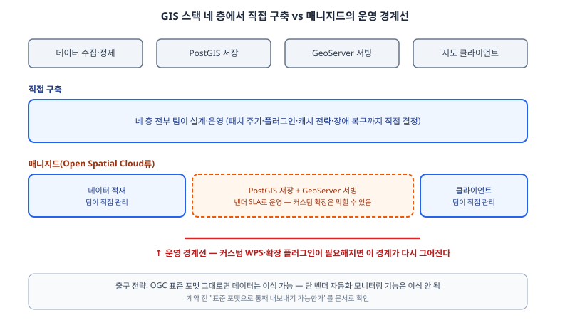

## 왜 지금 이 판단이 필요한가

"지자체 민원 지도 서비스 하나 새로 여는데, 서버 운영할 인력은 못 뽑아요"라는 요구는 GIS 담당자가 자주 받는다. 지금까지 답은 둘 중 하나였다 — PostGIS와 GeoServer를 직접 올려 전부 손으로 운영하거나, 에스리 같은 거대 상용 스위트를 통째로 들이는 것. 그 사이에 있는 선택지, 즉 오픈소스 표준 스택을 매니지드로만 빌려 쓰는 길은 뚜렷하지 않았다.

2026년 11월 2일 Open Spatial이 발표한 Open Spatial Cloud는 이 중간 지점을 정확히 노린다. PostGIS, GeoServer, QGIS와 OGC 표준을 그대로 쓰되, 서버 프로비저닝·패치·백업·장애 대응은 벤더가 가져가는 매니지드 플랫폼이다. "GIS 팀은 이미 이 오픈소스 도구들을 신뢰하고 있으니, 그 신뢰를 그대로 두고 운영 부담만 떼어내자"는 게 벤더가 밝힌 설계 의도다. 공교롭게도 같은 시기 DuckDB 2.0과 PostGIS 3.7 RC가 잇따라 나오며 공간 데이터 엔진 쪽의 선택지 자체도 늘고 있다. 즉 지금은 "어떤 엔진을 쓸까"뿐 아니라 "그 엔진을 누가 돌릴까"까지 동시에 판단해야 하는 시점이다. 이 판단을 기술 유행이 아니라 팀의 운영 역량 기준으로 내리는 법을 정리한다.

## 전체 시스템에서의 위치

GIS 서비스 하나는 데이터 수집·정제, PostGIS 저장, GeoServer의 WMS/WFS/타일 서빙, 그리고 프론트엔드 지도 클라이언트까지 네 층으로 이어진다. "직접 구축"과 "매니지드"의 차이는 이 네 층 중 어디까지를 팀이 직접 들여다보고, 어디부터는 블랙박스로 맡기느냐에 있다.



직접 구축에서는 네 층 전부가 팀의 손 안에 있다 — 인프라 패치 주기, GeoServer 플러그인 조합, 캐시 전략, 장애 시 복구 순서까지 전부 팀이 설계한다. Open Spatial Cloud 같은 매니지드 모델에서는 저장·서빙 층이 벤더 운영 영역으로 넘어가고, 팀은 데이터 적재와 스타일·레이어 구성, 그리고 클라이언트 쪽만 신경 쓴다. 중요한 건 이 경계선이 고정된 게 아니라는 점이다 — 커스텀 WPS 지오프로세싱 모듈을 직접 얹어야 하거나, 특정 버전의 GeoServer 확장이 필요해지는 순간 매니지드 플랫폼의 표준 구성 밖으로 밀려날 수 있다. 경계선을 미리 긋지 않고 쓰다가 나중에 벽에 부딪히는 경우가 가장 흔한 실패 패턴이다.

## 선택의 트레이드오프

| 기준 | 직접 구축(자체 GeoServer+PostGIS) | 매니지드(Open Spatial Cloud류) |
|---|---|---|
| 운영 부담 | 패치·백업·장애 대응 전부 팀 몫 | 벤더가 SLA로 흡수 |
| 커스터마이징 | 플러그인·확장 자유롭게 추가 | 벤더가 지원하는 구성으로 제한 |
| 데이터 주권 | 물리적 위치·접근 통제 전부 직접 결정 | 벤더 리전·계약 조건에 종속 |
| 비용 구조 | 초기 인프라+인건비, 트래픽 늘어도 선형 | 구독형, 트래픽 변동에 더 유연 |
| 표준 준수 | 팀 역량에 따라 들쭉날쭉 | OGC 표준 기반이라 이식성은 유지 |
| 출구 전략 | 애초에 락인 없음 | 표준 포맷이면 전환 가능, 벤더 자체 기능은 손실 |

표에서 가장 중요한 줄은 "출구 전략"이다. Open Spatial Cloud처럼 오픈소스 표준 그대로 쓰는 매니지드는, 상용 독점 포맷으로 가두는 플랫폼과 달리 나중에 자체 구축으로 돌아가거나 다른 벤더로 옮길 때 데이터 자체는 그대로 들고 나올 수 있다. 다만 벤더가 매니지드 레이어에 추가로 얹은 자동화·모니터링 기능은 이식되지 않으므로, "표준 기반이라 락인이 없다"는 말을 "전환 비용이 0이다"로 착각하면 안 된다.

## 실제 프로젝트 진행 순서

판단은 다섯 가지 질문에서 시작한다. 커스텀 WPS·확장 플러그인이 필요한가, 데이터 주권 규제(공공기관 내부망 요건 등)가 있는가, 내부에 GeoServer 운영 경험자가 있는가, 트래픽이 계절·이벤트에 따라 크게 출렁이는가, 그리고 장애 시 몇 분 안에 복구해야 하는 SLA가 걸려 있는가. 이 중 둘 이상에서 "직접 해야 한다"는 답이 나오면 매니지드는 후보에서 제외하는 게 안전하다.

그렇지 않다면 전체를 한 번에 매니지드로 옮기지 말고, 신규 서비스 하나를 매니지드 플랫폼 위에 PoC로 먼저 올려 본다. 이때 확인할 것은 성능이 아니라 "우리가 평소에 쓰던 확장·스타일 구성이 그대로 올라가는가"다.

```bash
# 기존 자체 환경에서 쓰던 스타일·레이어 정의를 그대로 내보내 호환성부터 확인
ogr2ogr -f "PostgreSQL" PG:"host=managed-pg.example.com dbname=gis" \
  local_layers.gpkg -nlt PROMOTE_TO_MULTI
geoserver-cli style export --workspace my_ws --format sld > styles/
```

이 PoC에서 커스텀 확장이 막히는 지점이 나오면, 그 기능만 자체 구축으로 남기고 나머지는 매니지드로 보내는 하이브리드 구성도 고려 대상이다. 마지막으로 계약 전에 반드시 "데이터·스타일·설정을 표준 포맷으로 통째로 내보낼 수 있는가"를 문서로 확인해 둔다 — 이 한 가지만 지켜도 나중에 벤더를 바꾸거나 자체 구축으로 되돌아갈 때의 비용을 크게 줄일 수 있다.

## 마무리 요약

- Open Spatial Cloud는 PostGIS·GeoServer·QGIS·OGC 표준을 그대로 쓰면서 운영만 벤더에게 넘기는 중간 지점을 제시했다.
- 직접 구축과 매니지드의 차이는 "어느 층까지 팀이 직접 운영하는가"의 경계선이며, 이 경계는 커스텀 확장이 필요해지는 순간 다시 그어야 한다.
- 전체를 한 번에 옮기지 말고 신규 서비스 하나로 PoC를 돌려 호환성 벽을 먼저 확인하고, 계약 전 표준 포맷 내보내기 가능 여부를 반드시 문서로 받아 둔다.

## 참고 자료

- [Open Spatial — Open Spatial Cloud 발표](https://www.geoweeknews.com/?p=50676)
- [PostGIS 3.7 릴리스 노트](https://postgis.net/)
- [OGC 표준 개요](https://www.ogc.org/standards/)
