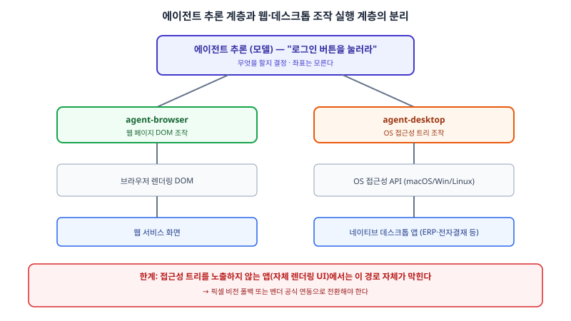

## 왜 지금 이 판단이 필요한가

"사내 전자결재 프로그램, API가 없어서 그런데 에이전트가 대신 눌러서 처리하게 해주세요"라는 요구는 생각보다 자주 들어온다. 은행 창구 단말기, 10년 넘은 ERP 클라이언트, 특정 장비 제조사가 깔아준 설정 프로그램처럼 API 문서 한 줄 없는 네이티브 데스크톱 앱이 업무 한가운데 버티고 있는 경우가 많기 때문이다. 지금까지 이런 요구에 대한 답은 사실상 하나였다 — 화면을 스크린샷으로 찍어 모델에게 보여주고, 모델이 "여기를 클릭하라"고 좌표를 돌려주면 그 좌표를 클릭하는 픽셀 기반 컴퓨터 사용(Computer Use) 루프. 이 방식은 범용적이지만 느리고, 해상도나 테마가 바뀌면 좌표가 어긋나고, 매 턴마다 스크린샷을 모델에 태우는 비용이 쌓인다.

2026년 10월 말 Vercel Labs가 공개한 **agent-desktop**은 이 문제를 다른 축에서 공략한다. macOS·Windows·Linux가 스크린 리더를 위해 이미 제공하고 있는 OS 네이티브 접근성 트리(accessibility tree)를 직접 읽어, 화면의 버튼·입력창·메뉴 하나하나에 안정적인 JSON 참조(reference)를 부여하는 Rust 기반 CLI다. 에이전트는 좌표가 아니라 이 참조를 대상으로 "로그인 버튼을 눌러라"처럼 명령하고, 도구는 참조를 실제 OS 호출로 변환해 클릭·입력을 수행한다. 흥미로운 점은 이 도구 안에 모델이 전혀 없다는 것이다 — 추론은 철저히 에이전트 쪽 책임이고, agent-desktop은 "이 화면에 지금 무엇이 있고 어떻게 조작하는가"라는 구조화된 사실만 돌려준다. 좌표 추측이라는 가장 불안정한 단계를 통째로 들어낸 셈이다.

## 전체 시스템에서의 위치

이 기술은 에이전트 파이프라인에서 정확히 "조작 실행 계층" 한 자리를 차지한다. 사용자 요청이 들어오면 에이전트가 무엇을 할지 추론하고, 그 결정을 실제 화면 조작으로 바꾸는 역할을 agent-desktop 같은 도구가 맡는다. 같은 제작자가 만든 agent-browser가 웹 페이지의 DOM을 같은 방식으로 다루는 자매 도구라는 점도 설계상 중요하다. 즉 "웹이냐 네이티브 앱이냐"에 따라 조작 계층 자체가 갈라지는 구조다.



그림처럼 에이전트의 추론 자체는 하나의 모델이 맡지만, 그 결정을 실행으로 옮기는 조작 계층은 대상에 따라 완전히 다른 기술 스택을 탄다. 브라우저 자동화 코드를 데스크톱 앱에 그대로 가져다 쓸 수 없는 것과 같은 이치로, 두 조작 계층은 서로 대체재가 아니라 역할이 분리된 보완재다. 설계할 때는 "이 작업이 웹 범위인가, 로컬 OS 범위인가"를 가장 먼저 가르고, 그 경계를 넘나드는 작업(예: 데스크톱 앱에서 데이터를 뽑아 웹 대시보드에 입력)은 두 도구를 체인으로 엮어야 한다는 뜻이기도 하다.

## 선택의 트레이드오프

| 조작 방식 | 속도·비용 | 안정성 | 커버리지 | 보안 노출 |
|---|---|---|---|---|
| 픽셀 비전(스크린샷+좌표) | 느림, 매 턴 이미지 토큰 소모 | 해상도·테마 변경에 취약 | 어떤 앱이든 화면만 있으면 동작 | 화면 전체가 모델에 노출 |
| 접근성 트리(agent-desktop류) | 빠름, 구조화된 텍스트만 전달 | UI 요소 참조 기반이라 비교적 안정 | 접근성 트리를 노출하는 앱만 가능 | 스냅샷·클립보드에 민감정보 포함 가능 |
| 네이티브 API·RPA 전용 커넥터 | 가장 빠르고 안정적 | 매우 안정 | 벤더가 연동을 제공하는 범위로 제한 | 공식 인증 경로라 상대적으로 좁음 |

접근성 트리 기반이 픽셀 기반보다 거의 모든 면에서 낫다고 해서 만능은 아니다. 가장 큰 한계는 접근성 트리 자체를 노출하지 않는 앱이다 — 자체 렌더링 엔진으로 UI를 그리는 일부 게임성 프로그램이나 일부 캔버스 기반 앱은 OS가 내부 구조를 들여다볼 수 없어 이 방식 자체가 통하지 않는다. 이런 경우에는 결국 픽셀 비전으로 돌아가거나, 벤더가 제공하는 공식 연동을 다시 찾아봐야 한다. 또한 Linux에서는 마우스 입력에 X11 환경이나 headed 모드가 필요해 완전한 헤드리스 서버 환경에서는 제약이 남는다.

## 실제 프로젝트 진행 순서

가장 먼저 할 일은 대상 프로그램이 접근성 트리를 실제로 노출하는지 확인하는 것이다. macOS라면 손쉬운 사용(Accessibility) 권한을 내주고 Accessibility Inspector로, Windows라면 Inspect.exe로 해당 앱의 UI 트리가 제대로 잡히는지부터 눈으로 확인한다. 이 단계를 건너뛰고 바로 자동화 코드를 짜기 시작하면, 트리가 비어 있는 걸 뒤늦게 발견하고 작업을 통째로 되돌리는 일이 생긴다.

```bash
# 1. 현재 포커스된 앱의 접근성 트리 스냅샷 확인
agent-desktop snapshot --app "전자결재" --format json > snapshot.json

# 2. 스냅샷에서 얻은 안정 참조(ref)로 조작 — 좌표 대신 ref를 쓴다
agent-desktop click --ref "button:로그인" 
agent-desktop type --ref "input:사번" --text "2026-1234"
```

트리가 확인되면 가장 위험도가 낮은 흐름(로그인 후 특정 메뉴로 이동하는 정도)부터 자동화하고, 결재·승인처럼 되돌리기 어려운 동작은 사람 승인 없이는 실행되지 않게 별도 게이트를 건다. 동시에 snapshot 로그와 클립보드 접근 기록에 계좌번호·주민등록번호 같은 민감정보가 그대로 찍히는지 꼭 점검해야 한다. 이 도구는 접근성 정보를 "읽을 수 있는 그대로" 돌려주기 때문에, 로그 보관 정책과 전송 구간 암호화를 자동화 도입과 동시에 정리해 두지 않으면 자동화 자체보다 로그 유출이 더 큰 사고가 될 수 있다. 마지막으로 접근성 트리가 없는 화면을 만났을 때의 폴백(픽셀 비전으로 전환하거나 작업을 중단하고 사람에게 넘기는 경로)을 미리 설계해 둬야, 트리가 비는 예외 케이스에서 에이전트가 엉뚱한 좌표를 찍는 사고로 되돌아가지 않는다.

## 마무리 요약

- Vercel Labs의 agent-desktop은 스크린샷 좌표 추측 대신 OS 접근성 트리를 읽어 안정적인 JSON 참조로 데스크톱 앱을 조작하는 오픈소스 CLI다. 도구 안에 모델은 없고 추론은 전적으로 에이전트 몫이다.
- 접근성 트리 기반은 픽셀 기반보다 빠르고 안정적이지만, 트리를 노출하지 않는 앱(자체 렌더링 UI 등)에서는 아예 쓸 수 없다는 커버리지 한계가 분명하다.
- 도입 순서는 트리 노출 여부 확인 → 저위험 흐름부터 자동화 → 되돌리기 어려운 동작에 승인 게이트 → 스냅샷·클립보드의 민감정보 노출 점검 → 트리 부재 시 폴백 설계다.

## 참고 자료

- [Vercel Labs — agent-desktop (GitHub)](https://github.com/vercel-labs/agent-desktop)
- [agent-browser.dev/desktop 문서](https://agent-browser.dev/desktop)
