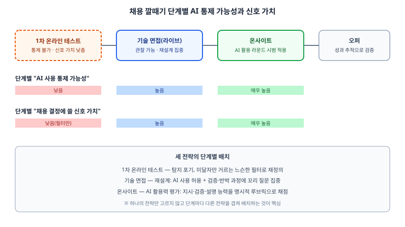

## 왜 지금 이 판단이 필요한가

"신입 개발자 뽑는데 코딩테스트에서 AI 못 쓰게 막으면 되는 거 아닌가요"라는 요구는 채용팀에서 자주 나온다. 문제는 이 전제 자체가 더는 성립하지 않는다는 데 있다. 약 19,368건의 면접을 분석한 감사 결과, 2025년 7월부터 2026년 1월 사이 후보의 38.5%가 AI 보조 부정행위로 플래그됐고 기술직군만 따지면 48%에 달했다. 같은 기간 동안 플래그율은 15%에서 35% 안팎으로 거의 두 배가 됐다. 심지어 Anthropic조차 지원자들이 자사 Claude로 자사 기술 면접 문제를 풀어버리는 바람에 문제 자체를 다시 써야 했다는 사례가 알려졌다. "AI를 못 쓰게 막는다"는 전제가 AI를 만드는 회사에서조차 지켜지지 않은 셈이다.

더 중요한 건 탐지가 실제로 작동하지 않는다는 점이다. FAANG급 기업 중 탐지 소프트웨어를 쓰는 곳은 11% 남짓이라는 조사가 있다. 나머지 대다수가 탐지를 포기한 이유는 단순하다 — 탐지 정확도는 낮고, 오탐은 우수한 후보를 억울하게 걸러내며, 탐지를 피하는 기법은 탐지 기법보다 항상 한 발 빠르게 진화한다. 그래서 질문이 "AI 사용을 어떻게 막을 것인가"에서 "AI를 쓰는 걸 전제로 무엇을 평가할 것인가"로 완전히 옮겨갔다. 이건 채용 담당자 한 명의 판단이 아니라, 채용 프로세스 전체를 다시 설계해야 하는 조직 전략의 문제다.

## 전체 시스템에서의 위치

채용 프로세스는 지원서 → 1차 온라인 코딩테스트(자동 채점) → 기술 면접(라이브) → 온사이트 → 오퍼로 이어지는 깔때기다. AI 사용 문제는 이 단계마다 성격이 다르다. 자동 채점되는 1차 온라인 테스트는 응시 환경을 통제할 수 없어 AI 사용 여부 자체를 확인할 방법이 사실상 없다. 반면 라이브로 진행되는 기술 면접과 온사이트는 면접관이 실시간으로 후보의 사고 과정을 관찰할 수 있는 유일한 지점이다.



그림처럼 1차 온라인 테스트는 통제는 불가능하지만 애초에 걸러내기용 저비용 필터였던 단계이므로, 여기서 AI 사용을 막으려는 시도 자체를 내려놓는 편이 합리적이다. 대신 신호 가치를 라이브 단계로 옮겨, 기술 면접과 온사이트에 평가 역량을 집중시키는 것이 전체 깔때기 설계의 핵심 이동이다. "어느 단계에서 무엇을 확인할 수 있는가"를 먼저 가르지 않고 모든 단계에 똑같은 탐지 정책을 적용하면, 통제 불가능한 단계에서는 정책이 무력하고 통제 가능한 단계에서는 자원을 낭비하게 된다.

## 선택의 트레이드오프

| 전략 | 핵심 방식 | 장점 | 한계 |
|---|---|---|---|
| 탐지(Detection) | 부정행위 탐지 소프트웨어, 화면 공유 강제 | 기존 프로세스를 그대로 유지 가능 | 오탐·우회 기법과의 끝없는 군비경쟁, FAANG의 11%만 채택 |
| 재설계(Redesign) | 라이브 협업 세션 + 꼬리 질문으로 사고 과정 추궁 | 실제 이해도와 설계 근거를 직접 확인 | 면접관 부담과 소요 시간이 크게 늘어남 |
| AI 활용력 평가 | AI 사용을 허용하고 지시·검증·설명 능력 자체를 채점 | 실무와 가장 가까운 신호, 억제가 아니라 활용 역량 측정 | 업계 표준 루브릭 부재, 면접관 간 채점 편차 |

세 전략은 서로 배타적이지 않다. Meta가 온사이트 코딩 라운드 하나를 AI 활용 라운드로 교체해 후보가 AI를 어떻게 지시하고, 잘못된 제안을 걸러내고, 결과를 설명하는지를 채점하는 파일럿을 돌리는 것처럼, 실제로는 "1차는 탐지를 포기하고 신호 가치만 낮춰 둔 채 그대로 두고, 라이브 단계는 재설계와 AI 활용력 평가를 섞는" 조합으로 수렴하는 경우가 많다. 중요한 건 하나의 전략만 고르는 게 아니라 단계별로 다른 전략을 배치하는 것이다.

## 실제 프로젝트 진행 순서

가장 먼저 할 일은 어느 직군·레벨부터 손댈지 범위를 좁히는 것이다. 시니어 채용은 설계 토론과 과거 경험 검증 비중이 원래 높아 AI 사용 문제의 영향이 상대적으로 작다. 반면 주니어·신입 스크리닝은 알고리즘 문제 풀이 비중이 커서 AI로 인한 신호 왜곡이 가장 심하게 나타난다. 그러니 주니어 레벨의 1차 온라인 테스트와 기술 면접부터 재설계를 시작한다.

1차 온라인 테스트는 통과/탈락을 가르는 정밀한 변별 도구가 아니라 명백한 미달자만 거르는 느슨한 필터로 역할을 재정의한다. 이 단계의 통과 기준을 의도적으로 낮추고, 실제 변별은 뒤 단계로 넘긴다. 기술 면접은 다음 두 축으로 바꾼다.

```text
[기존 루브릭]                      [재설계 루브릭]
- 정답 코드를 작성했는가            - 요구사항을 프롬프트로 정확히 번역했는가
- 시간 안에 완료했는가              - AI가 내놓은 코드의 결함을 스스로 찾아냈는가
- 코드 스타일이 깔끔한가            - 왜 이 설계를 선택했는지 근거를 설명하는가
                                    - 제안을 그대로 받아들이지 않고 반박·수정했는가
```

후보에게 AI 도구 사용을 명시적으로 허용하되, 면접관은 작성된 코드 자체가 아니라 후보가 AI 출력을 검증하고 반박하는 과정에 꼬리 질문을 집중시킨다. 이 전환은 면접관 쪽 훈련이 선행돼야 한다 — 기존 루브릭에 익숙한 면접관은 "코드가 맞았다"는 결과에만 집중하기 쉬우므로, 새 루브릭으로 사내 모의 면접을 먼저 몇 차례 돌려 채점 편차를 줄인 뒤 실제 채용에 적용한다. 온사이트 단계는 Meta 사례처럼 기존 코딩 라운드 중 하나만 먼저 AI 활용 라운드로 바꿔 소규모로 시범 운영하고, 합격자의 실제 입사 후 성과와 비교해 이 라운드의 변별력을 검증한 뒤에 전체 라운드로 확대한다.

## 마무리 요약

- 약 19,368건 면접 감사에서 기술직군 48%가 AI 보조 부정행위로 플래그됐고, FAANG의 11%만 탐지 소프트웨어를 쓴다 — 탐지 전략은 이미 한계에 도달했다.
- 채용 깔때기 전체에 같은 정책을 적용하지 말고, 통제 불가능한 1차 온라인 테스트는 느슨한 필터로 재정의하고, 라이브 단계에 재설계와 AI 활용력 평가 역량을 집중시킨다.
- 도입 순서는 주니어 레벨부터 시작 → 1차 테스트 통과 기준 완화 → 루브릭을 'AI 출력 검증·반박 능력' 중심으로 재작성 → 면접관 모의 훈련 → 온사이트 한 라운드만 시범 교체 후 성과로 검증.

## 참고 자료

- [builtin.com — Is Anthropic's 'Cheating' Scandal the End of the Coding Interview?](https://builtin.com/articles/reimagining-coding-interview)
- [alexcloudstar.com — Technical Interviews in 2026: The Rules Changed](https://alexcloudstar.com/blog/technical-interviews-ai-2026/)
- [metaintro.com — Employers Are Rebuilding Interviews as 38% of Candidates Get Flagged for AI](https://www.metaintro.com/blog/employers-rebuild-interviews-38-percent-ai-flagged-2026)
