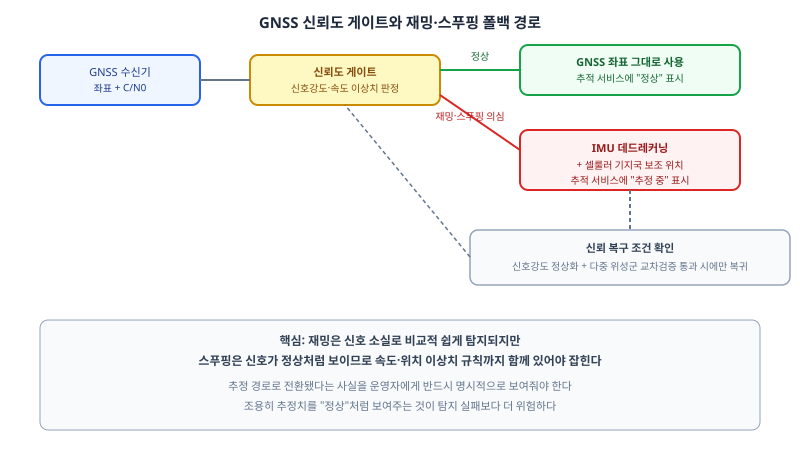

## 왜 지금 이 판단이 필요한가

"호르무즈 해협 지나는 유조선 선단 위치 추적 서비스, 그 구간에서도 추적이 끊기거나 엉뚱한 좌표로 안 튀게 해주세요"라는 요구는 해운·물류 쪽에서 점점 자주 들어온다. 지금까지 GNSS 위치 추적을 다루는 글들은 거의 전부 "정상적으로 들어오는 신호를 어떻게 더 정밀하게 받을 것인가"(RTK·PPP 보정)를 다뤘다. 이 요구는 질문 자체가 다르다 — 신호가 아예 꺼지거나(재밍), 가짜 위치로 거짓말을 하기 시작할 때(스푸핑) 그래도 서비스가 버티게 만드는 문제다.

2026년 들어 호르무즈 해협 일대에서 AIS 스푸핑과 GPS 재밍이 동시에 급증했다는 보고가 반복해서 나오고 있고, 별개로 민간 항공 쪽에서는 GPS 재밍·스푸핑 사고가 비교 기간 대비 다섯 배 가까이 늘었다는 집계도 있다. 재밍과 스푸핑은 다루는 방식이 완전히 다르다. 재밍은 신호 자체를 지워버리므로 수신기가 "신호가 없다"는 걸 비교적 쉽게 알아챈다. 스푸핑은 진짜처럼 보이는 가짜 신호를 주입하므로, 수신기는 자기가 속고 있다는 사실조차 모른 채 "정상 위치"라며 틀린 좌표를 계속 내보낸다. 이 비대칭 때문에 "GNSS 신호가 들어오고 있다"는 사실만으로는 그 위치를 믿어도 되는지 전혀 보장되지 않는다는 게 설계의 출발점이다.

## 전체 시스템에서의 위치

위치 추적 파이프라인은 보통 GNSS 수신기가 좌표를 내보내면 그걸 그대로 추적 서비스·대시보드가 받아 쓰는 단일 경로로 짜여 있다. 재밍·스푸핑에 버티는 설계는 이 경로 중간에 "이 좌표를 믿어도 되는가"를 판정하는 신뢰도 게이트와, 못 믿을 때 대신 쓸 보조 추정 경로를 끼워 넣는 일이다.



그림처럼 평소에는 GNSS 좌표가 신뢰도 게이트를 그대로 통과해 추적 서비스로 들어간다. 게이트가 신호 강도 급락이나 물리적으로 불가능한 속도·위치 점프를 감지하면, 경로는 즉시 관성항법(IMU) 기반 데드레커닝과 셀룰러 기지국 기반 보조 위치 추정으로 전환된다. 이 전환은 "더 정확한 값을 고르는" 문제가 아니라 "틀렸을 가능성이 있는 값을 신뢰 체계에서 배제하는" 문제라는 점이 핵심이다.

## 선택의 트레이드오프

| 방어 계층 | 잡아내는 것 | 못 잡는 것 | 추가 비용 |
|---|---|---|---|
| GNSS 단독(대응 없음) | 아무것도 못 잡음 | 재밍·스푸핑 전부 그대로 노출 | 0 |
| 신호 강도(C/N0) 모니터링 | 재밍으로 인한 신호 소실·약화 | 스푸핑(신호 자체는 정상처럼 보임) | 낮음 |
| 다중 GNSS 위성군 교차검증 | 일부 조악한 스푸핑(단일 위성군만 조작) | 정교한 다중 위성군 동시 스푸핑 | 중간 |
| IMU 데드레커닝 + 셀룰러 보조 | 신뢰 불가 구간에서 단기간 위치 추정 유지 | 장시간 지속 시 누적 오차로 추정치 표류 | 높음(하드웨어·엔지니어링) |

가장 흔한 실수는 신호 강도 모니터링 하나만 걸어두고 "재밍·스푸핑 대응을 했다"고 안심하는 것이다. 신호 강도 모니터링은 재밍에는 효과적이지만, 스푸핑 신호는 보통 정상 신호와 비슷하거나 오히려 더 강하게 들어오므로 이 계층만으로는 전혀 걸러지지 않는다. 반대로 데드레커닝만 과신해서는 안 된다 — IMU 추정치는 시간이 지날수록 오차가 누적되므로, 신뢰 가능한 GNSS가 돌아오는 즉시 보정해야 하는 임시방편이지 영구적인 대체재가 아니다.

## 실제 프로젝트 진행 순서

가장 먼저 할 일은 코드를 짜기 전에 이상 탐지 규칙부터 정의하는 것이다. 수신기가 노출하는 신호 대 잡음비(C/N0)의 급격한 하락, 그리고 직전 위치·속도로 보아 물리적으로 불가능한 순간 이동이나 속도 변화를 규칙으로 잡는다.

```python
# 단순화한 이상 탐지 게이트 예시
def is_trustworthy(fix, prev_fix, cn0):
    if cn0 < CN0_THRESHOLD:
        return False  # 재밍 의심: 신호 자체가 약하거나 소실
    dt = fix.timestamp - prev_fix.timestamp
    implied_speed = haversine(fix, prev_fix) / dt
    if implied_speed > MAX_PLAUSIBLE_SPEED:
        return False  # 스푸핑 의심: 물리적으로 불가능한 이동
    return True

if not is_trustworthy(fix, prev_fix, cn0):
    position = dead_reckoning(prev_fix, imu_data, cellular_fallback)
    mark_as_estimated(position)
else:
    position = fix
```

이 게이트가 자리 잡으면, 신뢰 불가 판정이 난 순간 IMU 데드레커닝과 셀룰러 기지국 기반 보조 위치로 전환하는 로직을 붙인다. 이때 중요한 건 추정치를 "정상 위치"와 시각적으로 구분하는 것이다 — 대시보드에 "현재 위치는 추정 중(GNSS 신뢰 불가)"이라는 상태를 명시적으로 띄워야 한다. 조용히 추정 좌표를 정상 좌표와 똑같은 모양으로 보여주면, 운영자는 배가 실제로 어디 있는지 모르면서도 "정상 추적 중"이라고 믿게 되는, 탐지보다 더 위험한 상황이 생긴다. 마지막으로 신뢰 복구 조건(신호 강도 정상화와 다중 위성군 간 일치)을 명확히 정의해, GNSS가 돌아왔다고 바로 전환하지 말고 몇 초간 교차 검증한 뒤에만 정상 경로로 복귀하게 한다.

## 마무리 요약

- 재밍은 신호를 지우고 스푸핑은 가짜 신호를 믿게 만든다 — 이 둘은 탐지 방식이 다르므로 신호 강도 모니터링 하나로는 스푸핑을 못 잡는다.
- 위치 추적 설계의 핵심은 "더 정밀한 좌표를 받는 것"이 아니라 "이 좌표를 믿어도 되는가"를 판정하는 신뢰도 게이트와 IMU·셀룰러 기반 폴백 경로를 두는 것이다.
- 진행 순서는 이상 탐지 규칙 정의 → 신뢰 불가 시 데드레커닝·셀룰러 폴백 전환 → 추정 상태를 UI에 명시적으로 표시 → 신뢰 복구 조건을 교차 검증 기반으로 정의다.

## 참고 자료

- [Trelleborg — Navigating the Invisible Threat: Safeguarding Against GNSS Attacks at Sea](https://www.trelleborg.com/en/marine-and-infrastructure/media/knowledge-hub/navigating-the-invisible-threat-safeguarding-against-gnss-attacks-at-sea)
- [Traxmate — Navigating the Rising Tide of GPS Jamming](https://traxmate.io/rising-tide-of-gps-jamming/)
- [Geotab — What are GPS jammers and how do you combat them?](https://www.geotab.com/blog/combating-gps-jammers/)
