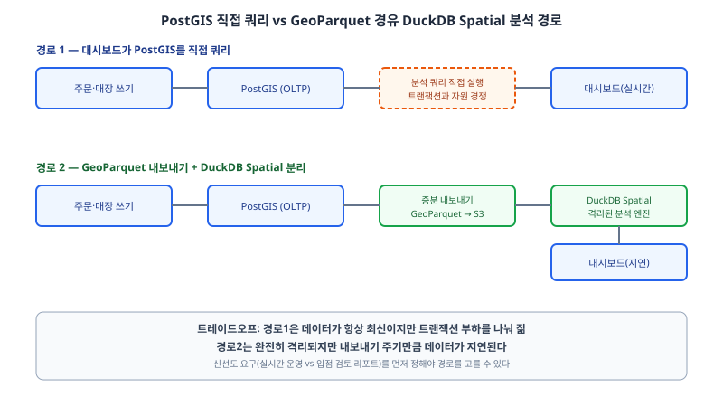

## 왜 지금 이 판단이 필요한가

"신규 매장 입점 검토용으로, 반경 1km 안에 경쟁사가 몇 곳 있는지 대시보드에서 바로 보여주세요"라는 요구는 흔하다. 가장 빠른 답은 서비스 운영에 쓰는 PostGIS에 `ST_DWithin` 쿼리를 하나 더 얹는 것이다. 매장 수가 수백 개뿐이고 대시보드 사용자가 적을 때는 이 방법으로 충분하다. 문제는 매장이 수만 개로 늘고, 분석 축이 "반경 안 개수"에서 "업종별·시간대별·요일별 교차 집계"로 복잡해질 때 터진다. 공간 조인은 일반 조인보다 무겁고, 이런 분석 쿼리가 주문 생성 같은 트랜잭션 쿼리와 같은 커넥션 풀과 같은 디스크 I/O를 두고 경쟁하기 시작하면, 대시보드 리포트 하나가 실서비스 응답 속도를 끌어내리는 사고로 번진다.

2026년 10월 21일, PostGIS 3.7.0rc3와 DuckDB 2.0이 같은 날 나온 것은 공교로운 우연이지만 이 판단을 다시 들여다볼 좋은 계기가 됐다. PostGIS 3.7은 coverage·최소신장트리 함수와 더 빨라진 `ST_DWithin`을 더하며 OLTP 공간 쿼리 자체를 계속 다듬고 있고, DuckDB는 spatial 확장을 통해 S3 같은 오브젝트 스토리지에 쌓인 GeoParquet·COG 파일을 import 없이 바로 읽어 집계할 수 있는 임베디드 분석 엔진으로 자리 잡았다. 즉 "공간 분석 쿼리를 어디서 돌릴 것인가"라는 질문이, 이제 PostGIS 하나를 더 잘 튜닝하는 문제가 아니라 **트랜잭션 레이어와 분석 레이어를 아예 분리할 것인가**를 공간 데이터에 맞게 다시 묻는 문제로 바뀌었다.

## 전체 시스템에서의 위치

매장·주문 데이터가 들어와 대시보드에 숫자로 나가기까지 거치는 경로는 크게 두 갈래로 나뉜다. 하나는 대시보드가 서비스 PostGIS에 분석 쿼리를 직접 던지는 경로고, 다른 하나는 PostGIS의 데이터를 주기적으로 GeoParquet로 내보낸 뒤 DuckDB Spatial이 그 파일을 직접 읽어 집계하고, 대시보드는 DuckDB(혹은 그 결과를 캐싱한 API)를 바라보는 경로다.



그림의 위쪽처럼 대시보드가 PostGIS를 직접 바라보면 데이터는 항상 최신이지만, 분석 쿼리의 부하가 트랜잭션 쓰기 경로와 같은 인스턴스 안에서 섞인다. 아래쪽처럼 GeoParquet 내보내기를 중간에 끼우면 분석 쿼리는 완전히 격리된 엔진에서 돌지만, 그 대신 내보내기 주기만큼의 데이터 지연(staleness)이 생긴다. 이 지연을 1분으로 둘지 하루로 둘지는 요구사항이 "실시간 운영 지표"인지 "입점 검토용 리포트"인지에 따라 완전히 달라지므로, 레이어를 나누기 전에 반드시 분석의 신선도 요구를 먼저 확정해야 한다.

## 선택의 트레이드오프

| 기준 | PostGIS에 직접 쿼리 | DuckDB Spatial 분석 레이어 분리 |
|---|---|---|
| 데이터 신선도 | 항상 최신(트랜잭션과 동기) | 내보내기 주기만큼 지연 발생 |
| 트랜잭션 영향 | 분석 쿼리가 같은 인스턴스 부하 공유 | 완전히 격리, 영향 없음 |
| 복잡한 공간 집계 성능 | 인덱스 설계에 크게 의존, 조인 많아지면 느려짐 | 컬럼형 저장 + 벡터화 실행으로 대규모 집계에 유리 |
| 운영 복잡도 | 추가 구성 없음 | 내보내기 파이프라인·스키마 동기화 관리 필요 |
| 인프라 비용 | 기존 DB 스펙 증설로 대응 | 가벼운 임베디드 엔진 + 오브젝트 스토리지 비용만 추가 |

표에서 가장 눈여겨볼 지점은 "복잡한 공간 집계 성능" 행이다. PostGIS는 트랜잭션 처리에 최적화된 행 기반 저장 구조라, 업종별·시간대별 교차 집계처럼 많은 행을 훑어 그룹핑하는 분석 쿼리에서는 아무리 공간 인덱스를 잘 걸어도 한계가 있다. DuckDB는 컬럼형 저장과 벡터화 실행 엔진을 쓰기 때문에 같은 종류의 집계에서 구조적으로 유리하다. 다만 이 이점은 "데이터가 이미 분석에 적합한 형태(GeoParquet)로 빠져나와 있을 때"만 성립하므로, 내보내기 파이프라인을 얼마나 안정적으로 운영할 수 있느냐가 실제 도입 여부를 가른다.

## 실제 프로젝트 진행 순서

가장 먼저 할 일은 지금 PostGIS에 걸리는 쿼리 로그를 뒤져 "분석성 쿼리"를 가려내는 것이다. `GROUP BY`가 들어가고 스캔 범위가 넓은 쿼리, 특히 대시보드나 배치 리포트에서 오는 쿼리를 `pg_stat_statements`로 식별한다. 트랜잭션 쿼리와 뒤섞여 있다면, 이 분석성 쿼리들의 평균 실행 시간과 호출 빈도부터 측정해 "지금 당장 분리가 필요한가, 아직은 버틸만한가"를 숫자로 판단한다.

분리가 필요하다고 판단되면 내보내기 파이프라인부터 작게 만든다. 전체 테이블을 매번 내보내지 말고, 변경된 행만 증분으로 뽑아 GeoParquet에 쌓는 구조로 시작한다.

```sql
-- PostGIS: 변경분만 GeoParquet로 내보내기 (예시, ogr2ogr/COPY 조합 중 하나)
COPY (
  SELECT store_id, name, category, geom
  FROM stores
  WHERE updated_at > now() - interval '1 hour'
) TO '/export/stores_delta.parquet' (FORMAT 'parquet');
```

```sql
-- DuckDB: spatial 확장으로 GeoParquet 직접 읽어 반경 집계
INSTALL spatial; LOAD spatial;
SELECT a.store_id,
       count(*) FILTER (WHERE ST_DWithin(a.geom, b.geom, 1000)) AS nearby_competitors
FROM read_parquet('s3://bucket/stores_delta.parquet') a,
     read_parquet('s3://bucket/stores_delta.parquet') b
WHERE a.category = 'cafe' AND b.category = 'cafe' AND a.store_id <> b.store_id
GROUP BY a.store_id;
```

내보내기 주기는 처음부터 "실시간"을 목표로 잡지 않는다. 1시간 주기로 먼저 운영해 보고, 대시보드 사용자가 실제로 더 짧은 신선도를 요구하는지 관찰한 뒤에만 주기를 줄인다. 동시에 PostGIS 쪽 분석 쿼리를 하나씩 걷어내며 트랜잭션 쿼리의 지연시간(p95)이 실제로 개선되는지 추적해야, "분리했는데 체감 효과가 없다"는 허탈한 결과를 피할 수 있다. 마지막으로 내보내기 파이프라인이 멈췄을 때 대시보드가 오래된 데이터를 "최신"인 것처럼 보여주지 않도록, 내보내기 시각을 함께 노출하는 장치를 반드시 넣는다.

## 마무리 요약

- 2026년 10월 21일 같은 날 나온 PostGIS 3.7 RC와 DuckDB 2.0을 계기로, 공간 분석 쿼리를 서비스 PostGIS에 얹을지 DuckDB Spatial 분석 레이어로 뗄지 판단할 때다.
- 분리의 핵심 비용은 데이터 신선도 지연이고, 핵심 이득은 트랜잭션 격리와 대규모 교차 집계 성능이다. 신선도 요구를 먼저 확정하지 않으면 레이어 분리 자체가 잘못된 선택이 된다.
- 진행 순서는 분석성 쿼리 식별 → 증분 GeoParquet 내보내기 → DuckDB Spatial로 쿼리 전환 → 트랜잭션 지연시간 개선 측정 → 신선도 표시 장치 추가다.

## 참고 자료

- [Crunchy Data — PostGIS meets DuckDB](https://www.crunchydata.com/blog/postgis-meets-duckdb-crunchy-bridge-for-analytics-goes-spatial)
- [DuckDB Spatial Extension](https://duckdb.org/docs/extensions/spatial)
- [PostGIS 3.7 Release Notes](https://postgis.net/2026/)
