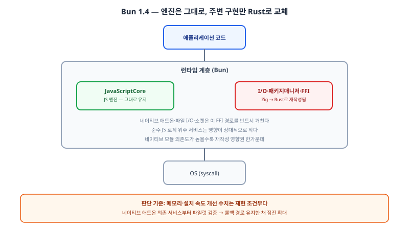

## 왜 지금 이 판단이 필요한가

"지금 Node로 돌리는 백엔드, Bun으로 옮기면 메모리도 아끼고 배포할 때 설치도 빨라진다던데 바꿔주세요"라는 요구는 Bun 1.4가 2026년 8월 공개되며 눈에 띄게 늘었다. 벤더 쪽 발표로는 HTTP 서버 메모리 사용량을 최대 48%까지 줄였고 패키지 설치 속도도 크게 빨라졌다고 한다. 문제는 이 수치가 나온 배경이 단순한 최적화가 아니라 **런타임 내부 구현을 Zig에서 Rust로 통째로 다시 쓴 결과**라는 점이다. Bun 1.3.14가 Zig 기반 마지막 버전이고, 1.4.0이 Rust 기반 첫 번째 안정 버전으로 선을 그었다.

주의할 점은 이 재작성이 JavaScript를 실행하는 엔진 자체를 바꾼 게 아니라는 것이다. Bun은 여전히 JavaScriptCore로 JS를 실행한다. 바뀐 건 그 엔진을 둘러싼 I/O, 패키지 매니저, FFI 바인딩 같은 런타임 몸통 쪽이다. "엔진은 그대로니까 안전하다"고 단정할 수도 없고, "완전히 새로 쓴 코드니까 무조건 불안정하다"고 단정할 수도 없는, 둘 다 틀릴 수 있는 중간 지대에서 판단해야 한다는 뜻이다. 실제로 한쪽에서는 Node.js 호환 테스트 통과 건수가 1,500건 넘게 늘었다고 보고하고, 다른 쪽에서는 이 재작성이 일부 플랫폼에서 아직 실험적 단계이고 리뷰를 기다리는 PR이 쌓여 있다는 우려도 함께 나온다.

## 전체 시스템에서의 위치

런타임은 애플리케이션 코드와 OS 사이에 끼인 계층이다. 이번 재작성에서 바뀐 건 이 계층 중 JS 엔진을 뺀 나머지 전부 — 이벤트 루프·네트워크 I/O·패키지 매니저·네이티브 모듈과 연결하는 FFI 다리다.



그림에서 보듯 애플리케이션 코드 입장에서는 "JS가 실행되는 방식"은 똑같지만, 그 JS가 파일을 읽거나 네트워크 소켓을 열거나 네이티브 애드온을 호출할 때 거치는 경로가 전부 새로 짜인 코드를 통과한다. 즉 순수 JS 로직 위주의 서비스는 영향이 상대적으로 작고, 네이티브 모듈·파일 I/O·소켓 처리가 많은 서비스일수록 이번 재작성의 영향권 한가운데 들어간다.

## 선택의 트레이드오프

| 런타임 | JS 엔진 | 주변 구현 | 성숙도 | 메모리/설치 속도 |
|---|---|---|---|---|
| Node.js | V8 | C++(수십 년 축적) | 매우 안정 | 기준선 |
| Bun 1.3.x(Zig) | JavaScriptCore | Zig | 안정적이나 네이티브 생태계 격차 있음 | 빠름 |
| Bun 1.4.x(Rust) | JavaScriptCore | Rust(막 재작성됨) | 막 안정화 시작, 일부 플랫폼 실험적 | 벤더 발표 기준 더 빠름 |

가장 흔한 실수는 벤더가 발표한 "메모리 48% 감소, 설치 몇 배 빠름" 같은 수치를 그대로 자사 서비스에 대입하는 것이다. 이 수치는 특정 벤치마크 조건에서 나온 값이지, 네이티브 애드온을 많이 쓰는 서비스나 Linux x64 glibc가 아닌 환경에서도 똑같이 재현된다는 보장이 아니다. 반대로 "방금 재작성된 거니까 무조건 피해야 한다"고 덮어놓고 거부하는 것도 기회비용이 크다 — Node.js 호환 테스트 통과 건수가 늘고 있다는 건 실제로 격차가 좁혀지고 있다는 신호이기도 하다.

## 실제 프로젝트 진행 순서

가장 먼저 할 일은 전사 서비스를 한 번에 옮기는 게 아니라, 장애가 나도 영향이 제한적인 서비스 하나를 파일럿으로 고르는 것이다. 이때 네이티브 애드온 의존성부터 점검해야 한다 — 런타임 내부가 재작성됐다는 건 FFI 바인딩도 다시 짜였다는 뜻이므로, Node-API나 네이티브 모듈을 쓰는 코드는 재작성 이전보다 호환성 검증을 더 꼼꼼히 해야 한다.

```bash
# 기존 Node 테스트 스위트를 Bun 런타임으로 그대로 돌려 호환성 1차 확인
bun test

# 네이티브 애드온 의존 여부부터 먼저 점검
grep -r "require.*\.node" --include="*.js" .
```

테스트 스위트가 통과했다고 바로 전환하지 말고, 파일럿 서비스에서 실제 트래픽을 받으며 메모리·설치 시간을 직접 측정해 벤더 발표 수치와 비교한다. 이 수치가 벤치마크와 비슷하게 나오는지가 두 번째 확인 지점이다. 마지막으로, 같은 코드베이스가 Node.js에서도 그대로 돌아가는 상태를 유지해 롤백 경로를 확보한 채로 트래픽 비중을 점진적으로 늘려간다 — 막 재작성된 런타임의 특성상 지금 당장은 "되돌릴 수 있는 전환"으로 설계하는 것이 핵심이다.

## 마무리 요약

- Bun 1.4는 JS 엔진(JavaScriptCore)은 그대로 두고 그 주변 I/O·패키지매니저·FFI 바인딩을 Zig에서 Rust로 통째로 재작성한 버전이다.
- 벤더가 발표한 메모리·설치 속도 개선 수치는 특정 벤치마크 기준이므로, 네이티브 애드온 의존도가 높은 서비스일수록 재작성의 영향권에 더 깊이 들어간다는 점을 감안해야 한다.
- 진행 순서는 영향 제한적인 서비스로 파일럿 → 네이티브 애드온 의존성 우선 점검 → 테스트 스위트 통과 후 실측치 비교 → Node.js 롤백 경로를 유지한 채 점진 확대다.

## 참고 자료

- [Bun — Bun v1.4 release notes](https://bun.com/blog/bun-v1.4)
- [Bun — Rewriting Bun in Rust](https://bun.sh/blog/bun-in-rust)
- [Bun — Node.js compatibility](https://bun.sh/docs/runtime/nodejs-apis)
