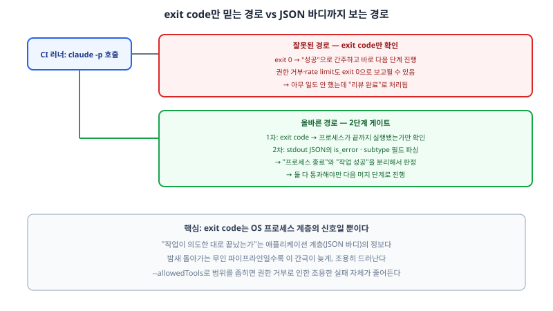

## 왜 지금 이 판단이 필요한가

"이 리포지토리, 매일 밤 PR 올라오는 대로 Claude Code한테 자동 리뷰시키고 문제 없으면 그대로 머지 파이프라인 태워주세요"라는 요구는 헤드리스(`claude -p`) 실행이 CI에 자리 잡으면서 흔해졌다. 이때 거의 모든 엔지니어가 본능적으로 짜는 코드는 셸 스크립트의 오랜 관습 그대로다 — exit code가 0이면 성공, 0이 아니면 실패로 분기한다. 문제는 이 가정이 claude -p에서는 그대로 통하지 않는다는 점이다.

커뮤니티에 보고된 사례들을 보면, 권한이 거부돼 Claude가 파일을 전혀 건드리지 못한 실행도 `exit code 0`에 `"subtype": "success"`, `"is_error": false`로 끝나는 경우가 있다. API 쪽에서 rate limit에 걸린 에러도 마찬가지로 `subtype: "success"` + exit code 0으로 돌아오고, 에러 메시지는 결과 텍스트 안에 섞여 들어간다는 보고도 있다. 즉 "프로세스가 비정상 종료됐는가"와 "작업이 실제로 의도한 대로 끝났는가"가 서로 다른 질문인데, 전통적인 exit code 분기는 이 둘을 같은 질문으로 취급한다. 밤새 자동으로 돌아가는 파이프라인일수록 사람이 로그를 실시간으로 안 보기 때문에, 이 간극은 몇 주가 지나서야 "그러고 보니 그날 리뷰가 하나도 안 달렸네"라는 식으로 드러난다.

## 전체 시스템에서의 위치

CI 러너가 `claude -p`를 호출하면 프로세스 종료 시점에 두 가지 신호가 동시에 나온다. 하나는 OS가 관리하는 exit code이고, 다른 하나는 stdout으로 찍히는 JSON 바디(`result`, `is_error`, `subtype`, `usage` 등)다. 전통적인 셸 파이프라인은 첫 번째 신호만 보고 다음 스텝을 분기하도록 짜여 있는데, 실제로 "무슨 일이 있었는지"에 대한 더 정확한 정보는 두 번째 신호 안에 있다.



그림의 위쪽 경로처럼 exit code만 보고 "0이니까 다음 스텝으로 진행"하면, 권한 거부나 rate limit처럼 exit code가 0으로 나오는 실패 케이스를 전부 성공으로 오인하게 된다. 아래쪽 경로처럼 JSON 바디까지 파싱해 `is_error`와 `subtype`을 확인해야, 프로세스는 정상 종료됐지만 작업 자체는 실패한 케이스를 구분할 수 있다. 이 구조에서 핵심은 CI 파이프라인의 성공/실패 판정 로직이 OS 프로세스 계층이 아니라 애플리케이션 계층(Claude Code가 보고하는 JSON)에 있어야 한다는 것이다.

## 선택의 트레이드오프

| 검증 방식 | 잡아내는 것 | 못 잡는 것 | 구현 비용 |
|---|---|---|---|
| exit code만 체크 | 프로세스 자체가 크래시한 경우 | 권한 거부·rate limit 등 exit 0으로 위장된 실패 | 거의 없음 |
| JSON의 is_error·subtype 체크 | 애플리케이션 레벨 실패 다수 | 아직 분류되지 않은 새로운 실패 유형 | 낮음 — 파싱 로직 추가 |
| `--allowedTools`로 범위 제한 | 애초에 위험한 액션 자체를 차단 | 허용된 범위 안에서의 실패는 못 막음 | 낮음 — 설정값 추가 |
| 위 셋을 모두 결합 | 대부분의 실패 유형 포착 | 여전히 없음(가장 안전) | 중간 — 세 로직 모두 유지보수 |

가장 흔한 실수는 "exit code가 0이니 리뷰가 정상적으로 끝났다"고 로그 한 줄 없이 다음 머지 단계로 넘어가는 것이다. 반대로 exit code를 아예 무시하고 JSON만 믿는 것도 완전한 답은 아니다 — 프로세스가 아예 떠보지도 못하고 죽는 경우(예: 바이너리 자체를 못 찾음)는 JSON 자체가 안 나오므로, exit code는 여전히 "최소한 프로세스가 끝까지 실행됐는가"를 확인하는 1차 게이트로서 의미가 있다.

## 실제 프로젝트 진행 순서

가장 먼저 할 일은 호출 자체를 구조화된 출력 형식으로 바꾸는 것이다. 사람이 읽는 일반 텍스트 출력이 아니라 JSON 형태로 받아야 이후 단계에서 파싱이 가능하다.

```bash
# 1차 게이트: exit code로 "프로세스가 끝까지 돌았는가"만 확인
output=$(claude -p "이 PR의 보안 취약점을 리뷰해줘" --output-format json --allowedTools "Read,Grep")
process_exit=$?

if [ $process_exit -ne 0 ]; then
  echo "프로세스 자체가 비정상 종료됨" >&2
  exit 1
fi

# 2차 게이트: JSON 바디의 is_error·subtype으로 "작업이 실제로 성공했는가" 확인
is_error=$(echo "$output" | jq -r '.is_error')
subtype=$(echo "$output" | jq -r '.subtype')

if [ "$is_error" = "true" ] || [ "$subtype" != "success" ]; then
  echo "애플리케이션 레벨 실패 감지: subtype=$subtype" >&2
  exit 1
fi
```

이 두 게이트가 자리 잡으면, `--allowedTools`로 애초에 Claude가 건드릴 수 있는 범위를 좁혀 권한 거부 자체가 발생할 여지를 줄인다. 범위가 좁을수록 권한 거부로 인한 "조용한 실패"가 나올 확률도 낮아진다. 마지막으로, rate limit처럼 재시도하면 해결될 수 있는 실패 유형과 코드 자체에 문제가 있어 재시도해도 똑같이 실패할 유형을 분리해, 전자만 제한된 횟수로 재시도하고 후자는 즉시 사람에게 알림을 보내는 분기를 추가한다. 이 분리를 안 해두면 재시도 루프가 영구적으로 실패하는 작업에 비용만 쌓이게 된다.

## 마무리 요약

- `claude -p`의 exit code 0은 "프로세스가 끝까지 실행됐다"는 뜻이지 "작업이 의도한 대로 끝났다"는 뜻이 아니다 — 권한 거부·rate limit도 exit 0으로 보고된 사례가 있다.
- 성공/실패 판정은 OS 프로세스 계층(exit code)과 애플리케이션 계층(JSON의 is_error·subtype) 두 단계로 나눠 걸어야 한다.
- 진행 순서는 구조화된 출력 형식 사용 → exit code 1차 게이트 → is_error·subtype 2차 게이트 → `--allowedTools`로 범위 축소 → 재시도 가능 실패와 불가능 실패를 분리해 알림이다.

## 참고 자료

- [Claude Code — Headless mode documentation](https://code.claude.com/docs/en/headless)
- [Claude Code — CLI reference](https://code.claude.com/docs/en/cli-reference)
- [Claude Code — CI/CD integration guide](https://code.claude.com/docs/en/cicd)
