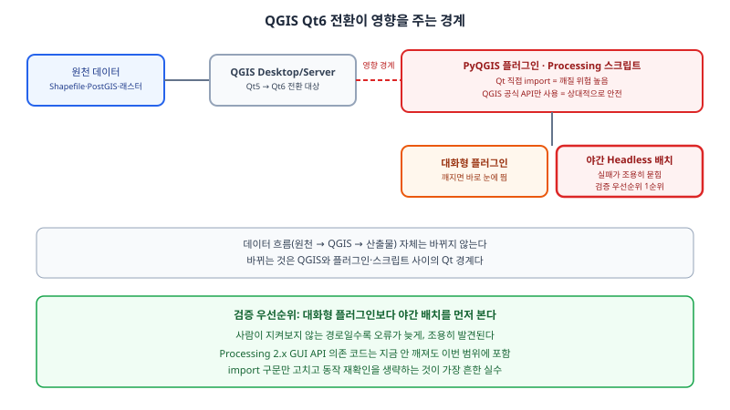

## 왜 지금 이 판단이 필요한가

"공장 부지 분석에 쓰던 QGIS 사내 자동화, 야간에 Processing 스크립트로 돌아가는데 최신 버전으로 그냥 올려도 되나요"라는 요구는 QGIS 4.0이 2026년 3월 정식 출시되면서 실제로 자주 들어오기 시작했다. 겉보기엔 "버전 번호가 하나 올라가는" 일처럼 보이지만, QGIS 4.0의 핵심은 GUI 프레임워크 자체를 Qt5에서 Qt6로 통째로 옮긴 것이다. 100개 넘는 새 기능이 따라오지만, 동시에 QGIS 개발팀 스스로 "Qt6 전환과 직접 관련된 범위에서만" 호환성 깨짐을 허용했다고 밝힐 만큼 구조적인 변화다.

문제는 이 전환이 QGIS 애플리케이션 자체보다 그 위에서 돌아가는 PyQGIS 플러그인·스크립트 쪽에서 먼저 드러난다는 점이다. Qt를 직접 import해서 다이얼로그를 그리거나 위젯을 다루는 플러그인은 Qt5·Qt6 API 차이 때문에 그대로 깨질 수 있고, Processing 2.x GUI API처럼 "이번엔 지우려 했지만 마이그레이션 부담 때문에 일단 남겨둔" deprecated API도 섞여 있다. 사람이 화면을 보면서 쓰는 대화형 플러그인은 깨지면 바로 눈에 띄지만, 새벽에 아무도 보지 않는 상태로 도는 배치 스크립트는 몇 주 뒤에야 "그러고 보니 그 레이어가 안 갱신되고 있었다"는 식으로 뒤늦게 발견된다.

## 전체 시스템에서의 위치

QGIS는 원천 공간 데이터(Shapefile·PostGIS·래스터)와 그 데이터를 가공해 결과물을 만들어내는 사내 자동화 사이에 놓인 오케스트레이션 레이어다. Qt6 전환은 이 레이어의 내부 GUI 프레임워크를 바꾸는 일이지만, 그 위에 얹힌 PyQGIS Processing 스크립트와 플러그인까지 영향권에 들어간다.



그림처럼 데이터 흐름 자체(원천 데이터 → QGIS → 산출물)는 Qt6 전환으로 바뀌지 않는다. 바뀌는 것은 QGIS와 PyQGIS 스크립트·플러그인 사이의 경계다. Qt를 직접 import하지 않고 QGIS 공식 Python API(`qgis.core`, `qgis.processing`)만 쓰는 배치 스크립트는 상대적으로 안전하지만, 대화형 플러그인이 Qt 위젯을 직접 그리는 코드는 이 경계에서 거의 예외 없이 손봐야 한다. 그리고 야간 배치는 보통 QGIS Server나 headless Processing 콘솔을 통해 도는데, 이 경로는 사람이 지켜보는 대화형 경로보다 오류가 조용히 묻히기 쉬운 자리다.

## 선택의 트레이드오프

| 선택지 | 받는 것 | 치러야 하는 것 | 적합한 상황 |
|---|---|---|---|
| 3.44 LTR 유지(Qt5) | 안정성, 기존 플러그인 그대로 동작 | 신기능 못 씀, 지원 종료 시점 다가옴 | 사내 배치가 많고 전면 검증 리소스가 없을 때 |
| 4.0으로 즉시 전환(Qt6) | 신기능, 향후 LTR 라인 선점 | Qt 직접 import 플러그인 전수 수정 필요 | 플러그인이 적고 QGIS API만 쓰는 경우 |
| 당분간 두 버전 병행 | 전환 리스크를 점진적으로 분산 | 운영 복잡도 2배(환경 두 개 유지) | 배치가 많고 영향도를 단계적으로 파악하고 싶을 때 |

가장 흔한 실수는 "데스크톱에서 플러그인 몇 개 열어보고 잘 뜨길래 넘어갔다"고 안심하는 것이다. 대화형 플러그인이 잘 뜨는 것과 headless Processing 환경에서 돌아가는 배치 스크립트가 끝까지 정상 종료되는 것은 전혀 다른 검증이다. 반대로 "Processing 2.x API를 당장 안 지운다고 했으니 손 안 대도 된다"고 미루는 것도 위험하다 — 유지는 됐지만 QGIS 개발팀이 향후 4.x 라인에서 걷어내겠다고 이미 예고한 API이므로, 지금 미뤄봐야 다음번에 다시 같은 마이그레이션을 반복하게 된다.

## 실제 프로젝트 진행 순서

가장 먼저 할 일은 코드를 건드리기 전에 플러그인·스크립트 인벤토리를 만들고, 각각이 Qt를 직접 import하는지 QGIS 공식 API만 쓰는지 분류하는 것이다. QGIS 커뮤니티가 공개한 Qt6 호환성 점검 도구로 이 분류를 자동화할 수 있다.

```bash
# PyQGIS 코드에서 Qt 직접 import 여부 전수 점검 (개념 예시)
grep -rl "from PyQt5" plugins/ scripts/
grep -rl "from qgis.PyQt" plugins/ scripts/   # 이쪽은 QGIS가 버전을 알아서 맞춰줌
```

분류가 끝나면 대화형 플러그인보다 **야간 배치·headless 스크립트부터 먼저** 4.0 환경에서 돌려본다. 사람이 지켜보지 않는 경로일수록 실패가 조용히 묻히므로, 오히려 검증 우선순위를 더 높게 잡아야 한다. 배치가 끝까지 정상 종료되고 산출물 레이어가 기대한 형태로 나오는지 결과물 기준으로 확인한다. Qt 직접 import 플러그인은 마이그레이션 스크립트로 import 구문을 1차로 정리한 뒤, 동작까지 반드시 수동으로 재확인한다 — import 구문이 바뀌었다고 동작까지 보장되지는 않는다. 마지막으로 Processing 2.x GUI API에 의존하는 코드는 지금 당장 깨지지 않더라도 이번 전환 작업 범위에 포함시켜, 다음 마이그레이션 때 또 손대는 일이 없게 한다.

## 마무리 요약

- QGIS 4.0의 핵심은 신기능이 아니라 Qt5→Qt6 전환이며, 영향은 QGIS 자체보다 그 위의 PyQGIS 플러그인·스크립트 쪽에서 먼저 드러난다.
- 대화형 플러그인이 잘 뜨는 것과 headless 배치가 끝까지 정상 종료되는 것은 다른 검증이므로, 사람이 지켜보지 않는 야간 배치부터 먼저 점검해야 한다.
- 진행 순서는 Qt 직접 import 여부로 플러그인·스크립트 분류 → 배치부터 우선 검증 → import 수정 후 동작 재확인 → Processing 2.x 의존 코드까지 이번 전환 범위에 포함이다.

## 참고 자료

- [QGIS — QGIS is moving to Qt6 and launching QGIS 4.0](https://blog.qgis.org/2025/04/17/qgis-is-moving-to-qt6-and-launching-qgis-4-0/)
- [QGIS — Visual changelog 4.0](https://qgis.org/project/visual-changelogs/visualchangelog40/)
- [NextGIS — QGIS 4 plugin migration devtools](https://nextgis.com/blog/qgis-4-plugin-migration-devtools/)
