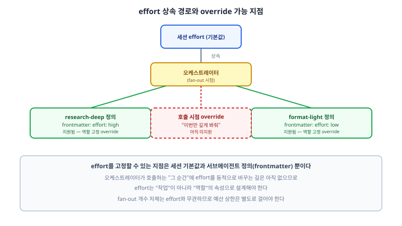

## 왜 지금 이 판단이 필요한가

"이 조사, 서브에이전트 다섯 개한테 나눠서 맡기되, 선례 조사는 꼼꼼히 생각하고 보고서 포맷 정리는 빨리 끝내주세요"라는 요구는 멀티 에이전트 구조가 기본값이 되면서 실제로 자주 들어온다. 문제는 오케스트레이터 자신이 xhigh 같은 높은 effort로 돌고 있으면, 별다른 설정 없이 띄운 서브에이전트들도 전부 같은 효과로 높은 effort를 그대로 물려받는다는 점이다. 포맷 정리처럼 사고 깊이가 필요 없는 작업까지 비싼 추론 비용을 그대로 쓰게 되는 것이다.

effort는 low·medium·high·xhigh·max 중 하나를 고르는 하나의 다이얼이지만, 이 다이얼이 "어디에" 고정되느냐에 따라 설계 난이도가 완전히 달라진다. 세션 전체 기본값으로만 걸 수 있다면 작업 단위로 나눠 거는 것 자체가 불가능하고, 서브에이전트 정의(frontmatter)에 박아둘 수 있다면 역할별로는 나눌 수 있지만 매 호출마다 동적으로 바꾸는 건 또 다른 문제다. 지금 이 세 지점 중 실제로 지원되는 지점이 어디인지를 정확히 알아야, "효율적으로 나눠 걸어주세요"라는 요구를 과도한 기능을 기대하지 않고 현실적으로 설계할 수 있다.

## 전체 시스템에서의 위치

effort 설정은 호출 스택을 따라 위에서 아래로 흐른다. 세션이 열리면 세션 effort가 기본값이 되고, 오케스트레이터가 서브에이전트를 띄울 때 그 서브에이전트에 자기만의 effort가 정의돼 있지 않으면 위에서 내려온 값을 그대로 물려받는다. 역할별로 effort를 다르게 걸려면, 이 흐름 중간에 "이 역할은 이 effort로 고정"이라는 규칙을 끼워 넣어야 한다.



그림에서 보듯 지금 실제로 끼워 넣을 수 있는 지점은 딱 하나, 서브에이전트 정의 자체의 frontmatter다. 리서치 담당 서브에이전트 정의에는 `effort: high`를, 포맷 정리 담당 정의에는 `effort: low`를 박아 두면 그 역할로 띄워지는 서브에이전트는 항상 그 effort로 실행된다. 반면 "이번 호출만 특별히 깊게 봐 줘"처럼 호출하는 그 순간에 effort를 동적으로 바꾸는 길은 아직 없다. 즉 effort는 "역할의 속성"으로는 설계할 수 있어도, "이번 작업의 속성"으로는 아직 설계할 수 없다.

## 선택의 트레이드오프

| 설계 방식 | 유연성 | 구현 난이도 | 지금 가능한가 |
|---|---|---|---|
| 세션 전체 단일 effort | 없음 — 전부 같은 깊이 | 없음(기본값) | 가능(사실상 현재 상태) |
| 서브에이전트 정의별 고정 effort | 역할 단위로만 가능 | 낮음 — frontmatter 한 줄 | 가능 |
| 호출 시점 동적 override | 작업 단위까지 가능 | 오케스트레이터가 매 호출 판단 | 아직 불가 — 커뮤니티에 요청 다수, 미지원 |
| 예산 상한(maxBudgetUsd·maxTurns) | effort와 별개 축 | 낮음 | 가능 — effort 미세조정의 대체재는 아님 |

가장 흔히 저지르는 설계 실수는 "일단 오케스트레이터만 xhigh로 올리면 전체 품질이 올라간다"고 가정하는 것이다. 실제로는 그 오케스트레이터가 띄우는 모든 서브에이전트가 같은 비용을 그대로 물려받으므로, 포맷 정리나 단순 조회처럼 깊은 사고가 필요 없는 작업에도 똑같이 비싼 추론 비용이 들어간다. 반대로 "역할별로 effort를 다 나눠뒀으니 비용 걱정은 끝났다"고 안심하는 것도 위험하다 — fan-out 자체의 개수는 effort와 무관하게 오케스트레이터의 판단에 달려 있으므로, 예산 상한선은 effort 설계와 별도로 반드시 걸어야 하는 안전장치다.

## 실제 프로젝트 진행 순서

가장 먼저 할 일은 서브에이전트를 "작업"이 아니라 "역할"로 먼저 분류하는 것이다. 리서치형(깊은 비교·판단이 필요), 집행형(파일 수정·커맨드 실행처럼 정해진 절차를 따름), 정리형(포맷·요약처럼 사고 깊이가 필요 없음) 세 갈래 정도로 나누면 대부분의 멀티 에이전트 작업이 들어맞는다.

```yaml
# .claude/agents/research-deep.md
---
name: research-deep
description: 선례 조사, 트레이드오프 비교처럼 깊은 판단이 필요한 작업 전용
effort: high
---
```

```yaml
# .claude/agents/format-light.md
---
name: format-light
description: 보고서 포맷 정리, 요약 재배치처럼 사고 깊이가 필요 없는 작업 전용
effort: low
---
```

역할별 정의가 자리 잡으면, 오케스트레이터는 "이 작업은 research-deep에게, 저 작업은 format-light에게"라고 역할을 골라 위임하는 것만으로 effort 분기가 자동으로 걸린다. 호출 시점 동적 override가 없다는 한계는 역할을 충분히 세분화하는 것으로 상당 부분 메울 수 있다 — 역할이 다섯 개면 다섯 가지 effort 조합이 생기는 셈이다. 마지막으로, effort 설계와는 별개로 세션이나 오케스트레이터 단위에 maxBudgetUsd·maxTurns 같은 예산 상한을 반드시 걸어, fan-out 개수 자체가 예상을 벗어나는 상황에서도 비용이 무한정 커지지 않도록 막아 둬야 한다.

## 마무리 요약

- effort는 세션 기본값 → 서브에이전트 정의(frontmatter)의 override까지는 지원되지만, 호출 시점에 동적으로 바꾸는 건 아직 불가능하다.
- 그래서 effort는 "작업의 속성"이 아니라 "역할의 속성"으로 설계해야 한다 — 서브에이전트를 리서치형·집행형·정리형처럼 역할로 먼저 나누고, 역할마다 effort를 고정해 두는 것이 지금 가능한 최선이다.
- 진행 순서는 역할 분류 → 역할별 effort를 frontmatter에 고정 → 오케스트레이터가 역할 선택으로 위임 → fan-out 개수 폭주에 대비한 예산 상한을 effort 설계와 별도로 확보다.

## 참고 자료

- [Claude Agent SDK — Subagent configuration](https://docs.claude.com/en/api/agent-sdk/subagents)
- [Claude Code — Subagents documentation](https://code.claude.com/docs/en/sub-agents)
- [Claude Code — Settings and cost controls](https://code.claude.com/docs/en/settings)
