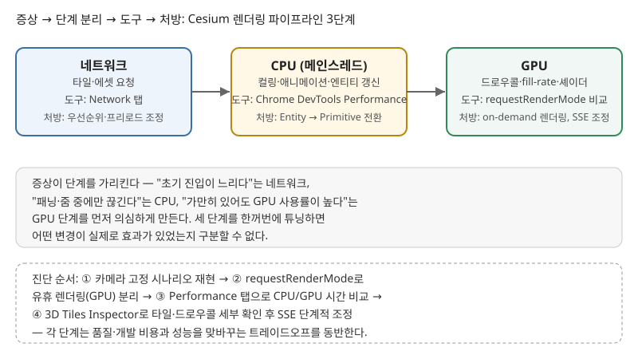

## 왜 지금 이 판단이 필요한가

"지도가 느려졌어요. 왜 그런지는 모르겠고 그냥 빠르게 해주세요"는 Cesium을 운영해본 사람이라면 한 번쯤 듣는 요구다. 최근 들어 이 요구가 더 자주 들어오는 이유가 있다. 3D Tiles 1.1의 메타데이터·시맨틱스 확장, Gaussian Splatting의 3D Tiles 통합, Google Photorealistic 3D Tiles 같은 무거운 콘텐츠가 기본 선택지가 되면서, 예전이라면 "일단 건물 몇 개 띄워보고 괜찮네"로 끝났을 검증 단계가 더 이상 실제 운영 환경을 대변하지 못하게 됐다.

문제는 "느리다"는 증상 하나에 원인 후보가 최소 네 가지(CPU 메인스레드 병목, GPU 드로우콜·fill-rate 병목, 네트워크 타일 요청 병목, LOD 전환 시 로드·언로드 비용)나 있다는 점이다. 체계 없이 접근하면 가장 먼저 눈에 띄는 처방(해상도를 낮추거나, 엔티티 개수를 줄이거나, requestRenderMode를 켜는 것)부터 땜질식으로 적용하게 되고, 운이 좋으면 우연히 맞지만 병목이 다른 곳에 있으면 체감 개선이 없다. 빌더에게 필요한 것은 "이 증상이면 이 설정"이라는 암기가 아니라, 증상을 보고 병목 단계를 좁혀가는 재사용 가능한 진단 순서다.

## 전체 시스템에서의 위치

Cesium 렌더링 파이프라인은 크게 세 단계를 거친다. 타일·엔티티 데이터가 네트워크로 들어오고, CPU(JS 메인스레드)가 컬링·애니메이션 계산·엔티티 업데이트를 수행하고, 그 결과를 GPU가 드로우콜과 셰이더로 화면에 그린다. 각 단계마다 쓰는 진단 도구가 다르고, 병목이 어느 단계인지 모르고 다른 단계의 설정을 건드리면 효과가 없다.



패닝·줌 같은 카메라 조작 중에만 느려진다면 CPU나 네트워크(타일 교체) 쪽을, 카메라가 멈춰 있는데도 GPU 사용률이 높다면 fill-rate나 불필요한 상시 렌더링 쪽을 먼저 의심하는 식으로, 증상이 이미 "어느 단계를 먼저 볼지"에 대한 힌트를 담고 있다. 이 힌트를 무시하고 전체를 한꺼번에 튜닝하려 들면 어떤 변경이 실제로 효과가 있었는지조차 알 수 없게 된다.

## 선택의 트레이드오프

| 증상 | 유력한 병목 | 진단 도구 | 대표 처방 |
|---|---|---|---|
| 가만히 있어도 GPU 사용률이 높다 | 불필요한 상시 렌더링·fill-rate | `requestRenderMode` on/off 비교 | `requestRenderMode: true`로 변화 시에만 렌더링 |
| 패닝·줌 중에만 끊긴다 | CPU 메인스레드(엔티티 수·애니메이션) | Chrome DevTools Performance 탭 | 개별 Entity를 PointPrimitiveCollection/Primitive로 전환 |
| 줌 전환 시 순간 멈춤 | 타일 로드·언로드(LOD 전환) 비용 | 3D Tiles Inspector의 Statistics | `maximumScreenSpaceError`·`dynamicScreenSpaceError` 조정 |
| 초기 진입이 유독 느리다 | 네트워크 타일 요청 병목 | 브라우저 Network 탭 | 타일 우선순위·프리로드 범위 조정 |

이 표의 처방들은 서로 대체재가 아니라 보완재에 가깝다. 예를 들어 `maximumScreenSpaceError`를 높이면 타일 로드 비용은 줄지만 화질이 떨어지므로, 실제로는 "사용자가 체감하는 화질 저하"와 "측정된 성능 개선 폭"을 같이 보면서 어디까지 낮출지 정해야 한다. 엔티티를 Primitive로 바꾸는 것도 유지보수 편의성(API가 더 저수준이라 개발 비용이 올라간다)과 성능을 맞바꾸는 결정이므로, 실제로 엔티티 수가 수천 개를 넘는 시점에만 적용하는 것이 합리적이다.

## 실제 프로젝트 진행 순서

가장 먼저 할 일은 재현 가능한 시나리오를 고정하는 것이다. 매번 다른 카메라 경로로 "느리다, 안 느리다"를 판단하면 어떤 변경이 실제로 효과가 있었는지 알 수 없다. 같은 시작 위치, 같은 줌·팬 동작을 스크립트나 녹화로 고정한다.

```js
// 1차 분리: 상시 렌더링 여부 확인
viewer.scene.requestRenderMode = true;
viewer.scene.maximumRenderTimeChange = Infinity;
// 카메라가 멈춘 상태에서도 GPU 사용률이 높다면 fill-rate·셰이더 쪽이 유력
```

이 1차 분리로 "유휴 상태에서도 느린가"를 걸러낸 뒤, 카메라를 움직이는 구간에서 Chrome DevTools의 Performance 탭을 켜서 메인스레드(Scripting)와 GPU(Rendering/Painting) 중 어느 쪽 막대가 긴지 확인한다. 메인스레드가 길면 엔티티 수·애니메이션 계산을, GPU가 길면 드로우콜·fill-rate를 의심한다. 마지막으로 3D Tiles를 쓰는 레이어라면 3D Tiles Inspector를 띄워 타일 개수·메모리·드로우콜 통계를 보면서 `maximumScreenSpaceError`를 단계적으로 조정해, 품질 저하 대비 성능 개선 폭이 어디서 꺾이는지 직접 측정한다.

## 마무리 요약

- "느리다"는 증상 하나에 CPU·GPU·네트워크·LOD 전환 비용 등 여러 원인 후보가 있으므로, 암기한 처방보다 증상에서 병목 단계를 좁혀가는 진단 순서가 재사용성이 높다.
- 재현 가능한 시나리오 고정 → `requestRenderMode`로 유휴 렌더링 분리 → Chrome DevTools로 CPU/GPU 분리 → 3D Tiles Inspector로 타일·드로우콜 세부 확인 순으로 좁혀간다.
- 처방 대부분은 품질·개발 비용과 성능을 맞바꾸는 트레이드오프이므로, 측정 없이 적용하면 체감 개선 없이 화질이나 유지보수성만 잃을 수 있다.

## 참고 자료

- [CesiumJS — Scene requestRenderMode documentation](https://cesium.com/learn/cesiumjs/ref-doc/Scene.html)
- [CesiumJS — 3D Tiles Inspector widget](https://sandcastle.cesium.com/?src=3D%20Tiles%20Inspector.html)
- [CesiumJS — Cesium3DTileset screen space error tuning](https://cesium.com/learn/cesiumjs/ref-doc/Cesium3DTileset.html)
