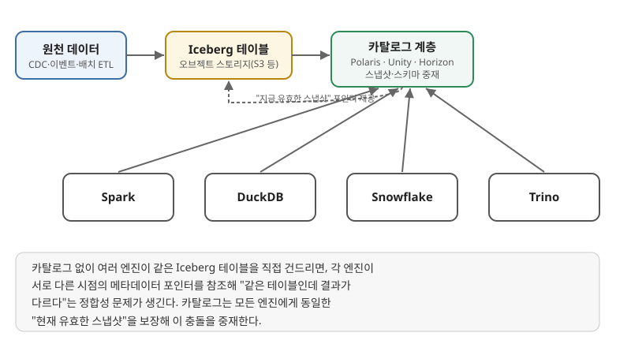

## 왜 지금 이 판단이 필요한가

"Spark 배치로 적재한 데이터를, 분석가는 DuckDB로 가볍게 보고 싶어 하고 BI 툴은 Snowflake에서 조회하고 싶어 해요. 같은 데이터인데 왜 복사본을 세 개나 만들어야 하나요?"라는 요구는 단일 엔진 분석 구조가 한계에 닿는 지점을 정확히 짚는다. 분석 엔진을 서비스 DB에서 분리하는 단계(DuckDB냐 ClickHouse냐를 고르는 결정)까지는 많은 팀이 이미 지났지만, 그다음 단계인 "여러 엔진이 같은 물리 데이터를 동시에 읽고 쓴다"는 요구는 엔진 선택이 아니라 데이터가 저장되는 포맷 자체의 설계를 요구한다.

이 영역은 최근 들어 구도가 명확해졌다. 테이블 포맷 경쟁은 사실상 Apache Iceberg 쪽으로 정리됐다는 평가가 업계에 자리 잡았고, Apache Polaris가 2026년 2월 Apache 최상위 프로젝트로 졸업했으며, Snowflake는 2026년 11월 1일 Horizon Catalog의 WIF(워크로드 아이덴티티 연합) 기반 교차 계정 읽기·쓰기를 정식 출시해 비밀키 공유 없이 다른 계정이 관리하는 Iceberg 테이블에 접근할 수 있게 했다. 포맷 전쟁이 끝나고 "어떤 카탈로그를 쓸 것인가"가 경쟁의 축이 됐다는 뜻이며, 빌더 입장에서는 이 선택이 특정 DB 제품을 고르는 것만큼 무거운 아키텍처 결정이 됐다.

## 전체 시스템에서의 위치

레이크하우스 구조에서 데이터는 원천(서비스 DB의 CDC, 이벤트 스트림, 배치 ETL)에서 출발해 Iceberg 같은 오픈 테이블 포맷으로 오브젝트 스토리지(S3·GCS 등)에 쌓인다. 이 물리 파일 자체는 어떤 엔진도 직접 읽을 수 있지만, "지금 이 테이블의 최신 스냅샷이 어떤 파일들로 구성되는지, 스키마가 어떻게 바뀌어왔는지"를 중재하는 계층이 바로 카탈로그다.



카탈로그 없이 여러 엔진이 같은 Iceberg 테이블을 건드리면, 각 엔진이 서로 다른 시점의 메타데이터 포인터를 참조해 "같은 테이블인데 결과가 다르다"는 정합성 문제가 생긴다. 카탈로그는 "지금 유효한 스냅샷은 이것"이라는 단일한 진실을 여러 엔진에게 동일하게 제공하는 역할을 맡는다. 그래서 이 계층을 어디에 둘지는 단순한 메타데이터 저장소 선택이 아니라, 여러 엔진 간 쓰기 충돌을 누가 중재하느냐를 정하는 설계다.

## 선택의 트레이드오프

| 방식 | 락인 | 운영 부담 | 교차 엔진 호환성 |
|---|---|---|---|
| 카탈로그 없이 엔진별 자체 메타스토어 | 낮음 | 낮음(초기) | 매우 낮음 — 동시 쓰기 시 정합성 깨짐 |
| 벤더 관리형 카탈로그(Snowflake Horizon, Databricks Unity) | 높음 | 낮음 — 벤더가 운영 | 벤더 생태계 안에서는 높음, 밖은 제한적 |
| 오픈 카탈로그 자체 호스팅(Apache Polaris) | 낮음 | 높음 — 직접 운영·패치 | 표준 REST 카탈로그 API 기준으로 높음 |
| 클라우드 네이티브 카탈로그(AWS Glue) | 중간 | 중간 | 해당 클라우드 생태계 안에서 양호 |

이미 특정 벤더(Databricks나 Snowflake)에 데이터 웨어하우스가 묶여 있다면, 그 벤더의 관리형 카탈로그로 시작하는 쪽이 운영 부담 대비 이득이 크다. 반면 여러 클라우드·여러 벤더 엔진을 혼용해야 하는 조직이라면, 벤더 중립성을 위해 Polaris 같은 오픈 카탈로그를 직접 운영하는 비용을 감수할 가치가 있다. 중요한 것은 "엔진이 하나뿐이고 당분간 늘어날 계획이 없다"면 이 계층 자체가 과한 설계라는 점이다 — 카탈로그는 "여러 엔진이 같은 데이터를 본다"는 요구가 실제로 있을 때만 값을 한다.

## 실제 프로젝트 진행 순서

가장 먼저 확인할 것은 "정말로 여러 엔진이 같은 테이블을 동시에 읽고 쓰는가"다. 분석 엔진이 하나뿐이라면 Iceberg와 카탈로그 계층 없이도 그 엔진의 네이티브 포맷으로 충분하다. 이 요구가 실제로 확인되면 테이블 포맷은 Iceberg로 고정한다 — 포맷 전쟁이 이미 정리된 영역이라 이 선택 자체의 리스크는 낮다.

```text
1. 기존 적재 파이프라인(Spark/Flink 등)의 출력 포맷을 Iceberg 테이블로 변경
2. 카탈로그 선택: 기존 벤더 종속이 있으면 관리형 카탈로그, 벤더 중립이 중요하면 Polaris self-host
3. 교차 계정/교차 엔진 인증을 비밀키 공유가 아닌 워크로드 아이덴티티 연합(WIF) 방식으로 설계
4. 스키마 진화·스냅샷 컴팩션 같은 운영 루틴의 책임 주체를 하나로 명확히 지정
5. 두 번째 엔진을 연결해 같은 테이블에서 동시 읽기·쓰기 충돌 시나리오를 직접 재현해본다
```

마지막 단계를 건너뛰고 바로 운영에 들어가면, 두 엔진이 동시에 컴팩션을 트리거하거나 스키마를 서로 다르게 변경하는 충돌이 실제 트래픽에서야 발견되는 경우가 많다. 카탈로그 계층의 가치는 설계 문서가 아니라 이 충돌 시나리오를 실제로 막아내는지로 검증해야 한다.

## 마무리 요약

- "여러 엔진이 같은 데이터를 동시에 읽고 쓴다"는 요구가 실제로 있을 때만 Iceberg·카탈로그 계층을 도입한다. 엔진이 하나뿐이면 과한 설계다.
- 테이블 포맷 경쟁은 Iceberg로 정리됐고, 남은 결정은 관리형 카탈로그(락인 낮은 운영 부담)와 오픈 카탈로그 자체 호스팅(운영 부담 높은 벤더 중립) 사이의 트레이드오프다.
- 진행 순서는 다중 엔진 필요성 확인 → Iceberg 고정 → 카탈로그 선택 → WIF 기반 교차 인증 설계 → 컴팩션·스키마 진화 책임 지정 → 동시 쓰기 충돌 시나리오 직접 재현이다.

## 참고 자료

- [Apache Iceberg — Table format documentation](https://iceberg.apache.org/docs/latest/)
- [Apache Polaris — Open catalog for Apache Iceberg](https://polaris.apache.org/)
- [Snowflake — Horizon Catalog release notes](https://docs.snowflake.com/en/release-notes)
