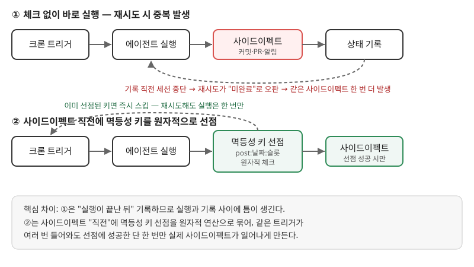

## 왜 지금 이 판단이 필요한가

"이 작업, 매일 아침 자동으로 돌아가게 해주세요. 사람이 안 봐도 알아서 하고, 끊기면 다시 이어서 하면 돼요"라는 요구는 더 이상 특이한 주문이 아니다. 최근 몇 달 사이 Microsoft의 agent-framework-go가 서브워크플로 라우팅을 추가하고, AWS가 Bedrock AgentCore와 Strands의 안정성을 끌어올리고, Perplexity가 "항상 켜져 있는 팀원(always-on teammate)" 제품을 내놓은 것도 같은 흐름이다. 에이전트를 한 번 호출하고 끝내는 게 아니라, 크론이나 트리거로 반복 실행시키는 패턴이 기본값이 되고 있다. 이 요구를 그대로 받으면 머릿속에서 바로 "크론 → 에이전트 실행 → 결과 반영" 파이프라인이 그려지지만, 여기서 빠뜨리기 쉬운 질문이 하나 있다. 실행 도중 rate limit이나 네트워크 오류로 세션이 끊기고, 스케줄러가 안전하게 "다시 한번 돌려봐"라고 재시도하면 무슨 일이 생기는가.

실제로 이런 사고는 드물지 않다. 반복 배치로 콘텐츠를 생성하는 파이프라인에서, 세션이 rate limit로 끊겼다가 재개되는 과정에서 이미 만든 결과물과 사실상 동일한 결과물이 한 번 더 만들어져 그대로 반영된 사례가 보고된 적이 있다. 문제는 재시도 로직 자체가 아니라, "재시도가 안전하다"는 가정이 깨지는 지점을 아무도 명시적으로 설계하지 않았다는 데 있다. 스케줄러·큐·에이전트 런타임이 제공하는 것은 대개 "적어도 한 번(at-least-once)" 실행 보장이지, "정확히 한 번(exactly-once)" 보장이 아니다. 이 둘의 차이를 메우는 책임은 거의 항상 애플리케이션 쪽, 즉 빌더가 짜는 코드에 넘어온다.

## 전체 시스템에서의 위치

상시 에이전트 파이프라인은 대체로 네 단계로 이어진다. 트리거(크론·웹훅·스케줄 깨우기)가 실행 시점을 알리면, 에이전트가 작업을 수행하고, 그 결과가 파일 커밋·API 호출·알림 발송 같은 사이드이펙트로 바깥 세계에 반영되고, 마지막으로 "이 작업을 했다"는 사실이 어딘가에 기록된다. 멱등성 문제는 이 네 번째 단계인 상태 기록이 세 번째 단계인 사이드이펙트보다 늦게, 혹은 아예 기록되지 못하고 중단될 때 생긴다.



그림 위쪽처럼 "트리거 → 바로 실행 → 끝나면 기록"의 순서로 짜면, 실행이 끝나고 기록 직전에 세션이 끊길 경우 다음 트리거(사람의 재개든 자동 재시도든)는 "아직 기록이 없으니 안 한 작업"으로 오판해 똑같은 사이드이펙트를 한 번 더 일으킨다. 그림 아래쪽처럼 사이드이펙트 "직전"에 멱등성 키를 원자적으로 선점하는 구조로 바꾸면, 같은 트리거가 몇 번 들어와도 실제 사이드이펙트는 한 번만 일어난다. 핵심은 "언제 기록하느냐"가 아니라 "사이드이펙트와 기록을 하나의 원자적 연산으로 묶을 수 있느냐"다.

## 선택의 트레이드오프

| 방식 | 구현 난이도 | 레이스 컨디션 안전성 | 적합한 상황 |
|---|---|---|---|
| 사전 체크(존재 확인 후 실행) | 낮음 | 낮음 — 체크와 실행 사이에 틈이 있다 | 재시도 빈도가 낮고 사람이 중간 점검하는 배치 |
| DB/파일 유니크 제약으로 선점 | 중간 | 높음 — DB가 원자성을 보장 | 사이드이펙트 자체가 DB·커밋 등 트랜잭션화 가능한 대상 |
| 분산 락(Redis, ZooKeeper 등) | 중간~높음 | 높음, 단 락 해제 타이밍 관리 필요 | 여러 워커가 동시에 같은 트리거를 받을 수 있는 분산 환경 |
| 외부 상태 저장소에 멱등성 키 기록 | 낮음~중간 | 높음, 키 설계가 핵심 | 사이드이펙트가 외부 API 호출처럼 자체 트랜잭션이 없는 경우 |

자연키(날짜+슬롯처럼 의미 있는 값)로 멱등성 키를 만들면 디버깅이 쉽지만, 같은 날짜·슬롯 안에서 내용이 바뀌는 재시도(예: 같은 자리에 다른 주제로 교체)를 구분하지 못하는 함정이 있다. 반대로 매 실행마다 새 UUID를 생성해 키로 쓰면 애초에 "같은 작업"이라는 식별 자체가 불가능해져 멱등성이 성립하지 않는다. 그래서 멱등성 키는 "무엇이 같으면 같은 작업인가"라는 비즈니스 질문에 먼저 답한 뒤에 설계해야 한다.

## 실제 프로젝트 진행 순서

가장 먼저 할 일은 멱등성 경계를 어디에 그을지 정하는 것이다. "에이전트가 생각을 시작하는 시점"이 아니라 "되돌릴 수 없는 사이드이펙트가 일어나는 시점" 바로 앞이 경계여야 한다. 이 파이프라인으로 치면 커밋·푸시·PR merge 같은, 한번 나가면 되돌리기 번거로운 지점이다.

```bash
# 의사코드 — 사이드이펙트 직전에 멱등성 키를 원자적으로 선점
KEY="post:${TODAY}:${SLOT}"

if ! claim_idempotency_key "$KEY"; then
  echo "이미 처리된 작업 — 재시도 중복, 스킵"
  exit 0
fi

run_side_effect   # 파일 커밋, PR 생성 등
mark_idempotency_key_done "$KEY"
```

그다음 이 경계를 재시도 테스트로 직접 검증한다. 같은 트리거를 의도적으로 두 번 쏴서 사이드이펙트가 정말 한 번만 일어나는지 확인하지 않으면, 설계는 서류상으로만 멱등하고 실전에서는 뚫린다. 마지막으로 멱등성 체크 자체가 실패했을 때(예: 상태 저장소가 응답하지 않을 때)의 기본 동작을 정해야 한다 — 안전을 우선해 작업을 건너뛸지, 가용성을 우선해 일단 실행할지는 사이드이펙트의 되돌림 비용에 따라 달라진다.

## 마무리 요약

- 스케줄러·재시도 메커니즘의 "적어도 한 번" 보장과 사용자가 기대하는 "딱 한 번" 사이의 간극은 애플리케이션이 직접 메워야 한다.
- 멱등성 경계는 되돌릴 수 없는 사이드이펙트 직전에 그어야 하고, 체크와 실행은 원자적 연산으로 묶여야 레이스 컨디션을 막는다.
- 진행 순서는 경계 설정 → 멱등성 키 설계(자연키 vs 생성키) → 원자적 선점 구현 → 중복 트리거로 직접 재시도 테스트 → 체크 실패 시 기본 동작 결정이다.

## 참고 자료

- [AWS — Idempotency patterns for serverless applications](https://docs.aws.amazon.com/lambda/latest/dg/powertools-idempotency.html)
- [Microservices.io — Idempotent Consumer pattern](https://microservices.io/patterns/communication-style/idempotent-consumer.html)
- [Temporal — Workflow determinism and retries](https://docs.temporal.io/workflows)
