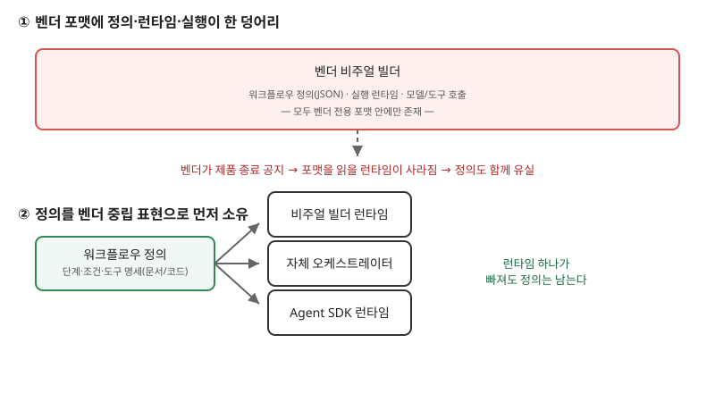

## 왜 지금 이 판단이 필요한가

"이 업무, 일단 빠르게 비주얼로 만들어서 돌려보고 싶어요. 코드는 나중에 정리하면 되죠?"라는 요구는 요즘 흔하다. OpenAI의 Agent Builder, UiPath의 대화형 에이전트, 여러 로우코드 플랫폼이 "드래그앤드롭으로 에이전트 워크플로우를 짜라"고 등을 떠밀었고, 실제로 프로토타입 단계에서는 효과가 컸다. 그런데 OpenAI는 Agent Builder를 2026년 11월 30일부로 종료한다고 공지했다. 그 전까지 워크플로우를 export해 인벤토리를 만들고, 대체 아키텍처를 정하고, 재구현과 회귀 테스트까지 마치라는 것이 공지의 요지다. 빌더 위에 업무 로직을 쌓아 올린 팀이라면 한 달 안에 그 로직 전체를 다른 형태로 옮겨야 한다.

이 사건이 중요한 이유는 Agent Builder 하나가 특별히 불안정해서가 아니다. 벤더가 내놓는 비주얼 오케스트레이션 제품은 대개 그 벤더의 모델·플랫폼 전략과 함께 움직이고, 전략이 바뀌면 제품도 접힌다. 문제는 "비주얼로 빠르게 만들어주세요"라는 요구를 받아들일 때, 그 결과물이 코드로 쉽게 빠져나올 수 있는 형태인지를 아무도 묻지 않는다는 데 있다. 빌더를 고르는 시점에는 보이지 않다가, 정확히 벤더가 발을 빼는 순간에만 드러나는 비용이다.

## 전체 시스템에서의 위치

에이전트 오케스트레이션은 보통 세 층으로 나뉜다. 가장 위에는 "무엇을 어떤 순서로 할지"를 정의하는 워크플로우 정의 레이어가 있고, 중간에는 그 정의를 실제로 실행하는 런타임이 있고, 맨 아래에는 모델 호출·도구 호출·상태 저장 같은 실행 프리미티브가 있다. 비주얼 빌더는 이 세 층을 하나로 묶어서 벤더의 캔버스 UI와 저장 포맷 안에 가둔다. 워크플로우 정의가 그 벤더의 JSON 스키마로만 존재하면, 런타임이 사라지는 순간 정의도 같이 못 쓰게 된다.



그림 위쪽처럼 정의·런타임·실행 프리미티브가 한 벤더 안에 뭉쳐 있으면 빌더 종료는 곧 업무 로직 손실이다. 그림 아래쪽처럼 워크플로우 정의를 단계·조건·도구 호출 명세 같은 벤더 중립 표현으로 먼저 적어 두고, 그 표현을 비주얼 빌더든 Claude Agent SDK든 자체 오케스트레이터든 여러 런타임이 해석하게 하면, 런타임 하나가 빠져도 정의는 남는다. 핵심은 "어디서 실행하느냐"가 아니라 "정의를 어느 레이어에서 소유하느냐"다.

## 선택의 트레이드오프

| 방식 | 초기 속도 | 탈출 비용 | 적합한 상황 |
|---|---|---|---|
| 벤더 비주얼 빌더에 전부 위임 | 매우 빠름 | 매우 높음 — 포맷 종속 | 단명할 프로토타입, 검증용 PoC |
| 빌더로 설계하되 정의를 문서로 병행 기록 | 빠름 | 중간 — 재입력은 필요 | 빌더 UI가 설계 사고에 도움이 되는 초기 단계 |
| 코드 기반 오케스트레이션(Agent SDK, 자체 워크플로우 엔진) | 느림 | 낮음 — 코드 자체가 정의 | 운영 지속성이 중요한 핵심 업무 흐름 |
| 하이브리드(코드로 정의, 비주얼은 모니터링 전용) | 중간 | 낮음 | 운영 중 가시성도 필요하고 장기 운영도 필요한 경우 |

빌더를 쓰지 말라는 결론이 아니다. 처음 요구사항이 모호해서 "일단 눈으로 보면서 흐름을 맞춰보고 싶다"는 단계에서는 비주얼 빌더가 사람 사이 합의를 빠르게 만드는 데 유리하다. 문제는 그 단계가 끝났는데도 정의의 소유권을 계속 벤더 포맷에 맡겨 두는 것이다. 트레이드오프의 축은 "지금 얼마나 빠르냐"가 아니라 "이 워크플로우가 1년 뒤에도 돌아야 하는가"로 잡아야 한다.

## 실제 프로젝트 진행 순서

가장 먼저 할 일은 지금 비주얼 빌더에 올라가 있는 워크플로우를 전수 조사하는 것이다. 몇 개의 노드로 구성되고, 어떤 도구를 호출하며, 어디서 사람 승인을 기다리는지를 벤더 UI 바깥의 문서로 먼저 적는다. 이 인벤토리가 없으면 "코드로 옮기자"는 결정 자체를 내릴 근거가 없다.

```text
워크플로우 인벤토리 예시
- 이름: 주간 리포트 생성
- 트리거: 매주 월요일 09:00
- 단계: 데이터 수집 → 모델 요약 → 승인 대기 → 발송
- 외부 호출: 사내 API 2개, 이메일 발송 1개
- 상태 의존: 승인 대기 중 사람 입력
```

그다음 각 워크플로우를 "지금 당장 코드로 옮겨야 하는 것"과 "당분간 비주얼로 둬도 되는 것"으로 나눈다. 기준은 운영 기간과 변경 빈도다. 몇 주 안에 폐기될 실험이라면 급하게 옮길 이유가 없고, 반대로 매주 돌며 회사 운영에 걸려 있는 흐름이라면 벤더의 종료 공지 유무와 무관하게 애초에 코드로 짰어야 한다는 신호로 받아들여야 한다. 마지막으로, 코드로 옮긴 뒤에는 반드시 같은 입력으로 비주얼 버전과 결과를 나란히 비교하는 회귀 테스트를 거친 뒤에 비주얼 버전을 끈다.

## 마무리 요약

- 벤더의 비주얼 에이전트 빌더는 제품 전략이 바뀌면 함께 접힐 수 있고, OpenAI Agent Builder의 종료 공지가 그 구체적 사례다.
- 탈출 비용을 낮추는 핵심은 워크플로우 정의를 벤더 포맷이 아니라 벤더 중립 표현으로 먼저 소유하는 것이다.
- 진행 순서는 워크플로우 인벤토리 작성 → 운영 지속성 기준으로 이관 대상 선별 → 코드로 재구현 → 회귀 테스트 → 비주얼 버전 종료다.

## 참고 자료

- [OpenAI — Agent Builder documentation](https://platform.openai.com/docs/guides/agent-builder)
- [Anthropic — Claude Agent SDK overview](https://docs.claude.com/en/api/agent-sdk/overview)
- [Martin Fowler — Avoiding vendor lock-in with workflow definitions](https://martinfowler.com/articles/)
