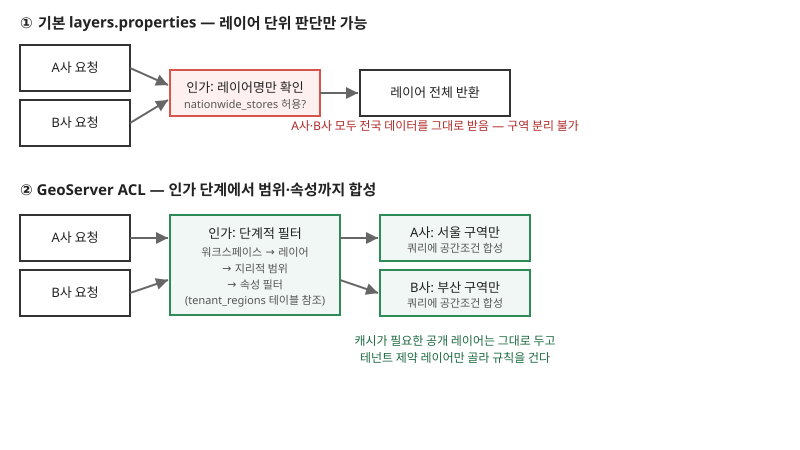

## 왜 지금 이 판단이 필요한가

"저희 고객사가 여러 곳인데, 같은 지도 서버 하나로 돌리되 A사는 자기 구역 레이어만, B사는 B사 구역만 보이게 해주세요"라는 요구는 GeoServer를 멀티테넌트로 쓰려는 조직에서 거의 반드시 나온다. 이 말을 그대로 받으면 "레이어마다 권한을 걸면 되겠지"로 생각이 끝나기 쉽지만, 실제로 GeoServer 기본 보안 모델은 이 요구를 절반밖에 풀지 못한다. 기본 레이어 보안은 `layers.properties` 파일에 워크스페이스·레이어별 read/write/admin 모드를 적는 방식인데, 전역 권한을 명시하지 않으면 읽기·쓰기가 기본으로 열려 있고, 서비스 보안과 레이어 보안을 섞어서 "이 레이어는 WMS만 허용, WFS는 막기"처럼 세밀하게 걸 수도 없다.

더 큰 문제는 "같은 레이어 안에서 고객사마다 보이는 피처가 달라야 하는" 경우다. 예를 들어 전국 상권 레이어 하나를 두고 A사에는 서울 지역만, B사에는 부산 지역만 노출하고 싶다면, 레이어 단위 권한으로는 애초에 표현할 수 없는 요구다. 이 틈을 메우려고 나온 것이 GeoServer 커뮤니티가 유지하는 별도 보안 플러그인인 GeoServer ACL이다. 인증 자체는 기존 메커니즘에 맡기고, 그 위에 워크스페이스·레이어·지리적 범위·속성 단위까지 세밀한 허용·차단·제한 규칙을 얹는다.

## 전체 시스템에서의 위치

레이어 접근 제어는 지도 요청이 들어오는 경로 한가운데, 정확히는 인증이 끝난 뒤와 실제 데이터 조회 사이에 끼어든다. 클라이언트가 WMS/WFS 요청을 보내면 GeoServer는 먼저 누구인지 확인(인증)하고, 그다음 그 사용자가 요청한 레이어와 범위에 접근할 수 있는지 확인(인가)한 뒤에야 PostGIS나 파일 스토어에서 실제 피처를 끌어온다. 기본 레이어 보안은 이 인가 단계를 "레이어 전체를 보여줄지 말지"로만 판단하지만, GeoServer ACL은 같은 단계에서 "어느 지리적 범위까지, 어느 속성까지" 보여줄지를 추가로 판단한다.



그림 위쪽 기본 방식에서는 인가가 레이어 이름만 보고 허용 여부를 결정하므로, 같은 레이어를 쓰는 두 테넌트를 구분할 방법이 없다. 그림 아래쪽 ACL 방식에서는 인가 단계가 사용자(또는 그 사용자가 속한 그룹)를 기준으로 워크스페이스 → 레이어 → 지리적 필터 → 속성 필터 순으로 조건을 좁혀 나가고, 그 결과로 PostGIS에 보내는 쿼리 자체에 공간 조건이 덧붙는다. 핵심은 권한 판단이 "레이어 이름 매칭"에서 "쿼리 조건 합성"으로 바뀐다는 점이다.

## 선택의 트레이드오프

| 방식 | 세밀도 | 운영 복잡도 | 적합한 상황 |
|---|---|---|---|
| 기본 layers.properties | 레이어 단위만 | 낮음 | 테넌트 수가 적고 레이어 자체가 테넌트별로 분리된 경우 |
| 워크스페이스 분리(테넌트마다 워크스페이스) | 레이어 단위, 단 관리는 쉬움 | 중간 | 테넌트 수가 늘어도 데이터까지 물리적으로 분리 가능한 경우 |
| GeoServer ACL(지리·속성 필터) | 피처·속성 단위 | 중간~높음 — 별도 서비스 운영 | 같은 레이어를 여러 테넌트가 공유하며 범위만 다른 경우 |
| 애플리케이션 레이어에서 사후 필터링 | 임의 수준 | 높음 — 캐시 전략과 충돌 | GeoServer 앞단에 API 게이트웨이를 이미 두고 있는 경우 |

워크스페이스 분리가 가장 단순해 보이지만, 테넌트 수가 수십 개를 넘어가면 워크스페이스·스토어·레이어를 테넌트 수만큼 복제해야 해서 관리 비용이 기하급수로 늘어난다. 반대로 애플리케이션 레이어에서 필터링하면 유연하지만, GWC 같은 타일 캐시 전략과 정면으로 충돌한다 — 같은 타일 영역이라도 테넌트마다 다른 결과를 돌려줘야 하므로 캐시 키에 테넌트를 섞어야 하고, 그만큼 캐시 적중률이 떨어진다. GeoServer ACL은 이 중간 지점에서, 캐시 가능한 공개 레이어는 그대로 두고 테넌트별 제약이 필요한 레이어만 골라서 규칙을 건다.

## 실제 프로젝트 진행 순서

가장 먼저 할 일은 테넌트 경계가 "레이어 단위"인지 "같은 레이어 안의 지리적 범위"인지를 구분하는 것이다. 전자라면 워크스페이스 분리로 충분하고 ACL까지 끌어올 필요가 없다. 후자라면 ACL 도입이 필요하다는 신호다.

```text
# GeoServer ACL 규칙 예시 (개념적 표현)
rule:
  user: tenant-a-user
  workspace: commerce
  layer: nationwide_stores
  access: LIMIT
  spatial_filter: "ST_Within(geom, (SELECT boundary FROM tenant_regions WHERE tenant='A'))"
```

규칙을 짜기 전에 먼저 각 테넌트의 지리적 범위를 담을 기준 테이블(위 예시의 `tenant_regions`)을 별도로 두고, 규칙은 그 테이블을 참조하는 형태로 설계해야 테넌트가 늘어날 때마다 규칙 자체를 다시 쓰지 않아도 된다. 그다음 기존에 캐시(GWC)를 쓰고 있던 레이어라면, ACL을 건 레이어는 캐시 대상에서 빼거나 테넌트별로 캐시 키를 분리해야 한다는 점을 미리 확인해야 한다. 마지막으로, 운영에 들어가기 전에 반드시 "A사 계정으로 B사 구역을 직접 레이어 요청해서 실제로 비어 있는지"를 공격자 관점에서 재현 테스트해야 한다 — 권한 규칙은 설정 파일에 존재한다는 사실만으로 동작을 보장하지 않는다.

## 마무리 요약

- 기본 GeoServer 레이어 보안은 레이어 단위까지만 권한을 나눌 수 있어, 같은 레이어를 공유하는 다중 테넌트의 지리적 범위 분리에는 쓸 수 없다.
- GeoServer ACL은 인가 단계에서 워크스페이스·레이어·지리적 필터·속성 필터를 단계적으로 좁혀, 쿼리 자체에 테넌트 조건을 합성한다.
- 진행 순서는 경계 유형 판별(레이어 vs 범위) → 테넌트 기준 테이블 설계 → 규칙 작성 → 캐시 전략 재검토 → 공격자 관점 재현 테스트다.

## 참고 자료

- [GeoServer — Layer security](https://geoserver.org/geoserver/en/user/security/layer)
- [GeoServer ACL — User guide](https://geoserver.org/geoserver-acl/user_guide/)
- [GeoServer — Security overview](https://docs.geoserver.org/2.20.x/en/user/security/index.html)
