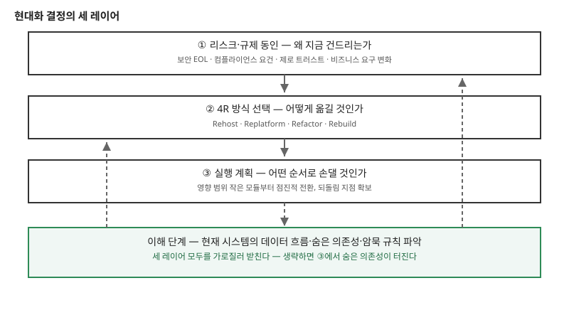

## 왜 지금 이 판단이 필요한가

"레거시 시스템, 이번 기회에 통째로 새로 지어주세요. 어차피 손댈 거면 제대로 하죠"라는 요구는 임원 보고 자리에서 흔히 나온다. 그런데 이 요구를 "교체냐 보수냐"의 기술 선택으로만 받으면 절반을 놓친다. 최근 업계 흐름은 현대화를 기술부채 해소의 문제에서 리스크 관리의 문제로 옮기고 있다. 컴플라이언스를 설계 단계부터 넣어야 한다는 "Compliance-by-Design"이 요구사항이 되고, 아이덴티티 중심 제로 트러스트가 기본 전제가 되면서, "지금 이 시스템을 그대로 두는 것 자체가 감수해야 할 리스크"라는 프레임이 힘을 얻고 있다. 동시에 AI 가속 코드 전환이 늘면서 현대화 투자의 상당 부분이 자동 변환 도구로 옮겨가고 있다는 점도 판단을 복잡하게 만든다.

이 상황에서 "빅뱅으로 통째로 바꾸자"는 결정은 업계 다수 사례에서 실패 확률이 높다고 지적된다. 문제는 바꾸는 방식 하나를 고르기 전에 "이 시스템이 지금 정확히 어떻게 동작하는가"를 이해하는 단계를 건너뛰는 데 있다. 리호스트든 리팩터든 리빌드든, 모든 접근법의 공통 전제는 현재 시스템을 정확히 파악하는 것이고, 이 이해 단계가 현대화 성공의 핵심 변수로 꼽힌다. 요구사항을 "뭘로 바꿀까"가 아니라 "지금 이 리스크를 어떤 속도로, 어떤 범위로 줄일까"로 먼저 번역해야 하는 이유다.

## 전체 시스템에서의 위치

현대화 결정은 하나의 레이어가 아니라 세 겹의 판단이 쌓인 결과다. 맨 위에는 "이 시스템을 왜 지금 건드리는가"라는 리스크·규제 동인이 있고, 중간에는 "어떤 방식으로 옮길 것인가"라는 4R(Rehost·Replatform·Refactor·Rebuild) 선택이 있고, 맨 아래에는 "실제로 어떤 순서로 손댈 것인가"라는 실행 계획이 있다. 많은 팀이 중간 레이어(4R 선택)부터 시작하는데, 맨 위 동인을 먼저 명확히 하지 않으면 4R 선택 자체가 흔들린다 — 보안 패치가 더는 안 나오는 시스템을 리스크 때문에 옮기는 것과, 단순히 느려서 옮기는 것은 허용 가능한 중단 시간과 예산이 완전히 다르다.



그림에서 보듯 이해 단계(현재 시스템 파악)는 세 레이어 중 어디에도 속하지 않고 그 아래를 가로질러 받친다. 동인을 정했어도, 4R을 골랐어도, 이해가 부족하면 실행 계획 단계에서 숨어 있던 의존성이 튀어나와 일정과 예산이 깨진다. 현대화를 "교체 프로젝트"가 아니라 "리스크 동인 → 방식 선택 → 실행 계획"이 순서대로 검증되는 파이프라인으로 그려야, 어느 단계에서 판단이 틀렸는지를 나중에도 추적할 수 있다.

## 선택의 트레이드오프

| 방식(4R) | 속도 | 리스크 해소 폭 | 적합한 상황 |
|---|---|---|---|
| Rehost(들어올려 옮기기) | 빠름 | 좁음 — 인프라 리스크만 | 클라우드 이전이 급하고 코드 자체는 안정적인 경우 |
| Replatform(일부 교체) | 중간 | 중간 — 런타임·DB 리스크까지 | EOL 임박한 런타임·DB를 바꿔야 하는 경우 |
| Refactor(구조 개선) | 느림 | 넓음 — 설계 리스크까지 | 아키텍처 자체가 변경을 막고 있는 경우 |
| Rebuild(전면 재작성) | 매우 느림 | 가장 넓음, 단 신규 리스크 발생 | 비즈니스 요구가 근본적으로 달라진 경우 |

이 표를 "아래로 갈수록 좋다"로 읽으면 안 된다. Rebuild는 리스크 해소 폭이 가장 넓지만 그만큼 새로운 버그·새로운 운영 미숙련이라는 리스크를 새로 만든다. 반대로 Rehost는 빠르지만 애초에 문제였던 아키텍처·코드 품질 리스크는 그대로 들고 간다. 올바른 질문은 "어느 방식이 가장 좋은가"가 아니라 "지금 해소해야 하는 리스크가 인프라·런타임·설계·비즈니스 요구 중 어디에 있는가"이고, 그 답이 표의 행을 정해준다.

## 실제 프로젝트 진행 순서

가장 먼저 할 일은 "왜 지금"을 리스크 언어로 적는 것이다. "느려서", "불편해서"가 아니라 "이 버전은 N개월 뒤 보안 지원이 끊긴다", "이 인증 방식은 신규 규제 요건을 못 맞춘다"처럼 구체적인 동인을 문서로 남겨야, 뒤에 나올 4R 선택과 예산 확보 근거가 같이 선다.

```text
현대화 동인 체크리스트 예시
- 보안: 사용 중인 프레임워크 EOL 시점, 대체 불가능한 CVE 존재 여부
- 규제: 신규 컴플라이언스 요건이 요구하는 아이덴티티·감사 로그 수준
- 운영: 변경 한 번에 걸리는 평균 리드타임, 장애 시 복구 소요
- 비즈니스: 현재 아키텍처로 처리 불가능한 신규 요구사항 존재 여부
```

그다음 이해 단계로 넘어간다. 현재 시스템의 데이터 흐름, 숨은 의존성, 암묵적 비즈니스 규칙을 코드 정적 분석과 실제 운영 로그로 함께 추적한다. 이 단계를 생략하고 바로 Rebuild로 넘어가면, 아무도 문서화하지 않은 예외 처리 로직이 새 시스템에서 빠져 운영 중에야 발견되는 사고가 난다. 이해가 끝난 뒤에야 4R 중 하나를 고르고, 고른 방식 안에서도 영향 범위가 가장 작은 모듈부터 점진적으로 옮기며 각 단계마다 되돌릴 수 있는 지점을 남겨 둔다.

## 마무리 요약

- 레거시 현대화는 기술부채 해소가 아니라 보안·규제 리스크를 관리하는 결정으로 바뀌었고, 빅뱅 교체는 다수 사례에서 실패 확률이 높다.
- 4R(Rehost·Replatform·Refactor·Rebuild) 중 무엇을 고를지는 "어느 방식이 좋은가"가 아니라 "지금 리스크가 어느 레이어에 있는가"로 정해야 한다.
- 진행 순서는 리스크 동인을 문서화 → 현재 시스템 이해 단계 → 4R 선택 → 영향 범위 작은 모듈부터 점진적 전환 → 각 단계 되돌림 지점 확보다.

## 참고 자료

- [AWS — 6 R's of application migration strategies](https://aws.amazon.com/blogs/enterprise-strategy/6-strategies-for-migrating-applications-to-the-cloud/)
- [Thoughtworks — Legacy displacement and modernization approaches](https://www.thoughtworks.com/insights/topic/legacy-modernization)
- [NIST — Zero Trust Architecture (SP 800-207)](https://csrc.nist.gov/pubs/sp/800/207/final)
