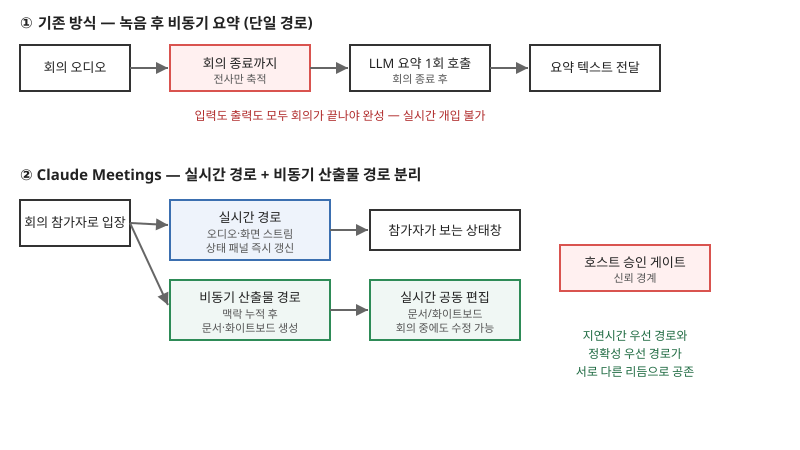

## 왜 지금 이 판단이 필요한가

"회의 끝나고 요약 보내주세요" 정도의 요구는 이미 익숙하다. 녹음을 떠서 끝난 뒤 LLM에 넘기면 되는, 완전히 비동기적인 문제였기 때문이다. 그런데 최근 들어오는 요구는 결이 다르다. "회의에 에이전트를 아예 참석시켜서, 끝날 때까지 기다리지 말고 그 자리에서 결정된 내용을 문서로 정리하고, 논의 중인 구조는 화이트보드에 바로 그려주세요"라는 식이다. 이 말을 그대로 받으면 "녹음 봇에 생성 기능을 얹으면 되겠지"로 끝나기 쉽지만, 실제로는 완전히 다른 문제다. 회의는 끝나지 않은 채로 계속 흘러가고, 에이전트는 그 흐름을 실시간으로 따라가면서 동시에 사람이 바로 보고 고칠 수 있는 산출물을 만들어내야 한다.

Anthropic이 2026년 11월 12일 Team·Enterprise 플랜에 베타로 연 Claude Meetings는 이 요구를 정면으로 겨냥한 제품이다. Google Calendar에 연결한 뒤 회의를 고르고 "Add Claude"를 누르면 에이전트가 Google Meet에 실제 참가자로 들어간다. 호스트가 승인하면 입장하고, 입장하는 순간 Meet 채팅에 알림을 남기며 해당 회의와 연결된 claude.ai 페이지 링크를 공유한다. 회의 참가자들은 실시간 상태 패널로 에이전트가 지금 뭘 하고 있는지 보고, 에이전트가 만들어가는 노트·문서·화이트보드를 그 자리에서 같이 편집할 수 있다. 중요한 건 기능 목록이 아니라, 이 제품이 "녹음해서 나중에 요약" 모델과 아키텍처 자체가 다르다는 점이다.

## 전체 시스템에서의 위치

기존 회의 봇은 오디오 스트림을 받아 전사(transcription)하고, 회의가 끝나면 그 텍스트 전체를 한 번에 LLM에 넣어 요약을 뽑는 단일 파이프라인이었다. 입력(오디오)과 출력(요약 텍스트)이 모두 회의가 끝난 뒤에나 완성되는 구조다. Claude Meetings는 이 파이프라인을 두 갈래로 쪼갠다. 하나는 실시간 경로로, 음성·화면 공유를 계속 받아 "지금 무슨 얘기가 오가는지"를 추적하며 상태 패널을 갱신한다. 다른 하나는 비동기 산출물 경로로, 실시간 경로가 축적한 맥락을 바탕으로 문서·화이트보드 같은 구조화된 산출물을 생성하고, 그 산출물은 사람이 보는 순간에도 계속 바뀔 수 있는 편집 가능한 상태로 유지된다.



이 분리가 왜 중요한가. 실시간 경로는 지연시간이 생명이다 — 상태 패널이 몇 초씩 늦으면 참가자는 에이전트를 신뢰하지 않는다. 반면 산출물 경로는 정확성이 생명이다 — 방금 나온 말 한 마디에 조급하게 반응해서 문서를 고쳤다가 다시 고치는 것보다, 맥락이 충분히 쌓인 뒤 안정적으로 갱신하는 편이 낫다. 두 경로의 목표 자체가 상충하기 때문에, 하나의 모델 호출로 "실시간성"과 "정확성"을 동시에 만족시키려 하면 둘 다 어중간해진다. Claude Meetings가 보여주는 설계는 이 둘을 애초에 다른 리듬으로 도는 별도 프로세스로 둔다는 점이다.

## 선택의 트레이드오프

| 접근 | 참가자에게 보이는가 | 산출물 편집 | 데이터 거버넌스 | 적합한 상황 |
|---|---|---|---|---|
| 녹음 후 비동기 요약 | 보이지 않음(녹음 봇만 표시) | 회의 종료 후 한 번 | 녹음 파일 보관 정책만 관리 | 요약만 필요하고 실시간 개입이 불필요한 경우 |
| Claude Meetings(관리형) | 참가자로 표시, 승인 필요 | 회의 중 실시간 공동 편집 | ZDR·HIPAA·CMEK 조직은 현재 미지원 | Google Meet 기반이고 규제 제약이 없는 팀 |
| 자체 구축(Meet API + STT + 자체 LLM 파이프라인) | 설계하는 대로 조정 가능 | 설계하는 대로 조정 가능 | 자체 데이터 보존·암호화 정책 적용 가능 | 규제 산업, 멀티 플랫폼(Teams·Zoom 포함) 요구 |

관리형 서비스를 쓰면 호스트 승인이라는 신뢰 경계가 기본으로 들어오고, 참가자 전원이 "지금 에이전트가 떠 있다"는 사실을 눈으로 확인할 수 있다는 점에서 투명성이 높다. 하지만 지금 베타 단계에서는 Google Meet만 지원하고, ZDR(제로 데이터 리텐션)·HIPAA 대응·CMEK(고객관리형 암호화 키)를 쓰는 조직에는 아직 열려 있지 않다. 규제가 걸린 산업이거나 Microsoft Teams·Zoom까지 커버해야 한다면, 자체 구축 경로로 가야 한다는 뜻이다. 다만 자체 구축은 "회의에 보이는 참가자로 들어가게 할 것인가, 조용히 전사만 할 것인가"부터 다시 설계해야 하는 부담을 그대로 떠안는다.

## 실제 프로젝트 진행 순서

가장 먼저 정해야 할 것은 "이 조직에서 회의에 들어오는 에이전트를 사람들이 신뢰할 수 있는 조건이 무엇인가"다. 호스트만 승인하면 되는지, 아니면 회의 시작 시점에 전원 동의를 구해야 하는지는 기술 설계보다 먼저 조직 차원에서 합의돼야 한다. 이 합의 없이 기능부터 켜면, 산출물의 품질과 무관하게 "누가 내 발언을 기록하고 있는지 모르겠다"는 신뢰 문제로 거부당한다.

```text
# 도입 전 점검 체크리스트(개념적 정리)
1. 조직 데이터 정책: ZDR/HIPAA/CMEK 요구가 있는가 → 있으면 관리형 베타는 보류
2. 플랫폼 범위: Google Meet만으로 충분한가, Teams/Zoom도 필요한가
3. 신뢰 모델: 호스트 승인만으로 충분한가, 전원 고지가 필요한가
4. 파일럿 범위: 낮은 위험도의 내부 회의부터 시작 (고객 미팅 제외)
5. 산출물 소유권: 에이전트가 만든 문서의 최종 편집 권한은 누구에게 있는가
```

점검이 끝나면 위험도가 낮은 내부 회의부터 파일럿을 돌려야 한다. 고객이 참석하는 회의나 민감한 인사·법무 논의에 바로 투입하면, 신뢰 모델이 아직 검증되지 않은 상태에서 가장 손실이 큰 실패를 맞을 수 있다. 파일럿에서 확인할 것은 산출물의 정확도만이 아니라, 참가자들이 실시간 상태 패널을 보고 "지금 이 내용을 기록해도 되는지" 스스로 판단할 수 있었는지, 그리고 에이전트가 만든 문서를 누가 최종적으로 손봤는지에 대한 책임 소재가 명확했는지다.

## 마무리 요약

- Claude Meetings는 회의 봇을 "녹음 후 비동기 요약"에서 "실시간 참가자 + 비동기 산출물 생성"으로 아키텍처 자체를 바꾼다.
- 실시간 경로(지연시간 중심)와 산출물 경로(정확성 중심)는 목표가 상충하므로, 하나의 호출로 합치지 않고 별도 리듬으로 분리해야 한다.
- 도입 전에는 기능보다 조직의 신뢰 모델(승인·고지)과 데이터 거버넌스 제약(ZDR·HIPAA·CMEK)부터 확정하고, 위험도 낮은 내부 회의로 파일럿을 시작해야 한다.

## 참고 자료

- [Anthropic — Claude Meetings](https://www.anthropic.com/news/claude-meetings)
- [Claude Help Center — Claude Meetings beta](https://support.claude.com)
- [Google Workspace — Meet add-ons and bots](https://workspace.google.com/)
