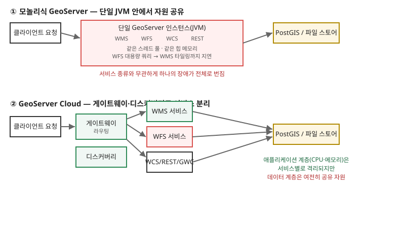

## 왜 지금 이 판단이 필요한가

"지도는 평소엔 잘 돌아가는데, 가끔 누가 큰 영역을 WFS로 통째로 다운로드하면 그 순간 다른 사용자들 지도 타일 로딩까지 같이 멈춰요"라는 보고는 GeoServer를 서비스용으로 운영해본 팀이라면 한 번쯤 듣는다. 이 말을 그대로 받으면 "서버 스펙을 올리면 되겠지"로 끝나기 쉽지만, 근본 원인은 스펙이 아니라 구조에 있다. 전통적인 GeoServer는 WMS·WFS·WCS·WPS·REST·GWC·관리 UI가 모두 하나의 JVM 프로세스 안에서 스레드 풀과 메모리를 공유한다. 무거운 WFS 쿼리 하나가 커넥션 풀과 메모리를 오래 붙잡고 있으면, 같은 프로세스 안의 WMS 타일 요청도 같이 대기열에 밀린다. 서비스 종류가 다르다고 해서 자원이 분리되지 않는다.

2026년 6월 11일, 17년 만의 전면 개편으로 나온 GeoServer 3.0은 이 구조 자체를 다시 짤 수 있는 선택지를 공식화했다. GeoTools 35.0·GeoWebCache 2.0.0을 품은 이 메이저 버전과 짝을 이루는 GeoServer Cloud는 Spring Boot·Spring Cloud 기반으로 WMS·WFS·WCS·WPS·REST·GWC·웹 UI를 각각 독립적으로 배포·확장 가능한 마이크로서비스로 쪼갠다. 다만 이건 "더 빠른 GeoServer"가 아니라 "운영 복잡도를 더 주고 장애 범위를 좁히는" 트레이드다. 이 글은 그 트레이드를 언제 받아들여야 하는지를 다룬다.

## 전체 시스템에서의 위치

지도 요청이 들어오는 경로를 보면 차이가 분명해진다. 모놀리식 GeoServer에서는 클라이언트 요청이 바로 단일 GeoServer 인스턴스(또는 그 앞의 단순 로드밸런서)로 가고, 거기서 서비스 종류와 무관하게 같은 요청 처리 스레드 풀과 같은 JVM 힙을 쓴다. GeoServer Cloud에서는 클라이언트 요청이 먼저 게이트웨이(3.0부터 Spring Cloud Gateway Server MVC)로 들어가고, 게이트웨이는 디스커버리 서비스(또는 쿠버네티스 환경이면 Kubernetes Service)를 통해 요청 종류에 맞는 개별 마이크로서비스로 라우팅한다. WFS 서비스가 메모리를 많이 먹어도 WMS 서비스의 자원 풀에는 손을 대지 않는다.



여기서 핵심은 "분리"가 끝이 아니라는 점이다. 각 마이크로서비스는 결국 같은 PostGIS·파일 스토어를 바라봐야 하므로, 데이터 계층 자체는 여전히 공유 자원이다. 즉 GeoServer Cloud가 격리하는 건 애플리케이션 계층의 CPU·메모리·스레드 풀이지, 데이터베이스 커넥션이나 디스크 I/O까지 자동으로 격리해주지는 않는다. WFS 서비스를 독립시켜도 그 WFS 서비스가 PostGIS 커넥션 풀을 고갈시키면 WMS 서비스의 쿼리도 여전히 영향을 받을 수 있다.

## 선택의 트레이드오프

| 구조 | 장애 격리 | 스케일링 단위 | 운영 복잡도 | 적합한 상황 |
|---|---|---|---|---|
| 모놀리식 GeoServer | 없음(서비스 전체 공유) | 인스턴스 전체 복제 | 낮음 — 단일 배포 단위 | 트래픽이 적거나 운영 인력이 1~2명인 팀 |
| 모놀리식 + 다중 인스턴스 로드밸런싱 | 인스턴스 단위 | 인스턴스 전체 복제 | 중간 | WMS 조회가 대부분이고 자원 낭비를 감수할 수 있는 경우 |
| GeoServer Cloud(도커 컴포즈) | 서비스 프로세스 단위 | 서비스별 독립 복제 | 중간~높음 — 게이트웨이·디스커버리 관리 | 서비스별 부하 패턴이 뚜렷이 다른 경우 |
| GeoServer Cloud(쿠버네티스) | 서비스·파드 단위 | 오토스케일링 가능 | 높음 — 클러스터 운영 역량 필요 | 트래픽 변동이 크고 이미 k8s를 운영 중인 조직 |

가장 흔한 실수는 트래픽이 많다는 이유만으로 바로 쿠버네티스 기반 GeoServer Cloud로 건너뛰는 것이다. 서비스별 부하 패턴이 실제로 다르다는 증거(예: WFS 요청의 평균 응답 시간과 메모리 사용량이 WMS보다 현저히 크다는 모니터링 데이터) 없이 구조부터 바꾸면, 늘어난 운영 복잡도(게이트웨이 설정, 디스커버리 서비스, 설정 서버, 서비스 간 네트워크)만 떠안고 실질적인 격리 효과는 못 본다. 반대로 WFS 대용량 다운로드와 WMS 실시간 타일링처럼 자원 요구 프로파일이 명확히 다른 서비스를 한 인스턴스에 묶어 둔 채 "스펙만 올리는" 선택을 반복하면, 같은 장애가 트래픽이 늘 때마다 재발한다.

## 실제 프로젝트 진행 순서

가장 먼저 할 일은 분리가 아니라 측정이다. 현재 모놀리식 인스턴스에서 서비스 종류별(WMS/WFS/WCS/REST/GWC)로 요청 수·응답 시간·메모리 점유 시간을 나눠서 모니터링하고, 실제로 어느 서비스가 다른 서비스를 밀어내는지부터 확인해야 한다. 이 데이터 없이 아키텍처 변경을 시작하면 투자 대비 효과를 판단할 기준 자체가 없다.

```text
# 전환 PoC 단계 (개념적 순서)
1. docker-compose로 GeoServer Cloud 최소 구성 실행
   - gateway, discovery, config, wms, wfs 서비스만 우선 분리
2. 기존 PostGIS/파일 스토어는 그대로 공유 자원으로 연결
3. 부하가 가장 컸던 서비스(보통 WFS)만 복제본을 늘려 부하 분산 확인
4. WMS 응답 지연이 WFS 부하와 무관해졌는지 비교 측정
5. 효과가 확인된 뒤에만 REST·GWC·WebUI까지 단계적으로 분리
6. 쿠버네티스 전환은 도커 컴포즈 단계에서 운영 패턴이 안정된 뒤에 검토
```

이 순서에서 중요한 것은 처음부터 모든 서비스를 다 쪼개지 않는다는 점이다. GeoServer Cloud 공식 문서도 서비스마다 성숙도가 다르다고 명시하므로, 가장 아픈 지점(대개 WFS와 WMS의 충돌)부터 분리하고 효과를 확인한 뒤 범위를 넓히는 편이 실패 비용을 줄인다. 그리고 분리 이후에도 PostGIS 커넥션 풀 크기는 서비스별로 재조정해야 한다 — 마이크로서비스로 쪼갰다고 자동으로 데이터베이스 자원까지 나뉘는 것은 아니기 때문이다.

## 마무리 요약

- 모놀리식 GeoServer는 WMS·WFS·WCS 등 모든 서비스가 같은 JVM 자원을 공유해, 한 서비스의 부하가 전체로 번진다.
- GeoServer Cloud는 게이트웨이·디스커버리를 거쳐 서비스별로 애플리케이션 계층 자원을 격리하지만, PostGIS 같은 데이터 계층은 여전히 공유 자원으로 남는다.
- 전환은 측정(서비스별 부하 데이터) → 가장 아픈 서비스부터 도커 컴포즈로 분리 → 효과 확인 후 범위 확대 → 쿠버네티스는 마지막 순서로 진행해야 운영 복잡도 대비 효과를 보장할 수 있다.

## 참고 자료

- [GeoServer 3.0.0 released](https://geoserver.org/announcements/vulnerability/2026/06/11/geoserver-3-0-0-released.html)
- [GeoServer Cloud — Developer guide](https://geoserver.org/geoserver-cloud/developer-guide/)
- [GeoServer Cloud — Kubernetes deployment](https://geoserver.org/geoserver-cloud/deploy/kubernetes/)
