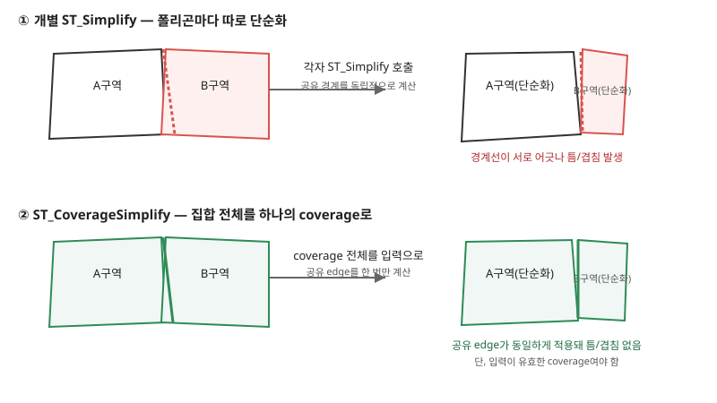

## 왜 지금 이 판단이 필요한가

"행정구역 경계 레이어 정점이 너무 많아서 지도가 느려요. 단순화해주세요. 근데 옆 동네랑 경계선에 틈이 생기거나 겹치면 안 돼요"라는 요구는 얼핏 모순처럼 들리지만 실무에서 거의 항상 같이 온다. 정점을 줄여야 렌더링이 빨라지는데, 폴리곤을 하나씩 따로 단순화하면 두 폴리곤이 공유하던 경계선이 각자 다른 결과로 깎여 나가 틈(gap)이나 겹침(overlap)이 생긴다. 지도에서는 몇 미터 차이라 눈에 잘 안 띄지만, 면적을 합산하거나 공간 조인을 거는 분석에서는 "구역 밖으로 샌 땅"이나 "두 구역 모두에 속한 땅"이 실제 오류로 드러난다.

기존에 흔히 쓰던 `ST_SimplifyPreserveTopology`는 이름과 달리 폴리곤 "각각의" 내부 토폴로지(자기 자신이 꼬이지 않는 것)만 보장할 뿐, 옆 폴리곤과의 "공유 경계" 일치는 보장하지 않는다. 이 틈을 메우기 위해 PostGIS 3.7(2026년 10월 29일 정식 출시, GEOS 3.15 이상에서 전체 기능 사용 가능)이 `ST_CoverageSimplify`·`ST_CoverageClean`·`ST_CoverageInvalidEdges` 같은 "coverage" 계열 함수를 들여왔다. 핵심 발상은 폴리곤을 개별 도형이 아니라, 서로 맞닿은 조각들의 집합(coverage)으로 보고 공유 경계선을 한 번만 계산해 모든 이웃에게 똑같이 적용하는 것이다.

## 전체 시스템에서의 위치

행정구역·필지·통계구역처럼 서로 맞닿아 영역을 빈틈없이 나누는 폴리곤 집합을 원본 데이터로 받으면, 보통 다음 순서로 웹 지도에 올라간다: 원본 고정밀 경계 적재 → 정점 단순화 → 벡터 타일 생성 → 클라이언트 렌더링. 기존 방식은 단순화 단계에서 폴리곤 테이블을 행 단위로 순회하며 `ST_Simplify`를 각각 호출했다. `ST_CoverageSimplify`는 이 단계를 "테이블 전체를 하나의 coverage로 보고 한 번에 단순화"하는 집합 연산으로 바꾼다.



여기서 중요한 전제가 하나 있다. coverage 함수들은 입력이 이미 "유효한 coverage"라는 것을 가정한다 — 즉 폴리곤들이 겹치지 않고, 공유 경계가 기하학적으로 정확히 일치해야 한다. 원본 데이터에 이미 미세한 gap이나 overlap이 있다면 `ST_CoverageSimplify`를 바로 돌려도 결과가 보장되지 않는다. 그래서 파이프라인에는 단순화 전에 `ST_CoverageInvalidEdges`로 기존 데이터가 유효한 coverage인지 먼저 검증하고, 문제가 있으면 `ST_CoverageClean`으로 정리하는 단계가 먼저 들어가야 한다.

## 선택의 트레이드오프

| 방식 | 공유 경계 일치 | 전제 조건 | 연산 단위 | 적합한 상황 |
|---|---|---|---|---|
| ST_Simplify(개별 호출) | 보장 안 됨 | 없음 | 폴리곤 1개씩 | 폴리곤끼리 맞닿아 있지 않거나 틈 허용 가능한 경우 |
| ST_SimplifyPreserveTopology | 보장 안 됨(자기 자신만 보장) | 없음 | 폴리곤 1개씩 | 자기교차만 막으면 되는 단일 폴리곤 작업 |
| ST_CoverageSimplify | 보장됨 | 입력이 유효한 coverage여야 함(GEOS 3.12+) | 테이블(coverage) 전체 | 행정구역·필지처럼 빈틈없이 맞닿은 폴리곤 집합 |
| PostGIS Topology 확장(완전 토폴로지 모델) | 보장됨 | 토폴로지 스키마 구축 필요 | 토폴로지 전체 | 편집·유지보수까지 토폴로지 일관성을 계속 지켜야 하는 경우 |

`ST_CoverageSimplify`는 완전한 토폴로지 모델(PostGIS Topology 확장)보다 훨씬 가볍다 — 별도 스키마나 edge·node 테이블을 만들 필요 없이, 기존 폴리곤 테이블에 함수 하나만 호출하면 된다. 다만 이 가벼움은 "한 번 단순화하고 끝"이라는 전제에서 나온다. 편집이 계속 일어나는 운영 데이터(사용자가 수시로 구역 경계를 수정하는 경우)라면, 매번 전체 coverage를 다시 단순화하는 것보다 PostGIS Topology로 토폴로지 자체를 유지하는 편이 장기적으로 안전하다. 반대로 분기마다 한 번 받아오는 행정구역 같은 정적 데이터라면 coverage 함수로 충분하다.

## 실제 프로젝트 진행 순서

가장 먼저 할 일은 GEOS 버전 확인이다. `ST_CoverageSimplify`·`ST_CoverageInvalidEdges`는 GEOS 3.12 이상, `ST_CoverageClean`은 3.14 이상, `ST_CoverageEdges`의 전체 기능은 3.15 이상을 요구한다. PostGIS 3.7을 설치했다고 해서 자동으로 GEOS가 그 버전까지 올라가 있는 게 아니므로, `SELECT postgis_geos_version();`으로 먼저 확인해야 한다.

```sql
-- 1) 기존 데이터가 유효한 coverage인지 먼저 검증
SELECT ST_CoverageInvalidEdges(geom) OVER ()
FROM admin_boundary;

-- 2) 문제가 있으면 정리
UPDATE admin_boundary b
SET geom = c.geom
FROM (
  SELECT id, ST_CoverageClean(geom) OVER () AS geom
  FROM admin_boundary
) c
WHERE b.id = c.id;

-- 3) 단순화 (허용 오차는 미터 단위, 좌표계에 맞게 조정)
SELECT id, ST_CoverageSimplify(geom, 10.0) OVER () AS simplified_geom
FROM admin_boundary;
```

단순화 허용 오차는 한 번에 크게 잡지 말고, 작은 값부터 시작해 렌더링 품질과 파일 크기를 비교하며 올려야 한다. 그리고 단순화 결과를 타일링 파이프라인에 넣기 전에 반드시 `ST_CoverageInvalidEdges`로 재검증해, 단순화 이후에도 coverage가 깨지지 않았는지 확인하는 단계를 파이프라인에 고정해야 한다.

## 마무리 요약

- 폴리곤을 개별로 단순화하면 공유 경계선이 각자 다르게 깎여 인접 구역 사이에 틈이나 겹침이 생긴다.
- `ST_CoverageSimplify`는 폴리곤 집합을 하나의 coverage로 보고 공유 edge를 한 번만 계산해 이 문제를 구조적으로 막지만, 입력이 이미 유효한 coverage여야 한다는 전제가 있다.
- 진행 순서는 GEOS 버전 확인 → `ST_CoverageInvalidEdges`로 기존 데이터 검증 → 필요 시 `ST_CoverageClean`으로 정리 → `ST_CoverageSimplify` 단순화 → 결과 재검증이다.

## 참고 자료

- [PostGIS 3.7.0 Release Notes](https://postgis.net/docs/manual-3.7/release_notes.html)
- [PostGIS — ST_CoverageSimplify](https://postgis.net/docs/manual-3.7/ST_CoverageSimplify.html)
- [PostGIS — ST_CoverageInvalidEdges](https://postgis.net/docs/manual-3.7/ST_CoverageInvalidEdges.html)
