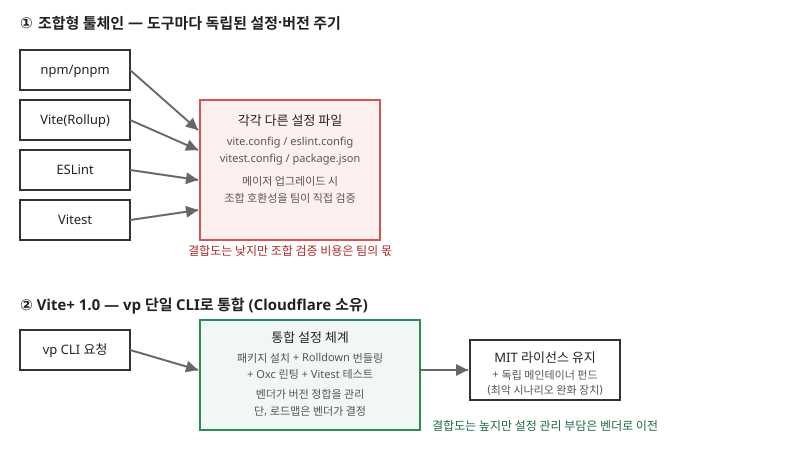

## 왜 지금 이 판단이 필요한가

"번들러는 Vite, 린트는 ESLint, 테스트는 Vitest, 패키지는 pnpm을 쓰는데, 메이저 업그레이드할 때마다 서로 호환되는 조합을 다시 맞추느라 하루씩 날아가요. 이거 하나로 묶어서 관리하게 해주세요"라는 요구는 프런트엔드 팀이 어느 정도 규모가 되면 반드시 나온다. 이 말을 그대로 받으면 "올인원 프레임워크 하나 고르면 되겠지"로 끝나기 쉽지만, 실제로는 도구 간 결합도를 어디까지 받아들일지를 정하는 아키텍처 판단이다. 조합형 툴체인은 각 도구를 독립적으로 교체할 수 있는 대신 조합의 조합 폭발을 팀이 떠안아야 하고, 통합 툴체인은 그 부담을 벤더에게 넘기는 대신 벤더의 로드맵에 종속된다.

2026년 6월 4일 Cloudflare가 Vite를 만든 VoidZero를 인수했고, 그 VoidZero가 쌓아온 Vite·Vitest·Rolldown(러스트 기반 번들러)·Oxc(러스트 기반 린터·파서 툴체인)를 하나의 CLI로 묶은 Vite+ 1.0이 2026년 9월 28일 정식 출시됐다. Vite 창시자 Evan You의 팀 전체가 Cloudflare의 Emerging Technology 조직으로 옮겨갔고, Cloudflare는 Vite·Vitest·Rolldown·Oxc·Vite+ 전부를 MIT 라이선스로 유지하겠다고 공식 발표했다. 숫자만 보면 매력적이다 — 주간 다운로드 1억 3천만 건을 넘는 생태계가 한 회사 아래 통합된 것이다. 하지만 "MIT 라이선스니까 안전하다"와 "지금 당장 갈아타도 된다"는 전혀 다른 질문이다.

## 전체 시스템에서의 위치

기존 빌드 파이프라인에서는 패키지 매니저(npm/pnpm)가 의존성을 설치하고, 번들러(Vite, 내부적으로 Rollup 또는 esbuild)가 개발 서버와 프로덕션 빌드를 맡고, 린터(ESLint)가 코드 품질을 걸러내고, 테스트 러너(Vitest)가 별도 설정 파일로 돈다. 각 도구는 독립된 패키지이자 독립된 설정 파일(vite.config, eslint.config, vitest.config)을 갖고, 서로 다른 메이저 버전 주기로 움직인다. Vite+는 이 네 역할을 `vp` 단일 CLI 아래로 모으고, 패키지 설치부터 린트·테스트·빌드까지 하나의 설정 체계로 묶는다.



여기서 주목할 지점은 번들러 내부가 Rollup에서 러스트 기반 Rolldown으로 바뀐다는 사실이다. 기존 Vite 플러그인 생태계는 수년간 Rollup의 JS 플러그인 API를 전제로 쌓였다. Rolldown이 Rollup API 호환을 목표로 하고는 있지만, 플러그인이 Rollup 내부 구현에 의존하는 경우(예: 특정 AST 변환 타이밍, 내부 캐시 접근)는 전환 과정에서 조용히 깨질 수 있다. 즉 Vite+ 도입은 "설정 파일 하나로 합치는" 표면적 변화가 아니라, 빌드 파이프라인 심장부의 엔진을 바꾸는 작업이라는 점을 먼저 인식해야 한다.

## 선택의 트레이드오프

| 구조 | 결합도 | 버전 관리 부담 | 벤더 종속 리스크 | 적합한 상황 |
|---|---|---|---|---|
| 조합형(Vite+ESLint+Vitest+pnpm 개별) | 낮음 — 도구별 독립 교체 가능 | 팀이 직접 조합 검증 | 낮음 — 도구별 대체재 존재 | 이미 안정된 조합을 쓰고 있고 전환 리스크를 피하려는 팀 |
| Vite+ 1.0(통합 툴체인) | 높음 — 한 벤더의 로드맵에 수렴 | Vite+ 쪽에서 통합 관리 | 중간 — MIT 라이선스지만 Cloudflare 로드맵에 종속 | 신규 프로젝트, 또는 버전 정합 피로가 생산성을 이미 깎아먹는 팀 |
| Vite+ 유료 플랜(스타트업/엔터프라이즈) | 높음 | 벤더 관리 + SLA | 높음 — 가격 정책 변경 리스크 | 지원 SLA와 로드맵 영향력이 필요한 조직 |

Cloudflare의 라이선스 약속과 100만 달러 독립 메인테이너 펀드는 "포크해도 생태계가 망하지 않는다"는 안전망을 제공하지만, 이는 최악의 경우를 완화하는 장치이지 전환 자체의 위험을 없애주지 않는다. 특히 Rolldown으로의 엔진 교체는 플러그인 생태계 전체가 아직 검증 중인 단계이므로, 커스텀 Vite 플러그인을 다수 쓰는 프로젝트일수록 신중해야 한다. 반대로 신규 프로젝트이거나 표준 플러그인만 쓰는 단순한 구성이라면, 버전 정합 피로를 줄이는 효과가 전환 리스크보다 클 수 있다.

## 실제 프로젝트 진행 순서

가장 먼저 할 일은 전면 전환이 아니라 격리된 환경에서의 호환성 검증이다. 기존 프로젝트를 그대로 둔 채, 별도 브랜치나 샌드박스 저장소에 `vite-plus`와 핵심 Vite 플러그인을 설치해보고 빌드·테스트가 깨지는 지점을 먼저 찾아야 한다.

```bash
# 격리 환경에서의 1차 호환성 검증 (개념적 절차)
npm install -D vite-plus @voidzero-dev/vite-plus-core
# package.json에 overrides로 vite/vitest 의존 패키지들을 vite-plus 버전으로 고정
# 기존 vite.config / vitest.config를 그대로 둔 채 vp build, vp test 실행
# 커스텀 플러그인 목록을 하나씩 비활성화하며 어느 플러그인에서 깨지는지 좁혀나가기
```

호환성이 확인되면 CI 파이프라인에 기존 도구 체인과 Vite+ 체인을 병행으로 돌려 빌드 산출물 크기·빌드 시간·테스트 결과를 비교해야 한다. 이 비교 없이 "더 빠르다더라"는 소문만으로 전환하면, 실제 이득이 없는데 플러그인 호환성 문제만 떠안을 수 있다. 병행 비교에서 유의미한 개선(빌드 시간 단축, 설정 관리 부담 감소)이 확인된 뒤에야 점진적으로 — 테스트 환경부터, 그다음 스테이징, 마지막에 프로덕션 빌드 파이프라인 순으로 — 전환 범위를 넓혀야 한다.

## 마무리 요약

- Vite+ 1.0은 번들러·패키지 매니저·린터·테스트 러너를 `vp` 단일 CLI로 통합하지만, 번들러 엔진 자체가 Rollup에서 Rolldown으로 바뀌는 심장부 교체를 동반한다.
- Cloudflare의 MIT 라이선스 유지 약속과 독립 메인테이너 펀드는 최악의 시나리오를 완화하는 안전망이지, 전환 리스크 자체를 없애주지 않는다.
- 전면 전환 전에 격리 환경에서 플러그인 호환성을 먼저 검증하고, CI에서 기존 체인과 병행 비교한 뒤 테스트 → 스테이징 → 프로덕션 순으로 범위를 넓혀야 한다.

## 참고 자료

- [VoidZero — Announcing Vite+](https://voidzero.dev/posts/announcing-vite-plus)
- [Cloudflare — Cloudflare Acquires VoidZero](https://www.cloudflare.com/press-releases/)
- [Vite+ — 공식 사이트](https://viteplus.dev/)
