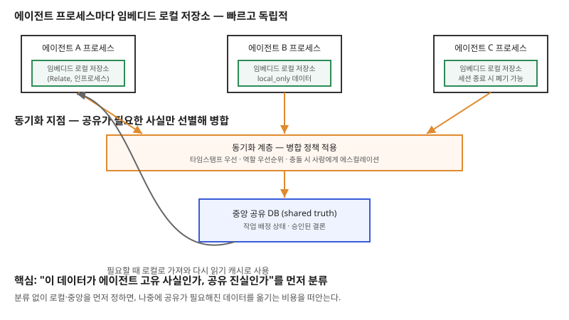

## 왜 지금 이 판단이 필요한가

"에이전트를 여러 개 띄워서 각자 맡은 영역을 처리하게 해주세요, 근데 매번 중앙 DB에 왕복하느라 느려지면 안 돼요"라는 요구를 받으면, 먼저 떠오르는 해법은 "상태를 에이전트 프로세스 안에 들고 있게 하자"다. 네트워크 왕복이 없으니 빠르고, 서버 운영 부담도 없다. 그런데 곧바로 다음 요구가 따라붙는다 — "근데 에이전트 A가 알아낸 걸 에이전트 B도 알아야 하는 경우가 있어요." 이 순간 로컬 상태만으로는 풀리지 않는 문제가 생긴다. 상태를 어디에 둘지는 "서버 하나 더 둘까 말까"가 아니라, 무엇이 에이전트 고유의 사실이고 무엇이 여러 에이전트가 합의해야 하는 공유 진실(shared truth)인지를 먼저 나누는 설계 문제다.

2026년 11월 11일 Neo4j가 공개한 Relate는 이 구조를 제품으로 구체화한 사례다. Rust로 작성된 오픈소스(Apache 2.0) 인프로세스 임베디드 그래프 DB로, 서버를 따로 띄울 필요 없이 Python·JavaScript·Rust·Java·Go·Swift 등에서 라이브러리처럼 바로 붙여 쓴다. 인메모리 엔진에 내구성이 필요하면 WAL(쓰기 전 로그)을 옵션으로 켤 수 있고, openCypher를 지원하며 MCP 서버(`relate serve`)로 에이전트 하네스가 바로 붙을 수 있게 했다. 동시에 Bolt·HTTP Query API를 노출해 서브그래프를 Neo4j Aura 같은 중앙 서비스와 주고받을 수 있다는 점이 핵심이다 — 로컬 임베디드와 중앙 공유를 완전히 분리된 세계가 아니라, 필요할 때 연결할 수 있는 두 계층으로 설계했다.

## 전체 시스템에서의 위치

에이전트 로컬 저장소는 에이전트 프로세스 안, 즉 "이 에이전트가 이번 작업에서만 필요한 상태"가 사는 자리다. 작업 중 쌓이는 중간 추론, 이번 세션에서만 유효한 캐시, 아직 다른 에이전트와 공유할 필요가 없는 가설이 여기 머문다. 반대로 중앙 공유 DB는 "여러 에이전트, 또는 여러 세션에 걸쳐 같은 값을 봐야 하는 사실"이 사는 자리다. 고객 정보, 작업 배정 상태, 이미 합의된 결론처럼 한쪽이 바꾸면 다른 쪽도 반드시 알아야 하는 데이터다.



그림에서 보듯 두 계층 사이에는 반드시 동기화 지점이 있어야 한다. 이 지점이 없으면 로컬 저장소는 그냥 "서로 다른 세상을 사는 여러 개의 섬"이 되고, 에이전트 B는 에이전트 A가 이미 알아낸 사실을 다시 처음부터 알아내야 한다. Relate가 Aura와의 서브그래프 이동을 1급 기능으로 넣은 이유도 여기에 있다 — 로컬에서 빠르게 작업하다가, 공유가 필요한 부분집합만 골라 중앙으로 밀어 올리는 경로를 제품 차원에서 보장한 것이다.

## 선택의 트레이드오프

| 방식 | 지연·비용 | 일관성 보장 | 적합한 상황 |
|---|---|---|---|
| 임베디드 로컬 저장소만 | 매우 낮음, 서버 운영 無 | 없음 — 에이전트별로 각자 진실 | 에이전트가 완전히 독립된 영역을 맡고 결과만 나중에 합치면 되는 경우 |
| 중앙 공유 DB만 | 네트워크 왕복만큼 높음 | 강함 — 단일 진실 소스 | 여러 에이전트가 실시간으로 같은 상태를 두고 경쟁·협업해야 하는 경우 |
| 로컬 우선 + 주기적 동기화 | 평상시 낮음, 동기화 시점만 높음 | 최종 일관성(eventual) | 공유가 "결과 단계"에만 필요하고 작업 중에는 독립적인 경우 |
| 로컬 캐시 + 중앙 쓰기 강제 | 읽기는 빠름, 쓰기는 느림 | 쓰기 기준 강함, 읽기는 지연 가능 | 쓰기 충돌 비용이 크고 읽기는 약간 오래된 값이어도 되는 경우 |

네 가지 중 무엇을 고르든 진짜 어려운 부분은 기술 선택이 아니라 "병합 정책"이다. 로컬에서 각자 돌던 에이전트 A와 B가 같은 대상에 대해 서로 다른 결론을 들고 중앙으로 올라오면, 누구 결론이 이기는지를 미리 정해 두지 않으면 병합 시점에 조용히 데이터가 덮어써진다. 타임스탬프 기준 최신 우선, 명시적 우선순위(특정 에이전트 역할이 항상 이김), 충돌 시 사람에게 넘기는 방식 중 하나를 데이터 종류별로 미리 정해야 한다. 그리고 로컬 저장소에 내구성(WAL)을 켤지 말지도 트레이드오프다 — 꺼두면 더 빠르지만 프로세스가 죽는 순간 로컬 상태는 통째로 사라지므로, 그 상태가 다시 만들어도 되는 중간 캐시인지 잃으면 곤란한 진행 상황인지를 먼저 구분해야 한다.

## 실제 프로젝트 진행 순서

가장 먼저 할 일은 코드를 짜는 것이 아니라, 에이전트가 다루는 데이터를 "이 에이전트만 알면 되는 것"과 "다른 에이전트도 알아야 하는 것" 두 칸으로 분류하는 것이다. 이 분류 없이 로컬이든 중앙이든 먼저 정하면, 나중에 공유가 필요해진 데이터를 옮기는 마이그레이션 비용을 떠안는다.

```text
# 데이터 분류 예시 (개념적 표현)
local_only:
  - 현재 작업의 중간 추론 체인
  - 이번 세션에서만 쓰는 캐시된 조회 결과
shared_truth:
  - 작업 배정 상태 (어느 에이전트가 무엇을 맡았는가)
  - 이미 사람이 승인한 결론
sync_policy:
  shared_truth: "쓰기는 항상 중앙 DB에, 로컬은 읽기 캐시로만"
  local_only: "세션 종료 시 폐기, 영속 불필요"
```

둘째로, 공유가 필요한 데이터부터 먼저 중앙 DB에 쓰기를 강제하고, 로컬에는 그 값의 캐시만 두는 가장 보수적인 구조로 시작해야 한다. 처음부터 로컬 우선 동기화를 설계하면 병합 충돌 로직까지 한 번에 검증해야 해서 실패 지점을 좁히기 어렵다. 셋째로, 로컬 저장소의 내구성 여부를 데이터 종류별로 명시하고, 프로세스가 죽는 시나리오를 실제로 재현해 "잃어도 되는 상태"가 정말 잃어도 괜찮은지 검증해야 한다. 마지막으로, 병합 정책을 실제 충돌 시나리오(두 에이전트가 같은 레코드를 동시에 수정)로 미리 테스트해, 조용히 덮어써지는 경우가 없는지 확인한 뒤에야 로컬 우선 구조로 확장해야 한다.

## 마무리 요약

- 에이전트 로컬 저장소와 중앙 공유 DB를 가르는 기준은 "이 데이터가 에이전트 고유의 사실인가, 여러 에이전트가 합의해야 하는 공유 진실인가"다.
- 임베디드 로컬 저장소는 지연과 운영 비용을 없애지만, 동기화 지점과 병합 정책 없이는 에이전트마다 다른 진실을 들고 사는 섬이 된다.
- 진행 순서는 로컬/공유 데이터 분류 → 공유 데이터부터 중앙 쓰기 강제로 보수적 시작 → 내구성 여부 검증 → 병합 충돌 시나리오 테스트 후 로컬 우선 확장 순이다.

## 참고 자료

- [Neo4j — Meet Relate: An Embedded Database for AI Agents](https://neo4j.com/blog/agentic-ai/meet-relate-by-neo4j-an-embedded-database-for-ai-agents/)
- [relatedb.ai](https://relatedb.ai/)
- [Blocks and Files — Neo4j's rusty in-memory AI agent graph database](https://www.blocksandfiles.com/ai-ml/2026/11/13/neo4js-rusty-in-memory-ai-agent-graph-database/)
