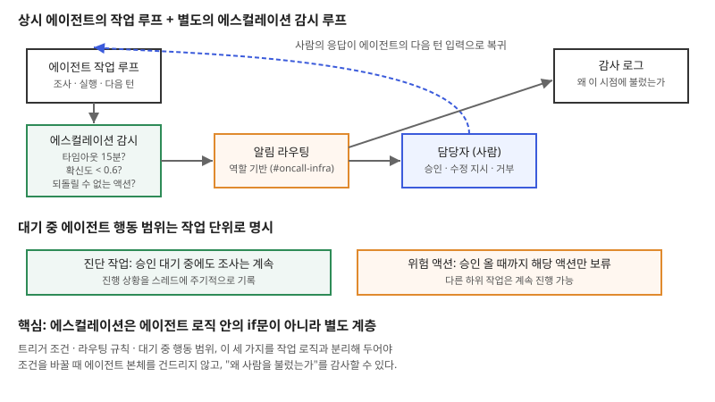

## 왜 지금 이 판단이 필요한가

"에이전트를 상시로 띄워서 며칠씩 알아서 일하게 해주세요"라는 요구를 받으면, 대부분은 먼저 작업을 자동화하는 쪽에 집중한다. 어떤 도구를 쓰게 할지, 얼마나 긴 컨텍스트를 들고 다니게 할지, 비용을 어떻게 통제할지를 설계하고 나면 일이 끝난 것처럼 보인다. 하지만 곧바로 다음 요구가 따라온다 — "근데 막히면 누군가는 알아야죠." 이 한 문장은 전혀 다른 설계 문제를 연다. 에이전트가 스스로 판단할 수 없는 지점에서 멈춰 사람을 기다릴지, 틀렸을 수도 있는 판단으로 그냥 밀고 나갈지는 모델 성능의 문제가 아니라, 애초에 "막혔다"를 누가 어떻게 감지하고 누구에게 어떤 채널로 넘길지를 미리 정해 두지 않으면 둘 다 사고로 끝난다는 구조적 문제다.

2026년 11월 초 Perplexity가 공개한 Teammates는 이 문제를 실제 제품 설계로 드러낸 사례다. Max 구독자를 대상으로 웹에서 먼저 열렸고, 사용자가 쓰던 Computer 환경의 프로젝트·스킬·플러그인·메모리·권한을 그대로 물려받아 격리된 데스크톱·브라우저 세션에서 독립적으로 돈다. 사이드바에는 팀메이트별로 하나의 영속 스레드가 남아, 여러 번의 실행에 걸친 활동과 맥락을 사람이 나중에 돌아가 확인할 수 있다. 공개 데모에서 눈에 띄는 설계는 온콜(on-call) 에이전트였다 — 장애 원인을 15분 안에 좁히지 못하거나, 제안한 수정이 승인이 필요한 수준이면 Slack으로 담당자를 직접 호출한다. "15분"이라는 구체적인 숫자 자체보다, 이 숫자가 코드 어딘가에 하드코딩된 타임아웃이 아니라 조직이 합의한 SLA라는 점이 빌더에게 중요하다.

## 전체 시스템에서의 위치

에스컬레이션은 에이전트 런타임과 사람 사이에 끼어드는 별도의 계층이지, 에이전트 로직 안에 섞여 들어가는 if문이 아니다. 요청이 들어오면 에이전트가 작업을 수행하다가, 진행 중 계속 "지금 이 상태를 사람에게 넘겨야 하는가"를 판단하는 감시 루프가 따로 돈다. 이 판단이 참이 되는 순간 알림 채널(Slack 멘션, 티켓 생성, 페이저)로 담당자에게 넘어가고, 사람의 응답(승인·수정 지시·거부)이 다시 에이전트의 다음 턴 입력으로 돌아온다. 이 경로를 작업 로직과 분리해 두지 않으면, 에스컬레이션 조건을 바꿀 때마다 에이전트 본체 코드를 건드려야 하고, 무엇보다 "왜 이 시점에 사람을 불렀는가"를 감사(audit)할 기록이 에이전트의 추론 로그 속에 묻혀 버린다.



그림에서 보듯 에스컬레이션 계층은 세 가지 정보를 함께 들고 있어야 제 역할을 한다. 첫째는 트리거 조건(시간 초과, 신뢰도 임계값 미달, 되돌릴 수 없는 액션 직전), 둘째는 라우팅 규칙(이 작업 종류는 누구에게 가는가), 셋째는 응답 대기 중 에이전트가 할 일(완전히 정지할지, 다른 하위 작업을 계속할지)이다. Teammates의 온콜 데모는 이 세 가지를 전부 제품 차원에서 기본값으로 내장했다는 점에서, 직접 구축하는 쪽이 반드시 처음부터 다시 설계해야 하는 체크리스트를 보여준다.

## 선택의 트레이드오프

| 에스컬레이션 방식 | 감지 기준 | 사람의 부담 | 적합한 상황 |
|---|---|---|---|
| 타임아웃 기반 (N분 안에 해결 못 하면 호출) | 단순, 예측 가능 | 중간 — 거짓 호출 가능 | 원인 진단처럼 "끝났는지"가 명확한 작업 |
| 신뢰도/확신도 기반 (판단에 자신 없으면 호출) | 모델이 자체 보고하는 확신도에 의존 | 낮음 — 과소·과대평가 위험 | 모델이 확신도 추정을 비교적 안정적으로 내는 작업 |
| 액션 위험도 기반 (되돌릴 수 없는 액션 직전 항상 호출) | 액션 종류로 판별, 모델 판단 불필요 | 높음 — 매번 승인 대기 | 환불·배포·권한 변경처럼 실수 비용이 큰 액션 |
| 사람이 능동적으로 들여다봄 (풀 방식, 호출 없음) | 없음 — 사람이 스레드를 직접 확인 | 낮음(평상시) ↔ 매우 높음(사고 시) | 실수 비용이 낮고 지연이 괜찮은 백그라운드 작업 |

네 가지는 서로 배타적이지 않고, 작업의 성격에 따라 겹쳐 쓰는 것이 실무에서는 정상이다. 온콜처럼 시간이 생명인 작업은 타임아웃 기반이 기본값이 되어야 하고, 환불 승인처럼 되돌릴 수 없는 액션은 확신도와 무관하게 액션 위험도 기준으로 항상 호출해야 한다. 반대로 신뢰도 기반만 단독으로 쓰면 위험하다 — 모델은 틀린 답에도 높은 확신도를 보고하는 경우가 드물지 않고, 이 과신을 걸러줄 장치가 없으면 가장 조용히 사고가 난다. 그리고 어떤 방식을 고르든 "호출이 너무 잦으면 담당자가 알림을 무시하기 시작한다"는 알림 피로(alert fatigue) 문제는 똑같이 따라온다. 침묵하는 실패보다는 잦은 호출이 낫다는 원칙으로 시작하되, 호출 빈도를 주기적으로 리뷰해서 임계값을 조정하는 과정을 처음부터 설계에 넣어야 한다.

## 실제 프로젝트 진행 순서

가장 먼저 할 일은 코드를 짜는 것이 아니라, 에이전트가 맡을 작업 유형별로 "무엇이 생기면 반드시 사람에게 넘겨야 하는가"를 목록으로 뽑는 것이다. 이 목록 없이 에스컬레이션 로직부터 짜면, 나중에 라우팅 규칙을 바꿀 때마다 에이전트 코드를 또 건드리게 된다.

```yaml
# 에스컬레이션 정책 예시 (개념적 표현)
escalation_policy:
  - trigger: timeout
    condition: "root_cause_not_isolated_within: 15m"
    route_to: "#oncall-infra"
    agent_behavior: "계속 조사하되 진행 상황을 스레드에 매분 기록"
  - trigger: action_risk
    condition: "action in [refund_over_100usd, prod_deploy, permission_change]"
    route_to: "owner_of(resource)"
    agent_behavior: "승인 응답 올 때까지 해당 액션만 보류, 다른 작업은 계속"
  - trigger: confidence
    condition: "self_reported_confidence < 0.6"
    route_to: "#review-queue"
    agent_behavior: "제안만 생성하고 실행은 하지 않음"
```

둘째로, 라우팅 대상을 사람 한 명으로 고정하지 말고 역할(온콜 로테이션, 리소스 소유자)로 추상화해야 한다. 담당자가 휴가를 가거나 팀을 옮기는 순간 라우팅이 깨지는 설계는 결국 아무도 못 받는 알림으로 썩는다. 셋째로, 사람이 응답하기 전까지 에이전트가 무엇을 계속해도 되는지를 작업 단위로 명시해야 한다 — 온콜 데모처럼 승인을 기다리는 동안에도 진단 자체는 계속할 수 있어야지, 전체 작업을 통째로 멈추면 "상시 에이전트"의 의미가 없어진다. 마지막으로, 실제 배포 전에 반드시 과거 사고 로그를 재생시켜 에스컬레이션 임계값이 실제로 그 사고를 호출로 걸러냈을지 시뮬레이션해야 한다 — 임계값은 처음부터 완벽하게 정해지지 않으므로, 이 재생 검증을 분기마다 반복하는 루틴까지 설계에 넣는다.

## 마무리 요약

- "막히면 사람에게"는 에이전트 로직 안의 예외 처리가 아니라, 작업 루프와 분리된 별도의 에스컬레이션 계층으로 설계해야 감사와 변경이 가능하다.
- 타임아웃·신뢰도·액션 위험도 세 가지 트리거는 서로 다른 실패 양상을 잡으므로, 작업 성격에 따라 겹쳐 써야 하며 신뢰도 기반 단독 운영은 특히 위험하다.
- 진행 순서는 작업별 호출 조건 목록화 → 역할 기반 라우팅 설계 → 대기 중 행동 범위 정의 → 과거 사고 로그로 임계값 재생 검증 순이다.

## 참고 자료

- [Perplexity — Teammates](https://www.perplexity.ai/)
- [The New Stack — Perplexity Teammates agent orchestration](https://thenewstack.io/perplexity-teammates-agent-orchestration/)
- [Digital Trends — Perplexity's new AI coworkers](https://www.digitaltrends.com/computing/perplexitys-new-ai-coworkers-can-take-over-your-workload-but-they-dont-come-cheap/)
