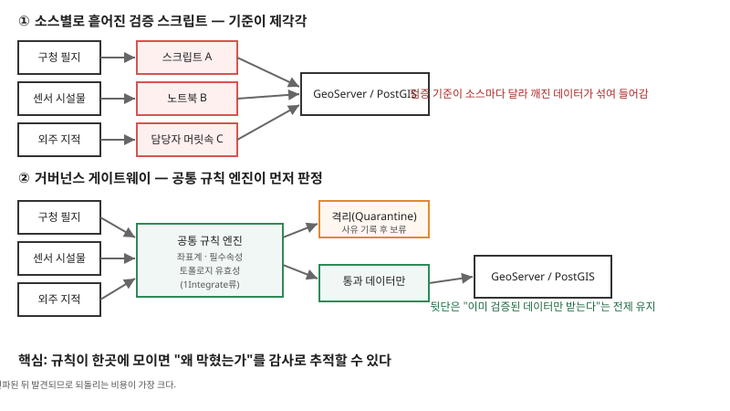

## 왜 지금 이 판단이 필요한가

"구청마다 올려주는 필지 데이터, 센서 업체가 보내주는 시설물 데이터, 외주사가 작업한 지적 데이터를 한 지도에 모았는데, 어디는 좌표계가 틀리고 어디는 필수 속성이 비어 있어서 그대로는 못 믿겠어요"라는 요구는 GIS 조직에서 데이터 소스가 둘 이상으로 늘어나는 순간 거의 반드시 나온다. 이 말을 받으면 흔히 "검증 스크립트를 하나 더 짜면 되겠지"로 끝내기 쉽지만, 소스가 셋을 넘어가는 순간 이 접근은 소스 수만큼 검증 로직이 흩어지는 문제로 이어진다. 좌표계 확인은 A 스크립트에, 필수 속성 체크는 B 노트북에, 폴리곤 유효성 검사는 C의 머릿속에만 있는 식으로 쌓이면, 새 소스가 추가될 때마다 "이번엔 뭘 또 깜빡했는가"를 반복한다.

2026년 11월 18일 VertiGIS가 공개한 Data Gateway는 이 문제를 제품으로 보여준 사례다. VertiGIS가 2025년 12월 1Spatial 인수를 발표하고 2026년 4월 인수를 완료한 뒤 내놓은 첫 플랫폼 혁신으로, 1Spatial의 데이터 관리·거버넌스 역량(1Integrate 룰 엔진)을 기반으로 복잡한 환경 전반에서 데이터 검증·정제·변환·규정 준수를 자동화한다고 밝혔다. 핵심은 "검증 로직을 어디에 짜 넣을까"가 아니라 "검증 로직을 파이프라인 코드와 분리된 별도 계층으로 둘 것인가"라는 질문으로 문제를 다시 던졌다는 점이다.

## 전체 시스템에서의 위치

거버넌스 게이트웨이는 소스 시스템과 서빙 계층(GeoServer·PostGIS) 사이, 전통적인 ETL이 있던 그 자리에 들어간다. 다만 역할이 다르다. 일반 ETL이 "형식을 맞춰서 옮긴다"에 집중한다면, 거버넌스 게이트웨이는 "이 데이터가 들어와도 되는가"를 규칙 엔진으로 먼저 판정하고, 통과하지 못한 레코드는 격리(quarantine)해 둔 채 통과한 것만 흘려보낸다. 좌표계 불일치·필수 속성 누락·토폴로지 오류 같은 품질 문제를 소스 쪽에서 한 번 걸러낸다는 점에서, 뒷단의 GeoServer·PostGIS는 "이미 검증된 데이터만 받는다"는 전제를 유지할 수 있다.



그림 위쪽의 흩어진 ETL 방식에서는 소스마다 다른 스크립트가 각자의 기준으로 검증하므로, 전체 파이프라인에서 "지금 어떤 규칙이 적용되고 있는가"를 한눈에 보기 어렵다. 아래쪽 게이트웨이 방식에서는 규칙이 한곳에 모여 있어 전체 데이터셋에 동일한 기준을 일관되게 적용할 수 있고, 실패한 레코드가 왜 막혔는지도 한곳에서 추적된다. 중요한 건 이 계층이 "데이터 흐름을 늦추는 관문"이 아니라 "뒷단이 신뢰할 수 있는 경계"로 기능한다는 점이다.

## 선택의 트레이드오프

| 방식 | 세밀도·유연성 | 운영 부담 | 적합한 상황 |
|---|---|---|---|
| 소스별 검증 스크립트 직접 작성 | 소스마다 자유롭게 커스텀 가능 | 소스 수에 비례해 증가, 지식이 흩어짐 | 소스가 1~2개로 고정되어 있고 변경이 거의 없는 경우 |
| 범용 ETL 도구(FME 등)에 규칙 내장 | 중간 — 도구 문법 안에서만 표현 | 중간 | 이미 ETL 도구를 운영 중이고 변환이 검증보다 비중이 큰 경우 |
| 전용 거버넌스 게이트웨이(1Integrate류) | 규칙을 선언적으로 관리, 감사 추적 내장 | 초기 도입 비용 높음, 이후 규칙 변경은 쉬움 | 소스가 계속 늘어나고 규정 준수 증빙이 필요한 경우 |
| 서빙 단계(GeoServer/DB 제약)에서 사후 검증 | 낮음 — 이미 들어온 뒤라 늦음 | 낮아 보이지만 오염 전파 후 발견 | 내부 단일 팀이 생성하는 소규모 데이터셋 |

네 번째 선택지, 즉 "일단 넣고 나중에 걸러내자"는 가장 쉬워 보이지만 가장 위험하다. 깨진 폴리곤이나 좌표계가 틀린 레코드가 이미 타일 캐시에 구워지거나 다른 테이블과 조인된 뒤에 발견되면, 되돌리는 비용이 애초에 막는 비용보다 훨씬 커진다. 전용 거버넌스 게이트웨이는 초기 규칙을 정의하는 비용이 들지만, 소스가 다섯 개, 열 개로 늘어나는 조직에서는 규칙을 한곳에서 관리하고 "왜 이 레코드가 거부됐는가"를 감사 로그로 추적할 수 있다는 점에서 장기적으로 운영 부담이 역전된다. 반대로 소스가 하나뿐이고 당분간 늘 계획이 없다면, 거버넌스 플랫폼 도입은 과한 투자다.

## 실제 프로젝트 진행 순서

가장 먼저 할 일은 코드나 제품을 고르는 것이 아니라, 현재 소스별로 실제로 발생하는 품질 문제 유형을 목록화하는 것이다. 좌표계 문제인지, 필수 속성 누락인지, 토폴로지 오류인지에 따라 어느 계층에서 걸러야 효율적인지가 달라진다.

```text
# 품질 규칙 인벤토리 예시 (개념적 표현)
source: 외주사_지적측량_shp
rules:
  - crs_must_equal: EPSG:5186
  - required_attributes: [pnu, jimok, area_sqm]
  - geometry_valid: true   # ST_IsValid 기준
action_on_fail: quarantine_with_reason
```

둘째로, 가장 품질이 나쁜 소스 하나를 골라 파일럿으로 먼저 돌려봐야 한다. 모든 소스를 한 번에 게이트웨이로 옮기려 하면 규칙 설계와 운영 전환이 동시에 터져 실패 원인을 구분할 수 없다. 셋째로, 격리된(quarantine) 레코드를 누가 확인하고 수정할지 책임자를 미리 정해야 한다 — 게이트웨이가 막아주는 것과, 막힌 데이터를 실제로 고치는 것은 별개의 운영 프로세스다. 마지막으로, 규칙이 과도하게 엄격해 정상 데이터까지 막는 "거짓 양성"이 없는지 초기 몇 주간은 격리함을 매일 사람이 직접 검토해 임계값을 조정해야 한다.

## 마무리 요약

- 소스가 늘어날수록 소스별로 흩어진 검증 스크립트는 "이번엔 뭘 깜빡했는가"를 반복하게 만들므로, 규칙을 한곳에 모으는 거버넌스 게이트웨이로의 전환이 필요해지는 시점이 온다.
- 서빙 단계에서 사후 검증하는 방식은 가장 쉬워 보이지만, 오염된 데이터가 전파된 뒤 발견되면 되돌리는 비용이 가장 크다.
- 진행 순서는 소스별 품질 문제 유형 인벤토리 → 최악의 소스로 파일럿 → 격리 레코드 처리 책임자 지정 → 초기 몇 주 거짓 양성 검토 순이다.

## 참고 자료

- [VertiGIS — Data Gateway](https://www.vertigis.com/vertigis-data-gateway/)
- [VertiGIS — VertiGIS acquires 1Spatial to expand its product portfolio](https://www.vertigis.com/news/vertigis-acquires-1spatial-to-expand-its-product-portfolio-and-global-reach/)
- [GeoConnexion — 1Spatial launches Data Gateway](https://www.geoconnexion.com/publication-articles/1spatial-launches-data-gateway)
