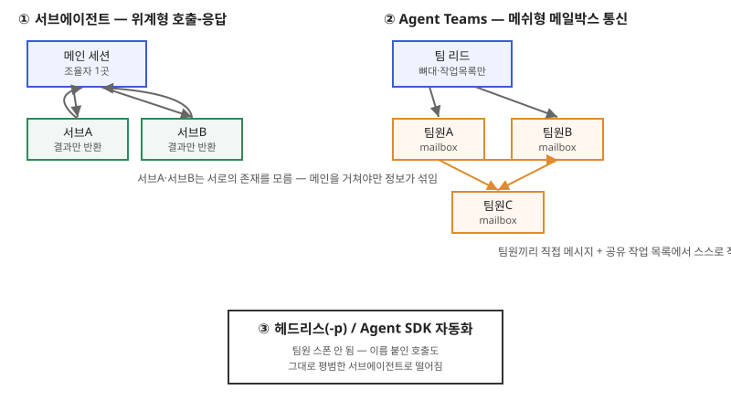

## 왜 지금 이 판단이 필요한가

"조사는 에이전트 여러 개를 띄워서 서로 다른 가설을 검증하게 하고, 틀린 가설은 서로 반박하면서 걸러내게 해주세요." 장애 원인 분석이나 아키텍처 리뷰를 자동화해달라는 요구를 받다 보면 이런 문장이 점점 자주 나온다. 지금까지 이런 요구는 메인 에이전트가 서브에이전트 몇 개를 띄우고, 서브에이전트는 각자 조사한 결과를 메인에게 "보고"하면 메인이 종합하는 위계형 구조로 번역해 왔다. 문제는 "서로 반박한다"는 요구 자체가 이 구조와 맞지 않는다는 데 있다. 서브에이전트는 서로의 존재를 모르고, 메인을 거치지 않고는 대화할 수 없기 때문에 "토론"이 아니라 "순차 보고의 합산"만 가능하다.

2026년 11월 16일 공개된 Claude Code 2.1.326은 Code Mode(에이전트가 도구 호출을 직접 코드로 조율하는 모드)를 Agent Teams와 함께 켤 수 있게 하면서, 그동안 실험적으로 다듬어지던 Agent Teams 기능의 공식 문서를 정비했다. 이 기능은 여전히 기본값으로는 꺼져 있고 `CLAUDE_CODE_EXPERIMENTAL_AGENT_TEAMS` 환경변수로 켜야 하는 실험 단계지만, 서브에이전트와는 통신 구조 자체가 다르다는 점에서 "얼마나 많이 띄울까"가 아니라 "애초에 어떤 통신 구조를 쓸까"를 다시 묻게 만든다. 빌더 입장에서 중요한 건 이 기능 자체가 아니라, 이걸 계기로 멀티 에이전트 설계의 선택지가 서브에이전트 하나에서 서너 개로 늘어났다는 사실이다.

## 전체 시스템에서의 위치

기존 서브에이전트 구조에서는 메인 세션이 유일한 조율자다. 서브에이전트를 부르고, 결과가 돌아오면 요약해서 자기 컨텍스트에 흡수하고, 다음 서브에이전트를 부른다. 통신은 항상 "호출 → 결과 반환"의 1:1 왕복이고, 서브에이전트끼리는 서로를 호출할 수 없다. 2026년 10월 Claude Agent SDK가 서브에이전트의 중첩 깊이를 1로 낮추고 동시 실행 수에 상한을 둔 것도 이 위계형 구조를 전제로 한 안전장치였다.

Agent Teams는 이 전제를 바꾼다. 팀 리드(메인 세션)가 팀원(teammate)을 이름을 붙여 띄우는 건 같지만, 일단 띄워진 팀원은 메일박스(mailbox)라는 파일 기반 메시징 채널로 다른 팀원에게 직접 메시지를 보낼 수 있고, 공유 작업 목록(shared task list)에서 대기 중인 작업을 스스로 집어갈 수 있다. 리드는 작업을 명시적으로 배정할 수도 있고, 팀원이 끝낸 작업에 의존하던 다른 작업이 자동으로 막힘 해제(unblock)되는 것도 시스템이 알아서 처리한다. 즉 조율의 중심이 리드 한 곳에서, 리드가 뼈대만 짜고 나머지는 팀원들의 메시지 교환으로 분산되는 구조로 옮겨간다.



그림의 핵심은 두 구조가 공존한다는 점이다. 같은 Claude Code 세션 안에서도 "빠르게 결과만 필요한 작업"은 여전히 서브에이전트로 위임하고, "서로 의견이 갈려야 의미가 있는 작업"만 팀으로 분리해 띄울 수 있다. 그리고 세 번째 축으로, 세션을 직접 여러 개 띄워 두고 세션 간 메시징(cross-session messaging)으로 느슨하게 연결하는 방식도 있다 — 이건 사람이 각 세션을 따로 시작한다는 점에서 Agent Teams와 다르다.

## 선택의 트레이드오프

| 구조 | 통신 방식 | 컨텍스트 | 토큰 비용 | 가장 맞는 상황 |
|---|---|---|---|---|
| 서브에이전트 | 호출자에게 결과만 반환 | 독립 컨텍스트, 결과는 호출자가 흡수 | 낮음 — 요약만 메인에 쌓임 | 빠른 조사·검증처럼 "결과만" 필요한 작업 |
| Agent Teams | 메일박스로 팀원끼리 직접 메시지 + 공유 작업 목록 | 완전 독립 컨텍스트, 대화 이력은 공유 안 됨 | 높음 — 팀원마다 별도 컨텍스트 윈도우, 선형 증가 | 경쟁 가설 검증, 다관점 리뷰처럼 "토론"이 결과물인 작업 |
| 세션 간 메시징 | 사람이 각각 띄운 세션끼리 메시지 전달 | 세션별로 완전히 분리 | 세션 수만큼, 사람이 직접 관리 | 사람이 각 세션의 진행을 직접 들여다봐야 하는 느슨한 병렬 작업 |
| 단일 세션 | 통신 없음 — 순차 처리 | 하나의 컨텍스트에 모두 누적 | 가장 낮음 | 같은 파일을 반복 수정하는 등 의존성이 많은 순차 작업 |

여기서 빌더가 가장 많이 놓치는 지점은 비용이 아니라 실행 환경 제약이다. Agent Teams는 비대화형(`-p` 플래그) 모드, 즉 Agent SDK를 통한 자동화 세션에서는 팀원을 띄우지 않는다. 리드가 이름을 붙여 부르려 해도 그 호출은 평범한 서브에이전트로 그대로 떨어진다. 이 글을 쓰고 게시까지 자동으로 마치는 이 파이프라인 자체도 `-p` 기반 헤드리스 세션으로 동작하기 때문에, 애초에 Agent Teams를 선택지로 쓸 수 없고 서브에이전트 구조로만 멀티 에이전트 작업을 설계해야 한다. 즉 "토론형 멀티 에이전트가 필요한가"를 묻기 전에 "이게 사람이 터미널로 들여다보는 대화형 세션인가, 아니면 크론이나 웹훅으로 깨어나는 자동화 세션인가"부터 물어야 한다. 후자라면 Agent Teams는 애초에 논의 대상이 아니다.

## 실제 프로젝트 진행 순서

먼저 지금 만들려는 워크플로우가 대화형 세션에서 도는지, 자동화 파이프라인에서 도는지부터 확정한다. 자동화라면 이하 단계는 건너뛰고 서브에이전트 설계로 간다. 대화형이라면 다음으로, 작업을 "결과만 필요한가, 토론이 필요한가"로 나눠 본다. 코드 리뷰를 보안·성능·테스트 커버리지 세 관점으로 쪼개 동시에 보게 하거나, 장애 원인을 두고 여러 가설을 경쟁시키는 작업은 팀 쪽이고, 모듈 하나를 구현하는 작업은 서브에이전트 쪽이다.

```text
# Agent Teams를 쓰기로 했다면 설정 예시
{
  "env": { "CLAUDE_CODE_EXPERIMENTAL_AGENT_TEAMS": "1" },
  "teammateMode": "auto",
  "subagentPromptCacheTtl": "1h"
}
```

이 플래그를 켠 뒤에는 바로 실무 작업에 투입하지 말고, 경계가 분명한 리서치·리뷰 작업으로 먼저 검증해야 한다. 공식 문서도 "코드를 쓰지 않는 조사·리뷰 작업부터 시작하라"고 권한다 — 파일 충돌 없이 팀의 가치를 확인할 수 있기 때문이다. 그다음 단계에서 파일을 나눠 쓰는 구현 작업으로 넘어가되, 팀원 간 파일 소유권을 반드시 분리해야 한다. 같은 파일을 두 팀원이 동시에 고치면 덮어쓰기가 난다. 마지막으로 `TaskCreated`·`TaskCompleted` 같은 훅을 걸어 품질 게이트를 강제해야 한다 — 팀원이 작업을 "완료"로 표시하는 타이밍이 지연되는 경우가 보고되고 있어, 훅 없이는 의존 작업이 조용히 막혀 있는 상태를 놓치기 쉽다.

## 마무리 요약

- Agent Teams는 서브에이전트의 "호출-응답" 위계 구조 대신 메일박스 기반 직접 메시징과 공유 작업 목록으로 팀원끼리 조율하게 하는, 통신 구조 자체가 다른 선택지다.
- 선택 기준은 토큰 비용 이전에 실행 환경이다 — 헤드리스(`-p`)·Agent SDK 자동화에서는 팀원이 아예 스폰되지 않으므로 이 선택지 자체가 사라진다.
- 도입 순서는 대화형 여부 확인 → 결과형/토론형 작업 분류 → 코드 없는 리서치·리뷰로 먼저 검증 → 파일 소유권 분리 → 완료 훅으로 품질 게이트 강제다.

## 참고 자료

- [Claude Code Docs — Orchestrate teams of Claude Code sessions](https://code.claude.com/docs/en/agent-teams)
- [Claude Code Docs — Sub-agents](https://code.claude.com/docs/en/sub-agents)
- [Remio — Claude Code v2.1.326 adds Code Mode for teams](https://www.remio.ai/post/claude-code-v2-1-326-adds-code-mode-for-teams)
