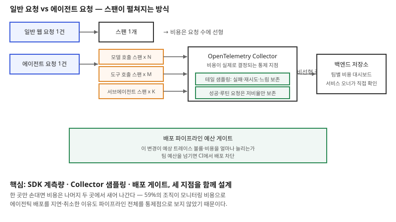

## 왜 지금 이 판단이 필요한가

"에이전트 기능을 프로덕션에 올렸는데, 장애 추적용 트레이싱을 다 켜두니 관측가능성 청구서가 클라우드 비용보다 빨리 늘어나서 재무팀이 확장을 보류시켰어요." 이런 보고를 받으면 대부분 먼저 엔지니어링 쪽을 의심한다 — 에이전트가 불필요한 호출을 반복하는 건 아닌지, 루프가 도는 건 아닌지부터 디버깅한다. 하지만 2026년 업계 데이터는 다른 그림을 보여준다. 300명 이상의 IT 의사결정자를 대상으로 한 조사(Apica, 2026년 8월)에서 **59%의 조직이 모니터링 비용 때문에 에이전틱 배포를 지연하거나 취소한 적이 있다**고 답했다. 같은 시기 업계 분석은 트레이스가 전체 관측가능성 비용의 60~70%를 차지하며, 에이전트 워크로드가 이 비율을 더 키운다고 지적한다. Gartner는 2027년까지 에이전틱 AI 프로젝트의 40%가 취소될 것으로 전망하는데, 원인이 모델 성능이 아니라 운영 비용 구조인 경우가 상당수 섞여 있다.

이게 "모니터링을 줄이면 되는 문제"가 아닌 이유는, 바로 그 트레이스가 에이전트 프로젝트에서 유일하게 "지금 뭘 하고 있는지"를 보여주는 창이기 때문이다. 트레이싱을 끄면 눈을 감고 운영하는 셈이 되고, 다 켜두면 재무가 막는다. 그래서 이 문제는 "얼마나 모니터링할까"가 아니라, 관측가능성 파이프라인 자체를 처음부터 비용을 통제하는 지점으로 설계했는가의 아키텍처 질문이 된다.

## 전체 시스템에서의 위치

일반적인 웹 서비스에서는 요청 하나가 트레이스 하나를 만든다. 스팬 수가 요청 수에 비례해서 늘어나므로, 트래픽이 늘어도 관측가능성 비용은 선형으로 증가한다. 에이전트 워크로드는 이 가정을 깬다. 사용자 요청 하나가 에이전트 오케스트레이터에 들어가면, 그 안에서 모델 호출·도구 호출·서브에이전트 호출이 여러 겹으로 펼쳐지고, 각 호출마다 자신의 스팬과 속성(attribute)을 남긴다. 요청 하나가 수십 개의 스팬으로 펼쳐지는 일이 흔하고, 에이전트가 재시도하거나 서브에이전트를 추가로 띄우면 이 펼쳐짐이 또 한 겹 늘어난다. 그 결과 관측가능성 비용은 요청 수가 아니라 요청당 호출 트리의 깊이와 너비에 비례해서, 선형보다 빠르게 늘어난다.

이 구조에서 OpenTelemetry Collector는 단순한 중계 지점이 아니라, 비용이 실제로 결정되는 통제 지점이 된다. SDK 단에서 생성된 스팬이 Collector를 거쳐 백엔드로 들어가기 전에, 여기서 무엇을 남기고 무엇을 버릴지가 정해진다. 이 지점을 그냥 통과시키기만 하는 파이프라인으로 두면, 에이전트의 호출 트리가 커질수록 청구서도 같은 속도로 커진다.



그림에서 보듯 비용 통제점은 세 곳에 나눠 둘 수 있다. SDK 단(애초에 얼마나 상세히 계측할지), Collector 단(샘플링·라우팅으로 무엇을 보낼지 거르기), 배포 파이프라인 단(변경이 예산을 넘기면 CI에서 막기)이다. 셋 중 하나만 손대면 다른 두 곳에서 비용이 새어 나간다.

## 선택의 트레이드오프

| 전략 | 비용 특성 | 디버깅 가시성 | 적합한 단계 |
|---|---|---|---|
| 전체 풀 트레이싱 (샘플링 없음) | 요청 트리 크기에 비례 — 프로덕션 규모에서 가장 비쌈 | 가장 높음 — 모든 호출 재구성 가능 | 프로토타입, 트래픽이 적은 초기 검증 |
| 헤드 기반 샘플링 (요청 시작 시 N% 결정) | 예측 가능, 낮음 | 중간 — 샘플링 안 된 실패는 통째로 누락 | 트래픽이 일정하고 실패가 드문 안정화 단계 |
| 테일 기반 샘플링 (완료 후 판단해 실패·재시도·느린 트레이스만 보존) | Collector에서 걸러져 중간~낮음 | 높음 — 봐야 할 것만 남김 | 에이전트처럼 호출 트리가 큰 프로덕션 워크로드 |
| 팀별 예산 게이트 (배포 전 비용 영향 추정, 초과 시 차단) | 상한선이 명확 | 샘플링 전략과 별개 — 조직적 안전장치 | 여러 팀이 같은 관측가능성 플랫폼을 공유하는 조직 |

이 중 에이전트 워크로드에 가장 맞는 조합은 테일 기반 샘플링과 예산 게이트의 병행이다. 헤드 기반 샘플링은 에이전트의 실패가 호출 트리 깊은 곳에서 터지는 경우가 많아, 시작 시점에 미리 버릴지 정하면 정작 봐야 할 실패를 놓치기 쉽다. 반대로 전체 풀 트레이싱은 프로토타입 단계에서는 맞지만, 그 설정을 그대로 프로덕션에 들고 가면 이번 59% 통계의 당사자가 된다. 예산 게이트는 샘플링 전략과 별개로, "이 변경이 예상 트레이스 볼륨을 얼마나 늘리는가"를 배포 전에 추정해 팀 예산을 넘기면 막는 조직적 장치다 — 기술적 해법이 아니라 재무와 엔지니어링이 같은 숫자를 보게 만드는 절차다.

## 실제 프로젝트 진행 순서

가장 먼저 할 일은 샘플링 규칙을 짜는 게 아니라, 현재 에이전트 워크로드의 요청당 평균 스팬 수와 속성 크기를 실측하는 것이다. 이 숫자 없이 샘플링 비율을 정하면 추측에 추측을 더하게 된다. 부하 테스트 단계에서 한 요청이 몇 개의 모델·도구·서브에이전트 호출로 펼쳐지는지, 그리고 그중 재시도로 인해 중복되는 비율이 얼마인지부터 측정한다.

```yaml
# OpenTelemetry Collector 테일 기반 샘플링 정책 예시 (개념적 표현)
tail_sampling:
  policies:
    - name: keep-failures
      type: status_code
      status_codes: [ERROR]
    - name: keep-slow
      type: latency
      threshold_ms: 3000
    - name: keep-retries
      type: and
      sub_policies:
        - type: string_attribute
          key: agent.retry_count
          values: ["1", "2", "3+"]
    - name: sample-routine-success
      type: probabilistic
      sampling_percentage: 5   # 성공·루틴 요청은 5%만 보존
```

측정이 끝나면 Collector에 테일 기반 샘플링을 올려 실패·재시도·느린 트레이스는 전량 보존하고, 성공한 루틴 호출은 낮은 비율로만 남긴다. 그다음 팀별·에이전트별로 트레이스 볼륨과 비용을 보여주는 대시보드를 Collector가 이미 갖고 있는 데이터로 구성해, 서비스 오너가 자기 팀의 관측가능성 발자국을 스스로 보게 한다. 중앙 집중된 FinOps 팀만 비용을 보는 구조는 책임 소재가 흐려진다. 마지막으로, 이 비용 추정을 배포 파이프라인의 게이트로 넣어 예산을 넘기는 변경을 사전에 걸러낸다. 그리고 이 모든 절차를 세우기 전에, 재무팀과 "모니터링 예산도 엔지니어링 변경 리뷰의 대상"이라는 합의를 먼저 받아 두어야 나중에 게이트가 만든 차단을 정치적 마찰 없이 유지할 수 있다.

## 마무리 요약

- 에이전트 프로젝트가 멈추는 건 모델 성능이 아니라 요청당 호출 트리가 비선형으로 펼쳐지며 관측가능성 비용이 따라서 폭증하는 구조적 문제인 경우가 많다.
- 헤드 기반 샘플링은 에이전트의 깊은 실패를 놓치기 쉬우므로, 실패·재시도·느린 트레이스만 보존하는 테일 기반 샘플링과 팀별 예산 게이트를 함께 써야 한다.
- 진행 순서는 요청당 스팬 수 실측 → Collector 테일 샘플링 도입 → 팀별 비용 대시보드 → 배포 전 예산 게이트 → 재무팀과의 조직적 합의 순이다.

## 참고 자료

- [Apica — How telemetry pipelines keep AI agent costs under control](https://www.apica.io/news/how-telemetry-pipelines-keep-ai-agent-costs-under-control/)
- [The New Stack — Agentic AI telemetry costs](https://thenewstack.io/agentic-ai-telemetry-costs/)
- [Gravitee — Observability cost vs. benefit](https://gravitee.io/corpus/gen-1227/engineering-economics/observability-cost-vs-benefit.html)
