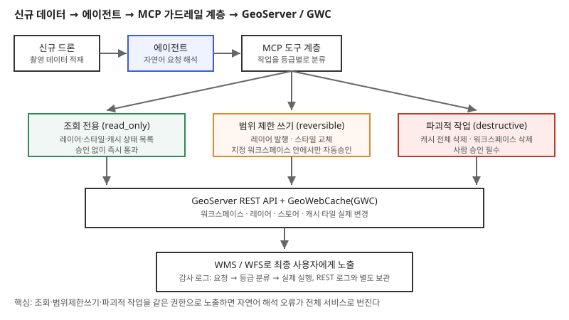

## 왜 지금 이 판단이 필요한가

"새 구역 항공 촬영 데이터가 들어오면 담당자 호출 없이 에이전트가 알아서 워크스페이스에 레이어로 퍼블리시하고, 스타일 입히고, 자주 보는 구역은 캐시까지 미리 구워주세요." GeoServer를 운영하는 팀이라면 이런 요구가 더 이상 공상이 아니라는 걸 안다. 지금까지 이 작업은 담당자가 GeoServer 관리 콘솔을 열거나, REST API를 호출하는 스크립트를 짜서 처리해 왔다. 두 방식 모두 "누가 무엇을 바꿨는지"가 사람의 조작 기록이나 스크립트 실행 로그로 비교적 분명했다.

2026년 11월 2일부터 4일까지 새크라멘토에서 열린 FOSS4G North America 2026에서, GeoServer 핵심 개발자인 Andrea Aime과 Simone Giannecchini(GeoSolutions)가 "AI-dministering GeoServer and MapStore"라는 발표로 이 경계를 흔들었다. 레이어 발행, 캐시 튜닝 같은 관리 작업을 AI 어시스턴트가 직접 처리하게 하는 초기 단계의 MCP(Model Context Protocol) 서버 구상을 공개하면서, 동시에 가드레일을 반드시 함께 설계해야 한다는 점을 강조했다. 같은 시기 커뮤니티에서도 python-geoservercloud를 감싸 80여 개 GeoServer 오퍼레이션을 MCP 도구로 노출하는 geoservercloud-mcp, LLM을 GeoServer REST API에 직접 연결하는 mahdin75/geoserver-mcp 같은 프로젝트가 이미 공개돼 있다. 핵심 개발자의 공식 구상과 커뮤니티의 실제 구현이 동시에 움직이고 있다는 건, 이 전환이 "된다 안 된다"의 문제가 아니라 "어떻게 안전하게 넘길 것인가"의 문제로 이미 넘어갔다는 뜻이다.

## 전체 시스템에서의 위치

지금까지 다룬 Cesium ion MCP Server(2026-11-06)는 3D 타일 자산의 업로드·타일링·태깅이라는 파이프라인 단계를 도구로 노출한 것이었다. 반면 GeoServer MCP는 훨씬 더 전통적인 2D 서비스 운영 영역 — 워크스페이스·레이어·스토어·스타일 관리와 GeoWebCache(GWC) 캐시 — 을 겨냥한다. 데이터가 파일 시스템이나 PostGIS에 적재된 뒤, 그걸 WMS·WFS로 외부에 노출하기까지의 "마지막 단계"가 자동화 대상이 되는 셈이다.

구조상으로는 에이전트가 GeoServer REST API를 직접 호출하지 않고, 그 사이에 MCP 도구 계층이 끼어든다. 이 계층은 단순히 REST 엔드포인트를 1:1로 감싸는 게 아니라, 작업을 안전 등급별로 분류해 노출 여부와 확인 절차를 다르게 둬야 한다. 레이어 목록을 조회하는 것과 워크스페이스를 통째로 삭제하는 것이 같은 권한 레벨로 노출되면, 에이전트가 잘못 해석한 자연어 요청 하나가 전체 서비스를 끊어버릴 수 있다.



그림에서 보듯 MCP 도구 계층은 에이전트와 GeoServer 사이의 방화벽 역할을 한다. 조회성 작업은 그대로 통과시키고, 발행처럼 되돌릴 수 있는 쓰기 작업은 워크스페이스 범위를 제한해 통과시키며, 캐시 전체 삭제나 워크스페이스 삭제처럼 되돌리기 어려운 작업은 사람의 승인을 거치게 한다. 이 분류를 MCP 도구 설계 단계에서 하지 않으면, 나중에 에이전트의 프롬프트나 모델 성능으로 안전성을 담보하려는 잘못된 시도로 이어진다.

## 선택의 트레이드오프

| 운영 방식 | 변경 기록의 명확성 | 반응 속도 | 실수 발생 시 파급 범위 | 적합한 조직 |
|---|---|---|---|---|
| 콘솔 직접 조작 | 높음 — 사람이 직접 클릭한 이력 | 느림 — 담당자 대기 필요 | 사람이 매번 확인하므로 제한적 | 레이어 수가 적고 변경이 드문 소규모 운영 |
| REST API 스크립트 자동화 | 높음 — 스크립트 실행 로그 | 빠름, 단 사전에 정의된 절차만 | 스크립트 버그 범위로 제한 | 반복 패턴이 고정된 대량 배치 작업 |
| MCP 노출 (가드레일 없음) | 낮음 — 자연어 해석 과정이 불투명 | 가장 빠름 | 전체 서비스 — 워크스페이스 삭제까지 자연어로 가능 | 권장하지 않음 |
| MCP 노출 (등급별 가드레일) | 중간 — 요청·승인·실행이 모두 감사 로그로 | 빠름, 단 고위험 작업은 승인 대기 | 작업 등급별로 사전에 제한된 범위 | 레이어·데이터 소스가 자주 바뀌는 중~대규모 운영 |

가드레일 없는 MCP 노출이 가장 위험한 이유는 단순히 "사고가 날 수 있다"가 아니라, 사고의 파급 범위가 작업 종류와 무관하게 전체로 열려 있다는 데 있다. 담당자 한 명이 실수로 레이어 하나를 잘못 지우는 것과, 에이전트가 모호한 지시를 "전체 워크스페이스 초기화"로 해석해 실행하는 것은 복구 난이도가 다르다. 반대로 REST API 스크립트 자동화는 안전하지만 유연성이 떨어진다 — 사전에 정의되지 않은 요청(이번엔 이 구역만 다른 스타일로)은 결국 사람이 다시 스크립트를 고쳐야 한다. 등급별 가드레일을 둔 MCP는 이 둘의 중간 지점을 노린다.

## 실제 프로젝트 진행 순서

가장 먼저 손댈 곳은 에이전트에게 쓰기 권한을 주는 게 아니라, 조회 전용 MCP 도구부터 노출하는 것이다. 레이어 목록, 스타일 목록, GWC 캐시 상태 조회처럼 되돌릴 게 없는 작업만 먼저 연결해, 에이전트가 자연어 요청을 실제로 의도한 레이어·워크스페이스로 정확히 매핑하는지부터 검증한다.

```yaml
# MCP 도구 등급 분류 예시 (개념적 표현)
tools:
  - name: list_layers
    risk: read_only
    approval: none
  - name: publish_layer
    risk: reversible_write
    approval: scoped_auto      # 지정된 워크스페이스 안에서만 자동 승인
    scope: "drone-survey-2026"
  - name: update_style
    risk: reversible_write
    approval: scoped_auto
  - name: truncate_cache
    risk: destructive
    approval: human_required
  - name: delete_workspace
    risk: destructive
    approval: human_required
```

검증이 끝나면 되돌릴 수 있는 쓰기 작업(신규 레이어 발행, 스타일 교체)을 특정 워크스페이스로 범위를 제한해 자동 승인으로 연다. 이때 "범위 제한"이 핵심이다 — 에이전트가 손댈 수 있는 워크스페이스를 사전에 명시적으로 고정해 두면, 자연어 해석이 잘못되더라도 피해가 그 워크스페이스 밖으로 번지지 않는다. 캐시 전체 삭제나 워크스페이스 삭제처럼 되돌리기 어려운 작업은 등급을 올려 사람 승인을 거치게 유지한다. 마지막으로, GeoServer REST API 자체의 로그와는 별도로 "에이전트가 무엇을 요청했고, MCP 계층이 그걸 어떤 등급으로 분류해 어떻게 처리했는지"를 남기는 감사 로그를 반드시 분리해 둔다. 사고가 났을 때 원인이 모델의 해석 오류인지, 가드레일 설계의 누락인지를 구분하려면 이 기록이 없으면 안 된다.

## 마무리 요약

- GeoServer MCP는 Cesium ion MCP와 달리 레이어·워크스페이스·GWC 캐시라는 전통적 2D 서비스 운영 영역을 자동화 대상으로 삼는다.
- 모든 작업을 같은 권한으로 노출하면 자연어 해석 오류 하나가 전체 서비스로 번진다 — 조회·범위 제한 쓰기·사람 승인 필수 세 등급으로 나눠야 한다.
- 도입 순서는 조회 전용 도구 검증 → 범위 제한된 쓰기 작업 자동 승인 → 파괴적 작업은 사람 승인 유지 → REST API 로그와 분리된 감사 로그 확보다.

## 참고 자료

- [FOSS4G North America 2026 — AI-dministering GeoServer and MapStore](https://talks.osgeo.org/foss4g-na-2026/talk/DTWQMH/)
- [PyPI — geoservercloud-mcp](https://pypi.org/project/geoservercloud-mcp/)
- [GitHub — mahdin75/geoserver-mcp](https://github.com/mahdin75/geoserver-mcp)
