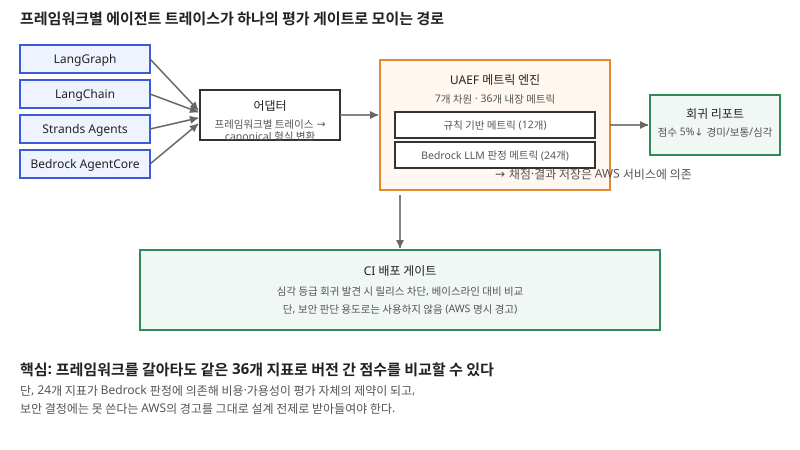

## 왜 지금 이 판단이 필요한가

"에이전트 프레임워크를 LangGraph에서 Strands Agents로 옮기려고 하는데, 바꾸고 나서 품질이 떨어지지 않는지 확인 좀 해주세요." 이런 요청을 받으면 대부분의 팀은 수동으로 질문 몇 개를 던져보고 "그럴듯하다"는 감으로 승인한다. 프레임워크마다 트레이스 포맷이 다르고, 평가 도구도 LangSmith는 LangChain 계열에, 다른 도구는 또 다른 생태계에 묶여 있어서 "버전 A와 버전 B를 같은 기준으로 비교"하는 일 자체가 어렵기 때문이다. 에이전트가 프로토타입 단계를 넘어 분기마다 프레임워크와 모델을 갈아타는 지금, 이 비교 불가능성은 더 이상 사소한 불편이 아니라 릴리스 판단을 가로막는 구조적 공백이다.

AWS는 2026년 11월 11일 이 공백을 정면으로 겨냥한 오픈소스 도구 UAEF(Universal Agent Evaluation Framework)를 Apache-2.0 라이선스로 공개했다. LangGraph, LangChain, Strands Agents, Bedrock AgentCore, Langfuse 트레이스를 하나의 canonical 형식으로 변환한 뒤, 7개 차원에 걸친 36개 내장 지표로 동일하게 채점한다. 텔레콤·헬스케어·금융 12개 조직이 사전에 이 도구로 릴리스 전 버전 비교를 했다는 점도 "프레임워크 중립 평가"가 더 이상 연구 과제가 아니라 실무 요구라는 신호다. 중요한 건 이 도구 자체를 쓰느냐 마느냐가 아니라, 이게 드러낸 질문 — "우리는 에이전트 버전을 비교할 공통 자(尺)를 갖고 있는가" — 에 어떻게 답할 것인가다.

## 전체 시스템에서의 위치

에이전트 평가는 모델 평가와 다른 자리에 있다. 모델 벤치마크는 모델 하나의 출력을 채점하지만, 에이전트 평가는 오케스트레이터·도구 호출·서브에이전트까지 얽힌 실행 트리 전체를 봐야 한다. 그래서 평가 파이프라인은 트레이스가 생성되는 런타임(LangGraph·LangChain·Strands·AgentCore)과, 그 트레이스를 소비해 점수를 매기는 평가 엔진 사이에 변환 계층이 필요하다. UAEF의 어댑터가 하는 일이 정확히 이 변환이다 — 프레임워크마다 제각각인 스팬 구조를 하나의 canonical 트레이스 레코드로 눌러, 뒤따르는 메트릭 엔진이 어떤 프레임워크에서 왔는지 신경 쓰지 않게 만든다.



그림에서 보듯 36개 지표 중 24개는 규칙만으로 채점되지 않고 Bedrock의 LLM 판정을 호출한다. 이 말은 평가 엔진 자체가 외부 서비스 가용성과 비용에 묶인다는 뜻이고, 회귀 리포트는 점수가 5% 넘게 떨어지면 경미·보통·심각 세 등급으로 분류해 CI 배포 게이트의 입력이 된다. 즉 이 파이프라인에서 "평가"는 사후 보고서가 아니라 배포를 막거나 통과시키는 실행 지점으로 설계돼 있다.

## 선택의 트레이드오프

| 방식 | 프레임워크 커버리지 | 비용·의존성 | 회귀 추적 자동화 | 보안 판단 용도 |
|---|---|---|---|---|
| UAEF (canonical 변환 + 7차원 지표) | LangGraph·LangChain·Strands·AgentCore·Langfuse + 커스텀 JSON 어댑터 | 24개 지표가 Bedrock 판정 의존, 그 외 무료 | 점수 변화 5% 기준 자동 등급화 | AWS가 명시적으로 비권장 |
| 벤더 전용 평가 도구(LangSmith 등) | 자사 생태계에만 강함 | 벤더 요금제에 종속 | 도구별로 제각각 | 도구마다 다름, 대부분 비권장 |
| 자체 LLM-as-judge 스크립트 | 자유롭게 설계 가능 | 직접 운영 비용·유지보수 전부 내부 부담 | 직접 구현해야 함 | 설계하기 나름이나 검증 책임도 전부 내부 |
| 순수 사람 수동 평가 | 제약 없음 | 인건비·시간 비용 가장 큼, 느림 | 사실상 불가능(일관성 유지 어려움) | 민감한 판단에 가장 신뢰 가능 |

이 표에서 가장 중요한 줄은 "보안 판단 용도"다. UAEF는 품질·회귀 비교에는 강하지만, AWS 스스로 보안 결정에는 쓰지 말라고 명시했다. LLM 판정 기반 지표는 재현성이 완벽하지 않고, Bedrock 가용성 장애나 비용 급증이 평가 자체를 막을 수 있기 때문이다. 따라서 "프레임워크를 갈아타도 품질이 유지되는가"는 UAEF 같은 canonical 평가 도구로 답하고, "이 에이전트에 보안 취약점이 없는가"는 별도의 보안 리뷰 절차로 분리해야 한다. 하나의 게이트에 두 질문을 섞으면 둘 다 어설프게 답하게 된다.

## 실제 프로젝트 진행 순서

가장 먼저 할 일은 도구를 설치하는 게 아니라, 7개 평가 차원 중 우리 서비스에서 실제로 중요한 차원을 선정하는 것이다. 모든 지표를 다 켜면 24개의 Bedrock 판정 호출이 매 릴리스마다 비용으로 쌓이므로, 핵심 차원(예: 작업 완수율, 도구 호출 정확도)과 참고용 차원을 나눠야 한다. 그다음 현재 운영 중인 프레임워크의 트레이스를 어댑터로 변환해보고, canonical 레코드가 실제 실행 흐름을 빠짐없이 담는지부터 검증한다.

```python
# UAEF 어댑터 사용 개념 예시 — 서로 다른 런타임 트레이스를 canonical 형식으로 변환
from uaef.adapters import LangGraphAdapter, StrandsAdapter
from uaef.core import Evaluator

baseline_traces = LangGraphAdapter().load("traces/v1_langgraph/")
candidate_traces = StrandsAdapter().load("traces/v2_strands/")

evaluator = Evaluator(dimensions=["task_completion", "tool_call_accuracy"])
baseline_score = evaluator.score(baseline_traces)
candidate_score = evaluator.score(candidate_traces)

report = evaluator.compare(baseline_score, candidate_score, regression_threshold=0.05)
# report.severity: "minor" | "moderate" | "severe"
```

검증이 끝나면 현재 프로덕션 버전의 점수를 베이스라인으로 고정해 저장하고, 이후 모든 변경(프레임워크 교체·모델 업그레이드·프롬프트 수정)은 이 베이스라인과 비교해 회귀 등급을 받도록 CI에 넣는다. "심각" 등급이 나오면 배포를 자동 차단하고, "경미"는 로그만 남기는 식으로 등급별 대응을 미리 정해둔다. 마지막으로, 보안 관련 판단은 이 게이트에서 완전히 분리해 기존 보안 리뷰 프로세스를 그대로 유지한다 — 평가 도구 하나가 모든 판단을 떠맡는 순간, 그 도구의 한계가 곧 조직의 맹점이 된다.

## 마무리 요약

- 에이전트가 프레임워크·모델을 자주 갈아타는 지금, "버전 간 품질을 같은 기준으로 비교할 수 있는가"가 릴리스 판단의 병목이 되고 있다.
- UAEF는 LangGraph·LangChain·Strands·AgentCore 트레이스를 canonical 형식으로 모아 36개 지표로 채점하지만, 24개는 Bedrock 판정에 의존해 비용·가용성이 제약이 되고 보안 판단에는 쓸 수 없다.
- 진행 순서는 핵심 평가 차원 선정 → 어댑터로 기존 트레이스 검증 → 베이스라인 점수 고정 → CI 회귀 게이트 삽입 → 보안 리뷰는 별도 프로세스로 유지, 순이다.

## 참고 자료

- [AWS — UAEF: a framework-agnostic system for closed-loop evaluation of AI agents](https://aws-news.com/article/2026-11-11-uaef-a-framework-agnostic-system-for-closed-loop-evaluation-of-ai-agents)
- [TheNextWeb — AWS open-sources UAEF, a tool to test AI agents across frameworks](https://thenextweb.com/news/aws-uaef-open-source-ai-agent-evaluation)
- [GitHub — awslabs/uaef](https://github.com/awslabs/uaef)
