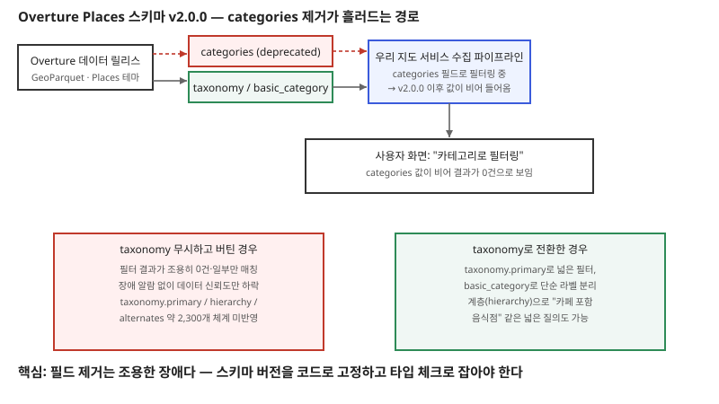

## 왜 지금 이 판단이 필요한가

"지도에서 카페·음식점 카테고리로만 매장을 걸러서 보여주세요." 이 흔한 요구사항을 Overture Maps의 Places 데이터로 구현해온 팀이라면, 최근 릴리스를 그대로 받아 갱신했다가 필터 결과가 뜬금없이 비거나 줄어든 경험을 했을 가능성이 크다. 원인은 에러가 아니라 스키마다. Overture Maps는 2026년 9월 23일 데이터 릴리스에서 Places 테마 스키마를 v2.0.0으로 올리면서, 그동안 써 오던 `categories` 속성을 완전히 제거하고 `taxonomy`와 `basic_category`로 대체했다. 이 전환은 2026년 6월 릴리스에서 먼저 공지됐다가 실제로는 9월 릴리스에 적용됐는데, 이 시차 자체가 "스키마 변경 공지를 언제 믿고 언제 실제로 반영해야 하는가"라는 또 다른 운영 질문을 남긴다.

문제를 더 까다롭게 만드는 지점은, 이게 단순한 필드 이름 변경이 아니라는 것이다. 기존 `categories`는 문자열 몇 개를 나열하는 평평한(flat) 구조였지만, 새 `taxonomy`는 약 2,300개 카테고리가 상위·하위 관계로 얽힌 계층형 체계이고 `taxonomy.primary`·`taxonomy.hierarchy`·`taxonomy.alternates` 세 필드로 나뉜다. 반면 `basic_category`는 이 계층을 단순화한 대표 라벨 하나만 남긴 값이다. 즉 마이그레이션은 "필드명만 바꾸면 끝"이 아니라, 우리 서비스가 애초에 "카페"라는 말을 평평한 문자열 매칭으로 쓰고 있었는지, 아니면 "카페를 포함한 음식점 전체"처럼 계층적 질의가 필요했는지부터 다시 묻게 만든다.

## 전체 시스템에서의 위치

Overture 데이터는 GeoParquet 형태로 배포되고, 이를 가져다 쓰는 서비스는 보통 수집(다운로드·필터링) → 적재(자체 DB 또는 데이터 웨어하우스) → 서비스 API(카테고리 검색·필터) → 화면(지도 위 POI 마커)으로 이어지는 파이프라인을 갖는다. `categories` 필드는 이 파이프라인 전체에서 "필터링 기준"으로 쓰이던 핵심 축이었다. 이 필드가 조용히 사라지면, 수집 단계의 파싱 코드는 에러를 내지 않고 그냥 빈 값이나 `null`을 돌려주고, 그 값이 그대로 적재·서비스·화면까지 흘러가 사용자에게는 "검색 결과가 0건"으로만 보인다. 로그에 예외가 안 남으니 장애 감지 자체가 늦어지는 게 이 유형의 스키마 변경이 특히 위험한 이유다.



그림에서 보듯 이 변화의 영향 범위는 "수집 코드 한 줄"이 아니라 파이프라인 전체다. 수집 단계에서 `taxonomy`로 바꿔 받아도, 서비스 API가 여전히 평평한 문자열 비교 로직을 쓰고 있다면 계층 구조의 이점을 전혀 살리지 못한 채 그냥 `taxonomy.primary` 하나만 `categories`처럼 억지로 쓰는 셈이 된다. 반대로 화면단 필터 UI는 그대로 두고 데이터만 바꾸면, 사용자가 선택한 "음식점" 버튼이 실제로는 더 이상 존재하지 않는 구 카테고리 값과 매칭을 시도하게 된다.

## 선택의 트레이드오프

| 전략 | 구현 난이도 | 필터 표현력 | 하위 호환 리스크 |
|---|---|---|---|
| `basic_category`만 사용 | 낮음 — 거의 `categories` 대체재처럼 씀 | 낮음 — 단순 라벨 하나, 계층 질의 불가 | 낮음, 가장 빠른 임시 조치 |
| `taxonomy.primary` 문자열 매칭 | 중간 | 중간 — 정확 카테고리만 매칭, 상위 개념 포함 안 됨 | 중간, 값 체계(taxonomy vocabulary)가 또 바뀔 수 있음 |
| `taxonomy.hierarchy` 기반 계층 질의 | 높음 — 트리 구조 질의 로직 필요 | 높음 — "카페를 포함한 음식점" 같은 넓은 질의 가능 | taxonomy 체계 자체에 종속, 버전 고정 필요 |
| 서드파티 래퍼 API(categories 필드 유지) | 낮음 | 중간 — 내부적으로 taxonomy에서 파생해 호환성 흉내 | 래퍼가 taxonomy 어휘와 어긋나면 빈 결과 재발 가능 |

가장 중요한 판단은 "우리 서비스가 정말 계층 질의가 필요한가"다. 매장을 단일 라벨로만 보여주는 가벼운 지도 서비스라면 `basic_category`로 충분하고 구현 비용도 가장 낮다. 반대로 "식당 카테고리 전체에서 특정 체인점만 빼고 보여주세요" 같은 요구가 이미 들어오고 있다면, 처음부터 `taxonomy.hierarchy`를 들고 가는 편이 나중에 두 번 마이그레이션하는 것보다 싸다. 서드파티 래퍼 API로 기존 `categories` 필드를 흉내 내는 선택지도 있지만, 래퍼가 내부적으로 taxonomy 값을 정확 문자열로 변환하는 방식이라 taxonomy 어휘 자체가 또 바뀌면 같은 문제가 재발한다는 점은 알고 가야 한다.

## 실제 프로젝트 진행 순서

가장 먼저 할 일은 현재 수집 파이프라인에서 `categories` 필드를 참조하는 모든 지점을 찾는 것이다. 파싱 코드, DB 스키마, API 응답 모델, 프런트엔드 필터 컴포넌트까지 — 이 필드 하나가 생각보다 넓게 퍼져 있다는 걸 이 단계에서 확인하게 된다. 그다음 신규 Overture 릴리스를 스테이징 환경에 받아, `categories` 값이 실제로 비어 들어오는지 먼저 재현한다. 재현 없이 코드만 고치면 "고쳤다고 생각했는데 실제로는 다른 지점에서 또 터지는" 상황을 반복하게 된다.

```python
# Overture Places GeoParquet에서 taxonomy 필드 읽는 예시
import duckdb

con = duckdb.connect()
con.execute("INSTALL spatial; LOAD spatial;")

result = con.execute("""
    SELECT
        id,
        names.primary AS name,
        taxonomy.primary AS primary_category,
        taxonomy.hierarchy AS category_hierarchy,
        basic_category
    FROM read_parquet('s3://overturemaps-us-west-2/release/2026-10-21.0/theme=places/type=place/*')
    WHERE basic_category = 'restaurant'
       OR list_contains(taxonomy.hierarchy, 'eat_and_drink')
    LIMIT 100
""").fetchdf()
```

검증이 끝나면 수집 파이프라인을 `taxonomy`·`basic_category` 기반으로 바꾸되, 서비스 API 응답에는 과거 `categories`를 쓰던 클라이언트가 당장 깨지지 않도록 과도기적으로 `basic_category`를 `categories`라는 이름의 필드로 당분간 함께 내려주는 방안을 검토한다. 마지막으로 Overture 릴리스 버전을 수집 설정에 명시적으로 고정해, 다음 스키마 변경이 공지되면 자동으로 따라가지 않고 먼저 스테이징에서 검증한 뒤에만 반영하는 절차를 만든다. 이번 사고의 본질은 taxonomy 자체가 아니라 "외부 데이터 공급자의 스키마 변경을 조용히 흡수하는 파이프라인 설계가 없었다"는 것이기 때문이다.

## 마무리 요약

- Overture Maps는 2026년 9월 23일 릴리스(스키마 v2.0.0)에서 Places의 `categories` 필드를 제거하고 계층형 `taxonomy`와 단순 라벨 `basic_category`로 대체했다.
- 이 변화는 필드명 변경이 아니라 평평한 문자열 매칭에서 계층형 질의로의 모델 전환이라, 서비스가 실제로 계층 질의가 필요한지부터 판단해야 전략을 고를 수 있다.
- 진행 순서는 `categories` 참조 지점 전수 조사 → 스테이징에서 빈 값 재현 → `taxonomy`/`basic_category` 기반 전환 → 과도기 호환 필드 제공 → 릴리스 버전 고정과 검증 절차 수립이다.

## 참고 자료

- [Overture Maps — 2026-09-23 release notes](https://docs.overturemaps.org/blog/2026/09/23/release-notes/)
- [Overture Maps — Places Guide](https://docs.overturemaps.org/guides/places/)
- [overturemapsapi.com — Overture Removed categories. Your Code Still Works.](https://www.overturemapsapi.com/blog/2026/10/07/overture-removed-categories-your-code-still-works)
