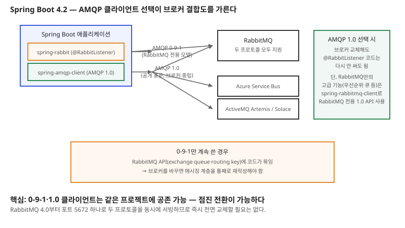

## 왜 지금 이 판단이 필요한가

"지금은 RabbitMQ 하나로 돌아가는데, 나중에 클라우드 쪽 Azure Service Bus나 다른 브로커로 옮길 수도 있으니 너무 RabbitMQ에 딱 붙은 코드는 피해주세요." 메시징 계층을 처음 설계할 때 이런 요청을 받으면 막막해지는 이유는, Spring에서 RabbitMQ를 쓰는 가장 흔한 방법인 `@RabbitListener`와 `spring-rabbit`이 애초에 RabbitMQ 고유의 AMQP 0-9-1 모델(exchange·queue·routing key)을 그대로 노출하는 구조이기 때문이다. "표준 프로토콜을 쓰고 있으니 괜찮겠지"라는 생각은 여기서 틀어진다 — AMQP라는 이름이 같다고 해서 0-9-1과 1.0이 같은 프로토콜의 다른 버전이 아니다.

2026년 11월 19일 GA로 나온 Spring Boot 4.2는 바로 이 지점을 겨냥한다. RabbitMQ 4.0이 AMQP 1.0을 코어 프로토콜로 추가하면서 생긴 흐름을 받아, Spring 쪽에서도 AMQP 1.0 클라이언트 지원이 자리를 잡았다. `spring-rabbit`이 여전히 0-9-1 전용인 반면, 새로 추가된 `spring-amqp-client`(Qpid ProtonJ2 기반)는 AMQP 1.0을 구현하는 어떤 브로커와도 통신할 수 있다. RabbitMQ 전용 1.0 기능이 필요하면 `spring-rabbitmq-client`를 쓰고, 브로커 중립성이 목적이면 `spring-amqp-client`를 쓰는 식으로 선택지가 갈린다. 메시지 브로커를 처음 고르는 단계가 아니라, 이미 RabbitMQ 위에 서비스를 올려둔 팀에게도 "지금 쓰는 클라이언트 계층이 우리를 얼마나 묶어두고 있는가"를 다시 묻게 만드는 변화다.

## 전체 시스템에서의 위치

메시지 브로커는 보통 서비스 간 비동기 통신의 중앙에 있다. 주문 서비스가 이벤트를 발행하면 재고·배송·알림 서비스가 각자의 큐에서 이를 소비하는 구조에서, 애플리케이션 코드와 브로커 사이를 잇는 게 AMQP 클라이언트 계층이다. 이 계층이 어떤 프로토콜을 쓰느냐에 따라, "브로커를 바꾼다"는 결정이 설정 몇 줄의 문제인지, 메시징 코드 전체를 재작성해야 하는 문제인지가 갈린다.



그림에서 보듯 AMQP 0-9-1은 애초에 RabbitMQ가 정의한 서버 모델(exchange·queue·바인딩)을 프로토콜 자체에 담고 있어서, 이 모델을 그대로 쓰는 `@RabbitListener` 코드는 다른 브로커로 옮길 때 통신 방식 자체를 다시 설계해야 한다. 반면 AMQP 1.0은 서버 모델을 정의하지 않는 범용 프로토콜이라, 브로커가 1.0을 구현하기만 하면 "주소(address)"라는 추상 단위로 통신할 수 있다. RabbitMQ는 이 주소를 내부적으로 exchange·queue 개념에 매핑해서 처리하지만, 애플리케이션 입장에서는 그 매핑을 몰라도 된다.

## 선택의 트레이드오프

| 구성 | 브로커 결합도 | RabbitMQ 고유 기능 | 적합한 상황 |
|---|---|---|---|
| `spring-rabbit` (AMQP 0-9-1) | 높음 — exchange·routing key가 코드에 노출 | 전부 사용 가능(우선순위 큐, 데드레터 등 RabbitMQ 확장 포함) | RabbitMQ를 계속 쓸 것이 확실하고, 생태계·레퍼런스가 가장 풍부한 선택이 필요할 때 |
| `spring-rabbitmq-client` (RabbitMQ의 AMQP 1.0) | 중간 — 1.0 프로토콜이지만 RabbitMQ 전용 구현에 묶임 | RabbitMQ 1.0 확장 기능 활용 가능 | RabbitMQ에 남아있을 계획이지만 1.0의 성능·경량 특성이 필요할 때 |
| `spring-amqp-client` (범용 AMQP 1.0, ProtonJ2) | 낮음 — 표준 프로토콜 위에서 브로커 교체 가능 | 사용 불가 — 범용 기능만 | 멀티 클라우드·브로커 교체 가능성이 실제로 로드맵에 있을 때 |
| 0-9-1·1.0 혼용(점진 전환) | 전환 구간만 일시적으로 중간 | 유지하면서 신규 모듈만 1.0으로 | 기존 서비스를 깨지 않고 신규 기능부터 표준화하고 싶을 때 |

여기서 짚어야 할 함정은 "표준 프로토콜이니 무조건 더 낫다"는 판단이다. `spring-amqp-client`는 브로커 중립성을 주는 대신 RabbitMQ만의 확장 기능(예: 우선순위 큐, 특정 데드레터 정책)을 포기해야 한다. 실제로 RabbitMQ를 바꿀 계획이 없고 그 확장 기능에 의존하고 있다면, 표준을 좇다가 오히려 쓰던 기능을 잃는 손해가 더 크다. 반대로 멀티 클라우드 전략이 조직 로드맵에 실제로 있다면, 지금 신규로 만드는 메시징 모듈만이라도 `spring-amqp-client`로 시작하는 편이 나중에 전체를 뜯어고치는 것보다 싸게 먹힌다.

## 실제 프로젝트 진행 순서

가장 먼저 할 일은 라이브러리를 바꾸는 게 아니라, 현재 메시징 코드가 RabbitMQ 고유 기능에 실제로 얼마나 의존하는지 점검하는 것이다. 우선순위 큐, 특정 교환기 타입(topic·fanout·headers), RabbitMQ 전용 관리 플러그인 연동 같은 부분을 목록으로 뽑아보면, "표준화해도 되는 부분"과 "RabbitMQ에 묶여 있을 수밖에 없는 부분"이 자연스럽게 갈린다.

```java
// spring-amqp-client로 AMQP 1.0 발행 예시 (개념적 코드)
@Configuration
public class Amqp10Config {

    @Bean
    public AmqpClientTemplate amqpClientTemplate(AmqpConnectionFactory factory) {
        return new AmqpClientTemplate(factory);
    }
}

@Service
public class OrderEventPublisher {

    private final AmqpClientTemplate template;

    public void publishOrderCreated(OrderCreatedEvent event) {
        // 주소 기반 전송 — 특정 브로커의 exchange·routing key 개념에 묶이지 않는다
        template.send("orders.created", event);
    }
}
```

점검이 끝나면 RabbitMQ 의존도가 낮은 신규 기능부터 `spring-amqp-client`로 전환해보고, 기존 `@RabbitListener` 기반 서비스는 당장 건드리지 않는다. RabbitMQ 4.0이 같은 포트에서 0-9-1과 1.0을 동시에 서빙하므로, 두 클라이언트를 같은 프로젝트에 공존시키며 점진적으로 옮기는 게 가능하다. 마지막으로, 정말 브로커 교체가 로드맵에 있다면 전환 대상 서비스를 먼저 스테이징에서 Azure Service Bus나 ActiveMQ Artemis 같은 다른 AMQP 1.0 브로커로 바꿔 실제로 코드 변경 없이 동작하는지 검증한 뒤에 프로덕션 계획을 세운다. 이 검증 없이 "표준이니 될 것"이라고 가정하면, 브로커별 1.0 구현 디테일(주소 라우팅 방식 등) 차이에서 뒤늦게 막히기 쉽다.

## 마무리 요약

- AMQP 0-9-1과 1.0은 이름만 같을 뿐 서로 다른 프로토콜이며, RabbitMQ 4.0부터 같은 포트에서 둘 다 지원한다.
- Spring Boot 4.2는 `spring-rabbit`(0-9-1)과 별개로 `spring-rabbitmq-client`(RabbitMQ 전용 1.0), `spring-amqp-client`(범용 1.0)를 제공해 브로커 결합도를 직접 선택할 수 있게 한다.
- 진행 순서는 RabbitMQ 고유 기능 의존도 점검 → 신규 기능부터 표준 1.0으로 전환 → 기존 0-9-1 코드와 공존 → 실제 브로커 교체 전 스테이징 검증이다.

## 참고 자료

- [Spring Boot 4.2.0 available now](https://spring.io/blog/2026/11/19/spring-boot-4-2-0-available-now/)
- [RabbitMQ — Native AMQP 1.0](https://www.rabbitmq.com/blog/2024/08/05/native-amqp)
- [Spring AMQP — Generic AMQP 1.0 Client Support](https://docs.spring.io/spring-amqp/reference/amqp10-client.html)
