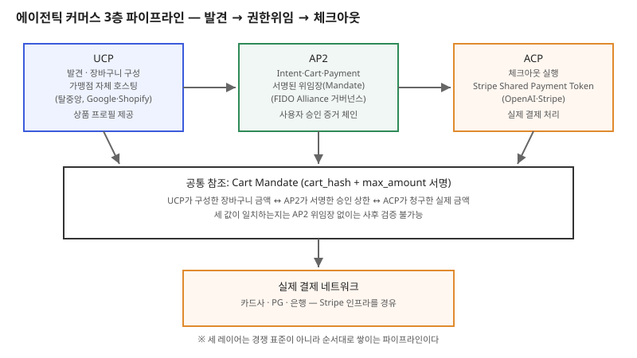

## 왜 지금 이 판단이 필요한가

"쇼핑 에이전트 만드는데, 마음에 드는 상품 찾으면 장바구니 담고 결제까지 사람 손 안 거치고 끝내주세요." 이 요구를 받은 팀은 보통 결제 연동 라이브러리를 하나 고르면 끝나는 일이라고 생각한다. 하지만 지금 에이전틱 커머스 생태계에는 서로 다른 레이어를 담당하는 표준이 최소 셋 떠 있다 — OpenAI·Stripe의 ACP(Agentic Commerce Protocol), Google의 AP2(Agent Payments Protocol), 그리고 Google·Shopify의 UCP(Universal Commerce Protocol). 이름이 비슷해서 "셋 중 하나를 골라야 하는 경쟁 표준"처럼 보이지만, 실제로는 발견(discovery)·체크아웃 실행·권한위임 신뢰라는 서로 다른 문제를 푼다. Perplexity가 ACP와 AP2를 동시에 쓰는 이유도 여기에 있다.

문제는 세 표준의 성숙도와 통제 구조가 제각각이라는 점이다. ACP는 Stripe의 Shared Payment Token으로 인앱 체크아웃을 실행하는 데 집중하고, 사양은 Apache-2.0으로 공개돼 있지만 실제 운영은 Stripe 인프라 하나에 사실상 묶여 있다. AP2는 Intent·Cart·Payment 세 종류의 서명된 위임장(mandate)을 W3C Verifiable Credentials로 발급해 "이 결제를 사용자가 실제로 승인했다"는 증거 체인을 만드는 권한 계층이고, FIDO Alliance가 거버넌스를 맡으면서 플랫폼 중립을 표방한다. UCP는 2026년 1월 발표된 가장 어린 표준으로, 가맹점이 자기 서버에 상품 프로필을 직접 호스팅하는 탈중앙 구조로 발견·장바구니 단계를 표준화한다. 이 중 어느 것부터 구현해도 "표준 하나 도입" 수준의 작업이 아니라, 신뢰 경계를 어디서 끊을지 결정하는 아키텍처 판단이다.

## 전체 시스템에서의 위치

세 표준은 경쟁자가 아니라 쇼핑 흐름의 세 단계에 각각 배치된다. 에이전트가 "어떤 상품이 있는지" 알아내는 발견·장바구니 단계는 UCP가, "결제를 실행해도 된다"는 사용자 승인의 증거를 남기는 권한위임 단계는 AP2가, 실제로 카드·계좌에 돈이 움직이는 체크아웃 실행 단계는 ACP가 맡는다. 가맹점 입장에서 이 세 레이어는 순서대로 쌓이는 파이프라인이지, 하나를 넣으면 나머지가 불필요해지는 대체재가 아니다.



그림에서 보듯 AP2의 위임장 체인은 다른 두 레이어를 가로지르는 감사 로그 역할도 겸한다. UCP 발견 단계에서 가맹점이 내놓은 상품 데이터와, ACP 체크아웃 단계에서 실제로 청구된 금액이 일치하는지는 AP2의 Cart Mandate가 서명한 내용과 대조해야 검증할 수 있다. 즉 AP2 없이 ACP만 붙이면 "에이전트가 승인했다고 주장하는 금액"과 "사용자가 실제로 승인한 금액"을 구조적으로 구분할 방법이 없다.

## 선택의 트레이드오프

| 레이어 | 담당 범위 | 운영 통제 구조 | 성숙도 (2026-11 기준) | 빠지면 생기는 공백 |
|---|---|---|---|---|
| UCP (Google·Shopify) | 상품 발견·장바구니 구성 | 탈중앙 — 가맹점이 자체 호스팅 | 2026년 1월 발표, 가장 초기 | 에이전트가 가맹점마다 다른 포맷을 긁어야 함 |
| AP2 (Google) | 사용자 승인의 서명된 증거 체인 | FIDO Alliance 거버넌스, 플랫폼 중립 | 60여 파트너, 실 서비스는 아직 제한적 | 결제 승인 여부를 사후에 증명할 수 없음 |
| ACP (OpenAI·Stripe) | 실제 체크아웃 실행 | 사양은 공개, 운영은 Stripe 인프라 집중 | Instant Checkout 표면은 축소됐지만 프로토콜 자체는 유지 | 승인까지는 됐는데 결제를 실행할 표준 경로가 없음 |

세 번째 줄을 가볍게 넘기면 안 된다. ACP는 사양이 Apache-2.0으로 열려 있다고 홍보되지만, 실제 트랜잭션은 Stripe의 Shared Payment Token 인프라를 통하도록 설계돼 있어 "표준을 따랐다"와 "Stripe에 결제 처리를 위탁했다"가 사실상 같은 말이 된다. 반대로 UCP는 가맹점이 자기 서버에서 상품 프로필을 직접 서빙하는 구조라 플랫폼 종속은 피하지만, 그만큼 표준 준수 여부를 검증할 중앙 기관이 없어 가맹점마다 구현 편차가 커질 위험을 가맹점 쪽이 떠안는다.

## 실제 프로젝트 진행 순서

가맹점(판매자) 입장에서 쇼핑 에이전트에 노출되려는 거라면 순서는 발견부터다. UCP 상품 프로필 포맷으로 카탈로그를 먼저 노출해야 어떤 에이전트든 찾아올 수 있고, 그 다음에야 ACP 체크아웃 연동이 의미를 가진다. 체크아웃만 먼저 붙이면 에이전트가 애초에 그 상품을 찾아내지 못해 기능이 죽은 코드로 남는다.

반대로 쇼핑 에이전트(구매자 쪽)를 만드는 거라면 가장 먼저 막히는 지점은 AP2 위임장이다. 아래는 Cart Mandate의 최소 구조다.

```json
{
  "mandate_type": "CartMandate",
  "user_credential_ref": "vc:user-auth-2026-11-24",
  "cart_hash": "sha256:9f2a...",
  "max_amount": { "currency": "KRW", "value": 128000 },
  "merchant_ref": "ucp:merchant/example-shop",
  "expires_at": "2026-11-24T15:30:00+09:00"
}
```

`max_amount`와 `cart_hash`를 묶어 서명하는 이유는, 에이전트가 담은 장바구니 금액이 사용자가 승인한 상한을 넘지 못하게 구조적으로 막기 위해서다. 여기서 흔히 막히는 지점은 "에이전트가 상품을 추가·변경할 때마다 새 Cart Mandate를 받아야 하는가"다. 매번 받으면 사용자 승인 피로가 쌓이고, 세션 단위로 뭉뚱그리면 금액 상한을 우회하는 경로가 생긴다. 실무에서는 상한 범위 안의 변경은 기존 Mandate로 흡수하고, 상한을 넘기거나 가맹점이 바뀌는 순간에만 재승인을 요구하는 경계선을 먼저 정하고 들어가야 한다. ACP 체크아웃 연동은 이 위임장 체인이 검증 가능해진 뒤에 붙이는 게 순서상 맞다 — 승인 증거 없이 결제 실행부터 연결하면, 나중에 분쟁이 났을 때 "사용자가 진짜 승인했는지" 증명할 방법이 없는 채로 돈만 움직이는 구조가 돼버린다.

## 마무리 요약

- UCP·AP2·ACP는 경쟁 표준이 아니라 발견·권한위임·체크아웃이라는 서로 다른 레이어이며, 하나만 넣고 끝낼 수 없다.
- 가맹점은 UCP(발견)부터, 쇼핑 에이전트는 AP2(위임장 체인) 설계부터 시작해야 나머지 레이어가 의미를 가진다.
- ACP의 "표준 공개"와 "Stripe 인프라 집중"은 별개 사실이며, 체크아웃 레이어를 고를 때는 이 둘을 분리해서 판단해야 한다.

## 참고 자료

- [Agentic Commerce Protocol (agenticcommerce.dev)](https://agenticcommerce.dev)
- [Google AP2 GitHub Repository](https://github.com/google-agentic-commerce/AP2)
- [Universal Commerce Protocol 소개](https://github.com/Shopify/universal-commerce-protocol)
