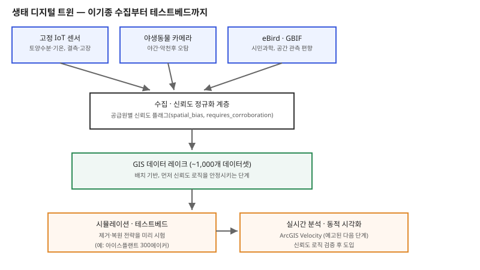

## 왜 지금 이 판단이 필요한가

"이 보호구역에 외래종이 퍼지고 있는데, 실제로 제거 작업을 벌이기 전에 어디부터 손대야 효과적인지 미리 시험해볼 수 있게 해주세요." 보존 담당 기관의 이런 요구는 지금까지 현장 조사 → 보고서 → 다음 연도 예산 신청이라는 연 단위 배치 주기로 처리됐다. 2026년 11월 Esri의 ArcNews가 소개한 Dangermond Preserve의 "Digital Twin of Nature" 프로젝트는 이 주기를 바꾸는 사례다. The Nature Conservancy의 Point Conception Institute와 UC Santa Barbara 공간과학센터, Esri가 함께 구축한 이 디지털 트윈은 IoT 센서·야생동물 카메라와, eBird·GBIF 같은 외부 생물다양성 시민과학 플랫폼의 연속 스트림을 자동 파이프라인으로 수집해 거의 1,000개에 달하는 GIS 데이터셋을 상시 갱신한다. 실제로 이 체계를 이용해 300에이커 규모의 침입종 아이스플랜트 확산 구역을 식별하고, 제거 전략을 시험한 뒤 결과까지 검증한 사례가 나왔다.

여기서 빌더가 주목해야 할 건 "디지털 트윈을 또 만들었다"는 사실이 아니라, 이 디지털 트윈이 지금까지 다뤄온 CityGML 기반 도시 디지털 트윈이나 IFC-BIM 연계 시공 디지털 트윈과 근본적으로 다른 종류의 데이터를 다룬다는 점이다. 건물 디지털 트윈은 측량·시공이라는 사람이 통제하는 주기로 갱신되는 정적인 3D 지오메트리가 중심이지만, 생태 디지털 트윈은 센서 고장·관측자 편향·계절 변동이 뒤섞인 이기종 연속 스트림을 상시 받아내야 한다. 이 차이를 무시하고 기존 디지털 트윈 설계를 그대로 가져오면, 파이프라인은 돌아가는데 그 안의 데이터는 믿을 수 없는 상태가 된다.

## 전체 시스템에서의 위치

Dangermond 사례의 구조를 보면 네 단계로 나뉜다. 가장 앞단에는 성격이 전혀 다른 세 종류의 데이터 공급원 — 고정 IoT 센서(토양 수분·기온), 야생동물 카메라 트랩, 그리고 eBird·GBIF 같은 외부 시민과학 API — 이 있다. 이들이 수집 계층을 거쳐 약 1,000개 데이터셋으로 구성된 GIS 데이터 레이크에 쌓이고, 그 위에서 "제거 전략을 먼저 시험해본다"는 시뮬레이션·테스트베드 계층이 동작한다. 다음 단계로 예고된 것이 ArcGIS Velocity 기반 실시간 분석과 시공간 변화의 동적 시각화다.



이 구조에서 핵심은 수집 계층이 단순 ETL이 아니라는 점이다. IoT 센서는 결측치와 고장을, 카메라 트랩은 야간·악천후 오탐을, 시민과학 데이터는 관측자가 접근하기 쉬운 지역에 몰리는 공간 편향을 각각 다른 방식으로 끌고 들어온다. 건물 디지털 트윈이라면 BIM 모델 하나의 정합성만 검증하면 되지만, 여기서는 세 공급원의 신뢰도를 각각 다르게 평가하는 로직이 수집 계층 안에 들어가야 다음 단계의 시뮬레이션이 의미를 가진다.

## 선택의 트레이드오프

| 구분 | 건물·도시 디지털 트윈 (CityGML·IFC) | 생태 디지털 트윈 (Dangermond형) |
|---|---|---|
| 데이터 성격 | 측량 시점의 정적 3D 지오메트리 | 상시 변화하는 이기종 연속 스트림 |
| 갱신 주기 | 시공·개정 단위(수개월~수년) | 센서는 실시간, 시민과학 데이터는 불규칙 |
| 신뢰도 검증 대상 | 좌표 정합·LOD 일관성 | 센서 고장·관측 편향·중복 관측 |
| 시뮬레이션 목적 | 설계안 검토, 간섭 확인 | 개입(제거·복원) 전후 효과 예측·검증 |
| 적합한 조직 규모 | 단일 기관·시공사 단위로도 가능 | 데이터 공급원을 여럿 묶을 파트너십 필요 |

가장 중요한 함정은 "실시간으로 다 보여주면 좋지 않냐"는 가정이다. Dangermond도 ArcGIS Velocity 기반 실시간 분석을 아직 "다음 단계"로 분리해 놓았다는 점을 주목해야 한다. 이기종 데이터의 신뢰도 검증 로직이 안정되기 전에 실시간 스트리밍부터 올리면, 센서 오작동이 그대로 "실시간 경보"로 증폭되는 역효과가 난다. 배치 기반 데이터 레이크를 먼저 안정시키고, 그 위에서 어떤 지표가 실시간성을 요구하는지 가려낸 뒤에야 스트리밍 계층을 얹는 순서가 맞다.

## 실제 프로젝트 진행 순서

이 정도 규모(TNC·UCSB·Esri 3자 파트너십, 1,000개 데이터셋)를 혼자 복제할 수 있는 조직은 드물다. 작은 자연보호구역이나 지자체 공원 관리 부서가 비슷한 요구를 받았다면, 시작점은 데이터 신뢰도 평가부터다. 아래는 공급원별 신뢰도 메타데이터를 데이터 레이크 등록 시점에 강제하는 설정 예시다.

```yaml
data_source:
  id: ebird-coastal-sector-12
  type: citizen_science
  reliability:
    spatial_bias: high   # 접근 용이 지역에 관측 집중
    temporal_coverage: irregular
    requires_corroboration: true   # 단독 관측만으로 트리거 금지
  ingestion_mode: batch   # 실시간 승격은 2단계 이후 검토
```

`requires_corroboration` 같은 플래그를 수집 계층에 못 박아 두지 않으면, 나중에 시뮬레이션 단계에서 "이 관측 하나만 믿고 제거 작업을 벌였다가 헛수고였다"는 사고가 난다. 진행 순서는 셋으로 쪼갠다. 첫째, 전체 생태계를 다 담으려 하지 말고 Dangermond의 아이스플랜트 사례처럼 범위를 좁힌 시나리오 하나로 가치를 증명한다. 둘째, 그 시나리오 안에서 배치 파이프라인으로 데이터 공급원별 신뢰도 평가 로직을 먼저 안정시킨다. 셋째, 신뢰도 로직이 운영 중 오탐률로 검증된 뒤에만 실시간 스트리밍과 "what-if" 테스트베드를 순차적으로 얹는다. 이 순서를 거꾸로 하면, 비싼 실시간 인프라를 먼저 깔아놓고 그 위에서 흐르는 데이터를 믿을 수 없어 결국 사람이 다시 수동 검증하는 악순환에 빠진다.

## 마무리 요약

- 생태 디지털 트윈은 정적 3D 지오메트리가 아니라 이기종 연속 스트림(센서·카메라·시민과학 API)을 다루므로, 건물·도시 디지털 트윈 설계를 그대로 가져오면 데이터 신뢰도 문제가 방치된다.
- 실시간 분석은 데이터 신뢰도 검증 로직이 안정된 뒤 얹는 마지막 단계이며, 먼저 깔면 센서 오작동이 실시간 경보로 증폭된다.
- 좁은 시나리오 하나로 가치를 증명하고, 배치 파이프라인에서 공급원별 신뢰도 로직을 검증한 뒤에만 스트리밍·테스트베드로 확장하는 순서를 지킨다.

## 참고 자료

- [Esri ArcNews — A Digital Twin of Nature to Test Ideas for the Future](https://www.esri.com/about/newsroom/arcnews/a-digital-twin-of-nature-to-test-ideas-for-the-future)
- [Esri — A Digital Twin of the Dangermond Preserve Fosters Open Science](https://www.esri.com/about/newsroom/arcnews/a-digital-twin-of-the-dangermond-preserve-fosters-open-science)
- [ArcGIS Velocity 제품 개요](https://www.esri.com/en-us/arcgis/products/arcgis-velocity/overview)
