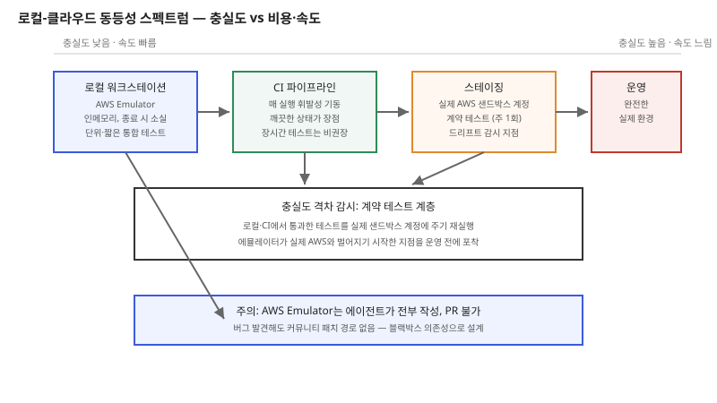

## 왜 지금 이 판단이 필요한가

"매번 AWS 계정 열어서 과금되는 리소스 만들지 말고, 로컬이나 CI에서 통합 테스트 좀 돌아가게 해주세요." 이 요구는 새롭지 않다. 그동안 LocalStack이 사실상 유일한 답이었는데, 2026년 3월 23일 LocalStack의 오픈소스 커뮤니티 에디션 저장소가 보관(archive) 처리되면서 공백이 생겼다. 커뮤니티가 fakecloud·MiniStack·LocalEmu 같은 대체 프로젝트를 내놓는 와중에, AWS가 2026년 11월 11일 직접 오픈소스 로컬 에뮬레이터 "AWS Emulator"를 공개했다. 여기서 빌더가 짚어야 할 건 단순히 "선택지가 하나 늘었다"가 아니라, 이 도구가 가진 두 가지 성격이 설계 판단 자체를 바꾼다는 점이다.

첫째, AWS Emulator는 사람이 작성하지 않았다. AWS의 자율 에이전트가 코드를 전부 작성했고, AWS는 외부 PR을 받지 않는다고 명시했다. 즉 에뮬레이터가 실제 AWS 동작과 어긋나는 걸 발견해도, 커뮤니티가 패치를 보내 고칠 수 있는 구조가 아니다. 둘째, 모든 에뮬레이트된 리소스는 메모리에만 존재하고 에뮬레이터를 멈추면 사라진다. AWS 스스로 장시간 구동이나 부하 테스트용으로 검증하지 않았다고 밝혔다. 이 두 성격을 "일단 LocalStack 대신 이것 쓰면 되겠지"로 뭉개면, 나중에 정확히 왜 로컬 테스트는 통과했는데 운영에서 깨지는지 설명 못 하는 상황에 몰린다.

## 전체 시스템에서의 위치

로컬-클라우드 동등성은 전부 아니면 전무의 문제가 아니라, 개발 루프의 각 단계마다 "충실도와 비용을 어느 수준에서 맞출 것인가"를 따로 정해야 하는 스펙트럼이다. 로컬 워크스테이션에서는 속도가 최우선이라 인메모리 에뮬레이터가 유리하고, CI 파이프라인은 매 실행마다 깨끗한 상태로 띄웠다 버리는 휘발성이 오히려 장점이다. 반면 스테이징은 실제 AWS 계정의 서비스 동작·과금·IAM 경계를 그대로 검증해야 하는 자리라 에뮬레이터로 대체할 수 없다.



그림에서 중요한 건 에뮬레이터와 실제 계정 사이에 반드시 "충실도 격차 감시" 지점을 둬야 한다는 점이다. 로컬·CI 단계만 통과시키고 끝내면, 에뮬레이터가 실제 AWS와 다르게 동작하는 부분(서비스 커버리지 공백, IAM 세부 정책 차이)을 아무도 모르는 채로 쌓인다. 스테이징에서 주기적으로 같은 테스트 스위트를 실제 계정에 돌려 "로컬에서 통과했는데 여기서 실패"하는 케이스를 잡아내는 계약 테스트 계층이 이 구조에서 빠지면 안 된다.

## 선택의 트레이드오프

| 방식 | 충실도 | 상태 영속성 | 장시간·부하 테스트 | 문제 발견 시 대응 |
|---|---|---|---|---|
| AWS Emulator (인메모리) | AWS 공식, 서비스 커버리지는 제한적 | 없음 — 종료 시 전부 소실 | 비검증, 비권장 | PR 불가, AWS 업데이트만 기다림 |
| 커뮤니티 포크(fakecloud 등) | 구현 범위는 메인테이너 역량에 의존 | 프로젝트마다 다름 | 대체로 비검증 | 커뮤니티 PR로 직접 수정 가능 |
| 실제 AWS 샌드박스 계정 | 완전 — 실제 서비스 그 자체 | 영속(의도적 정리 필요) | 검증 가능 | AWS 지원 채널로 문의 |
| 계약 테스트 + 모킹 | 테스트 설계자가 정의한 범위만 | 테스트 코드에 종속 | 설계에 따라 가능 | 코드 소유권이 전적으로 우리 쪽 |

가장 눈여겨봐야 할 줄은 마지막 열이다. AWS Emulator는 AWS 공식 도구라는 신뢰도를 주지만, 그 신뢰도와 별개로 **우리가 발견한 버그를 우리 손으로 고칠 수 없는 블랙박스 의존성**이라는 사실은 변하지 않는다. 이건 서드파티 라이브러리를 쓸 때의 "벤더 종속" 판단과 똑같이 다뤄야 한다 — 공식이라서 안전한 게 아니라, 패치 경로가 없다는 전제를 깔고 설계해야 한다.

## 실제 프로젝트 진행 순서

가장 먼저 옮길 테스트는 상태를 오래 들고 있지 않는 것들이다. "S3 이벤트가 Lambda에 올바른 형식으로 전달되는가", "DynamoDB 쓰기 후 바로 읽었을 때 스키마가 맞는가" 같은 짧은 단위 통합 테스트는 인메모리 에뮬레이터로 옮겨도 손해가 없다. 반대로 여기서 바로 막히는 지점은 둘이다. 하나는 테스트 간 상태를 유지해야 하는 시나리오(예: 배치 작업이 하루 걸쳐 쌓은 데이터를 다음 날 집계)이고, 다른 하나는 IAM 정책의 미묘한 거부 조건을 검증하는 보안 테스트다. 이런 테스트까지 에뮬레이터로 밀어넣으면 "통과는 했는데 뭘 검증했는지 모르는" 테스트가 쌓인다.

```bash
# CI 단계 구분 예시
test:unit        -> 모킹만 사용, AWS 의존 없음
test:integration -> AWS Emulator (인메모리, 매 실행 초기화)
test:contract    -> 실제 AWS 샌드박스 계정, 주 1회 스케줄 실행
test:staging-e2e -> 배포 전 수동 트리거, 실제 계정 전체 플로우
```

이렇게 네 단계로 쪼개면, 평소 개발 루프는 `test:integration`까지만 빠르게 돌리고 `test:contract`가 매주 한 번씩 "에뮬레이터가 실제와 벌어지기 시작했는지"를 잡아낸다. 이 계약 테스트 계층을 처음부터 넣지 않고 에뮬레이터 하나로 전부 대체하면, 몇 달 뒤 에뮬레이터가 새로 추가된 AWS 기능을 아직 흉내내지 못하는 공백을 운영 장애로 처음 발견하게 된다.

## 마무리 요약

- AWS Emulator는 AI 에이전트가 전부 작성하고 PR을 받지 않는 블랙박스 의존성이며, 인메모리 전용이라 장시간·부하 테스트에는 애초에 검증되지 않았다.
- 로컬-클라우드 동등성은 전부 아니면 전무가 아니라 개발 루프 단계별로 충실도 요구 수준을 다르게 설계해야 하는 문제다.
- 상태를 오래 들고 있지 않는 테스트부터 에뮬레이터로 옮기고, 실제 계정 대비 드리프트를 잡는 계약 테스트 계층을 반드시 함께 둔다.

## 참고 자료

- [AWS News Blog — Test your applications against AWS locally with AWS Emulator](https://aws.amazon.com/blogs/aws/test-your-applications-against-aws-locally-with-aws-emulator/)
- [AWS Builder Center — AWS Emulator in Practice](https://builder.aws.com/content/3M3qSo4KH3KNMJdJ6SExYVuylnA/aws-emulator-in-practice-test-aws-on-your-machine-with-no-account-and-no-cost)
