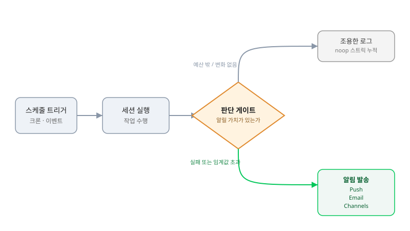

## 왜 지금 이 판단이 필요한가

"이거 매일 아침 자동으로 돌려놓고, 문제 있을 때만 알려주세요." 상시 에이전트를 붙여본 팀이라면 한 번쯤 듣는 요구다. 얼핏 할 일 목록에 "알림 보내기" 한 줄을 추가하는 문제처럼 보이지만, 실제로 맞닥뜨리는 건 "문제"가 무엇인지, "알려주세요"가 어느 채널로 언제 닿아야 하는지를 시스템이 스스로 판단하게 만드는 일이다. Anthropic은 2026년 4월 14일 Claude Code에 예약 실행 기능인 루틴(Routines)을 리서치 프리뷰로 공개했고, 이후 스케줄드 태스크(Scheduled Tasks)로 이름을 바꿔 크론 스케줄·API 호출·GitHub 이벤트로 트리거되는 완전 자율 클라우드 세션을 제공한다. 그런데 공식 문서와 커뮤니티 가이드를 보면 이 기능엔 기본 제공 푸시·이메일 알림이 없다 — 세션이 끝나도 사람에게 먼저 말을 거는 경로가 기본값으로 존재하지 않는다는 뜻이다. 알림을 받으려면 Slack·Gmail 같은 커넥터를 연결하거나, 실시간 이벤트 구독용으로 문서화된 Channels를 따로 연동해 "알려야 할 때 알리는" 로직을 직접 설계해 넣어야 한다.

이 공백은 의도된 설계에 가깝다. 2026년 업계 논의를 보면 상시 에이전트의 알림을 "유한한 예산(notification budget)"으로 보는 관점이 자리 잡고 있다 — 사람 한 명이 하루에 받아들일 수 있는 인터럽트 총량은 정해져 있고, 에이전트가 발견한 모든 이상 신호를 후보로 경쟁시켜 그중 예산을 쓸 가치가 있는 것만 통과시켜야 한다는 것이다. 같은 맥락에서 "bounded autonomy" 패턴은 에이전트가 정해진 범위 안에서는 조용히 행동하고, 그 범위를 벗어나는 예외와 고위험 결정에서만 에스컬레이션하라고 제안한다. 결국 "문제 있을 때만 알려주세요"는 알림 채널을 고르는 문제가 아니라, 침묵(기본값)과 발화(예외) 사이의 경계선을 코드 수준에서 명시적으로 그어야 하는 아키텍처 판단이다.

## 전체 시스템에서의 위치

상시 에이전트 파이프라인에서 알림은 맨 끝에 붙는 부가 기능이 아니라, 트리거와 실행 사이에 끼어드는 독립된 판단 게이트다. 스케줄 트리거(크론·이벤트)가 세션을 깨우면, 세션은 작업을 수행한 뒤 반드시 "이 결과가 알림 예산을 쓸 가치가 있는가"를 판정하는 게이트를 거친다. 이 게이트를 통과하지 못하면 결과는 로그에만 남고, 통과하면 비로소 Push·Email·Channels 같은 실제 전달 경로를 탄다.



여기서 중요한 건 "침묵"도 데이터라는 점이다. 아무 신호도 없이 그냥 넘어가는 것과, "확인했는데 이상 없음"을 적극적으로 기록하는 것은 다르다. 후자를 구분해 두면 — 예를 들어 연속된 무변화 상태를 하나의 스트릭으로 묶어 보여주는 식으로 — 사람은 "에이전트가 안 돈 건지, 돌았는데 할 말이 없었던 건지"를 나중에라도 구분할 수 있다. 이 구분이 없으면 알림이 안 왔을 때 그것이 정상인지 장애인지 알 방법이 없어지고, 그 순간 알림 설계 전체가 무너진다.

## 선택의 트레이드오프

| 경로 | 지연 | 사람이 실제로 보는 확률 | 노이즈 누적 비용 | 구현 난이도 |
|---|---|---|---|---|
| 폰 Push | 즉시 | 높음 (단, 과용 시 급락) | 가장 큼 — 예산 소진이 빠름 | 낮음 |
| 이메일 | 수 분~수 시간 | 중간 | 중간 — 받은편지함에 누적돼도 즉각 피로는 적음 | 낮음 |
| Channels (Slack·Discord 등 실시간 구독) | 즉시~수 초 | 맥락에 따라 다름 — 채널 소음도에 좌우 | 팀 채널이면 분산, 개인 DM이면 Push와 유사 | 중간 — 이벤트 구독·웹훅 설계 필요 |
| 세션 로그만 (침묵) | 없음 (사람이 능동 조회) | 낮음 — 사람이 먼저 열어봐야 함 | 없음 | 가장 낮음 |

표의 셋째 줄을 가볍게 보면 안 된다. Push는 가장 빠르고 확실하지만 예산 소진도 가장 빠르다 — "알아서 돌다가 문제 생기면 알려주세요"라는 요구를 "매번 사소한 변화마다 Push"로 구현하면 2주 안에 사람이 알림을 끄거나 무시하게 되고, 그 순간부터 이 자동화는 존재하지 않는 것과 같아진다. 반대로 전부 로그로만 남기면 알림이라는 요구 자체를 충족하지 못한다. 실무에서는 Push를 "정말 예외적인 한 가지 조건"에만 걸고, 나머지는 이메일이나 주간 다이제스트로 묶어 내려보내는 계층화가 필요하다.

## 실제 프로젝트 진행 순서

이걸 실제로 붙이기로 했다면 알림 채널 선정보다 먼저 손대야 할 건 "무엇이 일어나면 사람이 와야 하는가"를 문장으로 적어보는 일이다. 이 문장이 모호하면 — 예를 들어 "문제 있을 때"라고만 적으면 — 구현 단계에서 임계값을 과도하게 민감하게 잡아 알림 피로를 만들거나, 반대로 너무 둔감하게 잡아 정작 중요한 실패를 놓치게 된다. 아래는 이 판정을 게이트 함수 하나로 분리해 두는 최소 구조다.

```python
def should_notify(result, history):
    # 1. 작업 자체가 실패했는가 (가장 확실한 알림 조건)
    if result.status == "failed":
        return True, "critical"
    # 2. 관찰 대상이 실제로 변했는가 (noop 여부)
    if not result.changed:
        history.record_noop()
        return False, None
    # 3. 변화는 있었지만 사람이 정의한 임계값 안인가
    if result.severity < history.notification_threshold:
        return False, None
    return True, "normal"
```

여기서 흔히 막히는 지점은 두 가지다. 하나는 실패 자체를 알리는 경로를 깜빡하는 것 — 정상 결과만 알림 대상으로 설계하면, "오늘 이 작업이 아예 돌지 않았다"는 가장 치명적인 신호가 조용히 사라진다. 이 루틴처럼 매일 실행되는 작업이라면 "며칠째 조용하다"는 상태 자체도 감시 대상에 넣어야 한다. 다른 하나는 알림 본문의 내용이다. "문제가 있습니다"만 보내면 사람은 세션을 다시 열어 전체 로그를 뒤져야 하고, 그 순간 알림의 가치가 반으로 줄어든다. 업계 가이드가 공통적으로 강조하는 지점도 같다 — 알림은 "무엇이 일어났는지"와 "다음에 뭘 해야 하는지"를 한 번에 담아야, 사람이 알림만 보고 판단을 끝낼 수 있다. 검증은 임계값을 바로 실서비스에 걸지 말고, 먼저 일주일 정도 모든 판정 결과를 로그로만 쌓아 "이 임계값이었다면 몇 번 울렸을까"를 역산해 보는 게 안전하다 — 실제 알림을 내보내기 전에 노이즈 예산을 소진하는 실수를 미리 걸러낼 수 있다.

## 마무리 요약

- Claude Code 스케줄드 태스크(옛 루틴)는 기본 푸시·이메일 알림이 없다 — "언제 알릴지"는 Channels·커넥터 위에 직접 설계해 넣어야 하는 영역이다.
- 알림은 유한한 예산이라는 전제로 설계해야 한다. 모든 이상 신호를 다 올리면 예산이 빠르게 소진되고, 사람은 알림을 끄는 쪽을 택한다.
- "조용함"도 적극적으로 기록해야 한다 — noop과 미실행을 구분하지 못하면 알림이 안 왔을 때 정상인지 장애인지 판단할 방법이 사라진다.

## 참고 자료

- [Anthropic — Introducing routines in Claude Code](https://claude.com/blog/introducing-routines-in-claude-code)
- [Claude Code Docs — Scheduled Tasks](https://code.claude.com/docs/en/scheduled-tasks)
- [tianpan.co — Background agents, notification budget, and the attention economy (2026-05-13)](https://tianpan.co/blog/2026-05-13-background-agents-notification-budget-attention-economy)
- [Zylos — Agent Notification Intelligence: Smart Alerting, Triage, and Escalation (2026-04-23)](https://zylos.ai/research/2026-04-23-agent-notification-intelligence-smart-alerting-triage)
