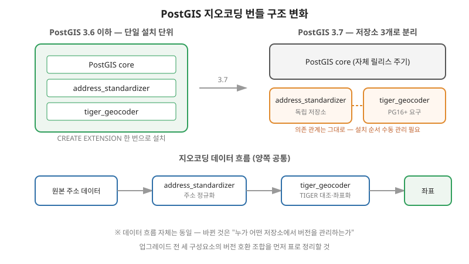

## 왜 지금 이 판단이 필요한가

"해외 배송 데이터, 미국 주소만 PostGIS로 좌표 붙여서 넘겨주세요." 이런 요구를 받으면 그동안 답은 간단했다 — PostgreSQL에 PostGIS를 올리고 `CREATE EXTENSION postgis_tiger_geocoder;` 한 줄이면 TIGER/Line 센서스 데이터 기반 지오코딩 함수가 바로 쓸 수 있는 상태로 설치됐다. 주소를 다듬어주는 `address_standardizer`도 같은 패키지 안에 딸려 왔으니, "PostGIS 버전만 맞으면 지오코딩도 따라온다"는 전제가 당연했다.

2026년 10월 29일 공식 릴리스된 PostGIS 3.7부터 이 전제가 깨진다. 개발팀은 2026년 2월부터 메일링 리스트에서 두 익스텐션을 코어 코드베이스에서 완전히 들어내자는 논의를 진행했고, Regina Obe는 "address_standardizer는 PostGIS 코어에 의존성이 전혀 없고 릴리스 주기도 훨씬 느리다"는 점을, tiger_geocoder 쪽은 "센서스 데이터가 바뀔 때마다 갱신되는데 PostGIS 릴리스 주기를 따라갈 이유가 없다"는 점을 근거로 들었다. 결과적으로 PostGIS 3.6 시리즈가 tiger_geocoder를 포함한 마지막 버전이 됐고, 3.7부터는 두 익스텐션 모두 OSGeo 산하의 별도 저장소로 독립했다. 단순한 버전업이 아니라, "지오코딩 기능이 PostGIS 설치에 자동으로 따라온다"는 운영 가정 자체를 재검토해야 하는 사건이다.

## 전체 시스템에서의 위치

주소 지오코딩 파이프라인에서 PostGIS가 차지하는 자리를 그려보면 변화가 왜 운영에 직접 영향을 주는지 보인다. 원본 주소 데이터는 먼저 `address_standardizer`를 거쳐 번지·도로명·주(state)·우편번호 같은 구조화된 필드로 정규화되고, 그 결과를 `tiger_geocoder`가 TIGER/Line 참조 테이블과 대조해 좌표로 변환한 뒤, 애플리케이션이 이 좌표를 저장·서빙한다. PostGIS 코어는 이 전체 흐름에서 지오메트리 타입과 공간 함수(ST_Distance, ST_Within 같은)를 제공하는 기반층일 뿐, 지오코딩 로직 자체는 원래도 그 위에 얹힌 두 개의 애드온이었다.



그림에서 보듯 3.6 이하에서는 세 구성요소가 하나의 설치 단위였기 때문에 CI 파이프라인이나 Dockerfile에서 "PostGIS 이미지 하나"만 관리하면 끝났다. 3.7부터는 PostGIS 코어, address_standardizer(github.com/postgis/address_standardizer), tiger_geocoder(OSGeo Gitea의 독립 저장소)가 각자 다른 릴리스 주기와 의존성을 갖는다. 특히 새 tiger_geocoder 저장소는 PostgreSQL 16 이상을 요구하는데, 이는 PostGIS 코어 자체의 최소 버전 요구사항과 별개로 추가 제약이 붙는다는 뜻이다. 더 까다로운 지점은 3.7의 Tiger Geocoder 치트시트 문서 자체가 "geocoder 함수는 address_standardizer 익스텐션을 필요로 한다"고 명시하고 있다는 점이다 — 즉 두 익스텐션은 분리됐지만 의존 관계는 그대로 남아, 설치 순서와 버전 호환성을 수동으로 맞춰야 하는 책임이 운영자에게 넘어왔다.

## 선택의 트레이드오프

| 선택지 | 운영 부담 | 장점 | 언제 쓰면 안 되는가 |
|---|---|---|---|
| PostGIS 3.6 유지 | 낮음 (기존 번들 그대로) | 당장 깨지는 게 없음 | GEOS·PostgreSQL 최신 보안 패치가 필요한 환경에서 장기 방치는 위험 |
| 3.7 업그레이드 + 두 익스텐션 수동 설치 | 중간~높음 (버전 핀 관리 필요) | PostGIS 코어 최신 기능·성능 개선 확보 | 센서스 데이터 지오코딩 외 기능은 안 쓰면서 번들 편의만 보고 유지하던 경우 |
| 외부 지오코딩 서비스로 이관 (libpostal, Pelias, 상용 API) | 초기 전환 비용 높음, 이후 운영은 낮음 | 주소 표준화·커버리지가 TIGER 데이터 한계를 넘어섬 | 미국 외 지역 주소가 섞여 있다면 애초에 tiger_geocoder만으로는 못 풀던 문제 |

세 번째 선택지를 가볍게 보면 안 된다. tiger_geocoder는 애초에 미국 센서스 TIGER/Line 데이터 기반이라 미국 주소 전용이었다 — 이번 분리 사건은 "원래 쓰던 기능이 더 좁아진다"가 아니라 "하나의 설치 단위로 묶여 있던 책임이 드러난다"에 가깝다. 다국가 주소를 다뤄야 하는 서비스라면 이번 기회에 지오코딩 레이어 자체를 PostGIS 바깥의 전용 서비스로 분리하는 쪽이 장기적으로 운영 부담을 줄인다.

## 실제 프로젝트 진행 순서

PostGIS를 3.7로 올리기 전에 먼저 할 일은 버전 고정이 아니라 **의존성 감사**다.

```sql
-- 현재 설치된 지오코딩 관련 익스텐션과 버전 확인
SELECT extname, extversion
FROM pg_extension
WHERE extname IN ('postgis', 'postgis_tiger_geocoder', 'address_standardizer');
```

이 쿼리로 tiger_geocoder·address_standardizer가 실제로 설치돼 있는지, 어떤 버전인지부터 확인한다. 둘 다 안 쓰고 있다면 3.7 업그레이드는 일반적인 메이저 버전업과 다르지 않다. 쓰고 있다면 다음 순서로 진행한다.

1. **PostgreSQL 버전 확인** — 새 tiger_geocoder 저장소는 PostgreSQL 16 이상을 요구한다. 아직 14·15를 쓰고 있다면 PostGIS 3.7보다 먼저 PostgreSQL 업그레이드부터 계획해야 한다.
2. **스테이징에서 분리 설치 리허설** — `address_standardizer`를 github.com/postgis/address_standardizer에서 먼저 빌드·설치하고, 그 위에 tiger_geocoder 저장소를 올려 기존 지오코딩 쿼리가 동일한 결과를 내는지 회귀 테스트한다. 두 저장소의 버전 조합이 치트시트에 명시된 요구사항과 맞는지 반드시 대조한다.
3. **CI/Dockerfile 갱신** — 이미지 빌드 스크립트에서 "PostGIS 설치 = 지오코딩 기능 포함"이라는 암묵적 가정을 걷어내고, 두 익스텐션을 명시적 단계로 분리해 버전을 고정한다.
4. **실패 시 롤백 경로 확보** — TIGER 참조 테이블은 용량이 커서 재적재에 시간이 걸린다. 업그레이드 실패를 가정해 기존 3.6 데이터 디렉터리 스냅샷을 먼저 떠 두고 진행한다.

여기서 가장 흔히 막히는 지점은 2번 리허설이다. 분리된 저장소들의 버전 태그가 PostGIS 코어 릴리스 노트와 동기화돼 공지되지 않는 경우가 있어, 조합을 잘못 고르면 익스텐션 로드 자체가 실패하는데도 에러 메시지만으로는 원인을 알기 어렵다. 업그레이드 전 세 구성요소의 버전 조합을 표로 먼저 적어 두고 시작하는 편이 디버깅 시간을 가장 많이 아낀다.

## 마무리 요약

- PostGIS 3.7(2026-10-29)부터 tiger_geocoder·address_standardizer가 코어에서 빠져 각각 독립 저장소로 운영된다.
- 분리됐지만 의존 관계는 그대로라, 설치 순서와 버전 호환을 운영자가 직접 맞춰야 한다 — "따로 관리하되 여전히 서로 필요"라는 점이 가장 큰 함정이다.
- 미국 외 주소를 다루는 서비스라면 이번 분리를 계기로 지오코딩 레이어를 PostGIS 바깥의 전용 서비스로 이관하는 선택지도 함께 검토할 가치가 있다.

## 참고 자료

- [PostGIS Tiger Geocoder 2025.1 Released](https://postgis.net/2026/06/PostGIS-Tiger-Geocoder-2025.1/)
- [PostGIS 3.7 Tiger Geocoder Cheatsheet](https://postgis.net/docs/manual-3.7/tiger_geocoder_cheatsheet-en.html)
- [PostGIS 3.7.0rc2 Release Announcement](https://postgis.net/2026/09/PostGIS-3.7.0rc2/)
- [PostGIS 개발 메일링 리스트 — Remove postgis_tiger_geocoder and address_standardizer](https://lists.osgeo.org/pipermail/postgis-devel/2026-February/030730.html)
