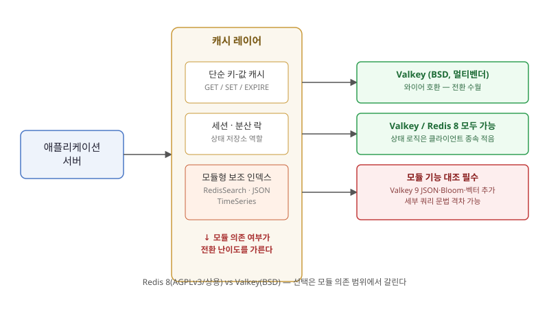

## 왜 지금 이 판단이 필요한가

"캐시 서버 라이선스 문제가 있다고 들었는데, 그냥 최신 버전으로 올리면 되는 거 아닌가요?" 플랫폼팀에 이런 질문이 들어오면 대부분 마이너 업그레이드 티켓 하나로 끝낼 일이라고 생각한다. 하지만 실제로는 "버전을 올릴 것인가"가 아니라 "어떤 라이선스·거버넌스 아래 있는 캐시 레이어를 계속 쓸 것인가"를 다시 정하는 문제다. Redis Inc.는 2024년 3월 Redis 7.4부터 라이선스를 RSALv2·SSPLv1 이중 라이선스로 바꿨고, 이후 Redis 8.0에서 AGPLv3를 세 번째 선택지로 추가하며 "완전 오픈소스로 복귀했다"고 홍보했다. 그런데 여기서 멈추지 않는다. 구버전 라인업인 Redis Software 7.2가 2026년 2월 28일부로 공식 EOL을 맞아 보안 패치와 지원이 끊겼다. 즉 7.2를 그대로 쓰는 팀은 지금 이 순간 패치되지 않는 캐시 서버를 운영 중이라는 뜻이고, 이 글을 읽는 시점에 아직 아무 결정도 안 내렸다면 이미 유예 기간이 아니라 방치 기간에 들어와 있는 셈이다.

이 상황에서 실제로 갈리는 선택지는 셋이다. 첫째, Redis 8 계열로 올려 AGPLv3 트랙을 타는 것. 둘째, Redis Cloud나 Redis Software 상용 라이선스로 전환해 엔터프라이즈 지원을 받는 것. 셋째, Linux Foundation 산하 멀티 벤더 거버넌스로 포크된 BSD 3-Clause 라이선스의 Valkey로 옮기는 것. 세 선택지는 "같은 제품의 버전 차이"가 아니라 거버넌스 주체와 라이선스 조건이 완전히 다른 별개의 제품이므로, 캐시 레이어 하나를 고르는 일이 곧 앞으로 몇 년간의 라이선스 리스크와 운영 주도권을 고르는 아키텍처 결정이 된다. 문제는 이 결정이 캐시 서버 하나로 끝나지 않는다는 점이다 — 애플리케이션이 RedisSearch로 벡터 검색을 하고 있는지, RedisJSON으로 문서를 저장하는지에 따라 선택지의 폭이 완전히 달라진다.

## 전체 시스템에서의 위치

캐시 레이어는 보통 애플리케이션 서버와 원본 데이터베이스 사이에서 세 가지 역할을 겸한다 — 단순 키-값 캐시, 세션·락 같은 상태 저장소, 그리고 모듈을 얹은 보조 인덱스(검색·시계열·JSON 문서)다. 이 세 역할 중 어디까지 캐시 레이어가 떠맡고 있는지에 따라 마이그레이션 난이도가 전혀 달라진다. 단순 키-값 캐시로만 쓰는 서비스는 와이어 프로토콜 호환성만 확인하면 되지만, RedisSearch로 임베딩 벡터 검색을 돌리거나 RedisTimeSeries로 메트릭을 쌓고 있다면 그 모듈이 이전 대상에도 존재하는지부터 확인해야 한다.



그림에서 보듯 모듈 의존성이 있는 경로는 선택의 폭이 좁아진다. Valkey는 포크 초기에는 모듈 생태계가 비어 있었지만, Valkey 9에서 JSON·Bloom Filter·벡터 검색 모듈을 공식으로 추가하면서 격차를 좁히는 중이다. 다만 "격차를 좁히는 중"이라는 말 자체가 완전히 동등하지 않다는 뜻이므로, 실제 서비스가 쓰는 모듈 기능(예: RedisSearch의 특정 쿼리 문법, RedisTimeSeries의 다운샘플링 정책)을 하나씩 대조해야 한다. 관리형 서비스를 쓰는 팀이라면 한 단계가 더 있다 — AWS는 ElastiCache와 MemoryDB 둘 다 Valkey를 지원하지만, Azure Cache for Redis는 이 글을 쓰는 시점까지 Valkey를 지원하지 않는다. 즉 클라우드 벤더 선택이 이미 Valkey 전환 가능 여부를 절반쯤 결정해 놓은 경우도 있다.

## 선택의 트레이드오프

| 기준 | Redis 8 (AGPLv3/상용) | Valkey |
|---|---|---|
| 라이선스 | AGPLv3 또는 RSALv2/SSPLv1/상용 중 선택 | BSD 3-Clause, OSI 승인 완전 오픈소스 |
| 거버넌스 | Redis Inc. 단일 벤더 | Linux Foundation, 멀티 벤더(AWS·Google·Oracle 등 참여) |
| 모듈 생태계 | RedisSearch·RedisJSON·RedisTimeSeries 네이티브 지원 | Valkey 9부터 JSON·Bloom·벡터 검색 공식 추가, 세부 기능 격차는 남음 |
| 관리형 서비스 | Redis Cloud, 일부 벤더 매니지드 | AWS ElastiCache·MemoryDB 지원, Azure Cache for Redis는 미지원 |
| 클라이언트 호환성 | 레퍼런스 구현 | 와이어 프로토콜 호환이라 기존 클라이언트 그대로 사용 가능 |
| AGPLv3 리스크 | 네트워크 서비스로 제공 시 소스 공개 의무 조항 검토 필요 | 해당 없음 |

표의 세 번째 줄(모듈 생태계)을 가장 보수적으로 읽어야 한다. "Valkey 9가 벡터 검색을 추가했다"는 소식만 보고 전환을 결정하면, 실제로는 자신이 쓰는 RedisSearch 쿼리 문법이나 인덱스 옵션 일부가 아직 구현되지 않아 마이그레이션 중간에 막히는 경우가 나온다. AGPLv3 쪽도 가볍게 볼 조항이 아니다 — 사내 전용으로만 쓴다면 문제가 적지만, 이 캐시 레이어를 포함한 서비스를 외부에 SaaS 형태로 제공한다면 네트워크 서비스 제공 자체를 소스 공개 트리거로 보는 해석이 있어 법무 검토가 선행되어야 한다.

## 실제 프로젝트 진행 순서

첫 번째로 손대야 할 것은 버전 비교표가 아니라 **모듈 의존성 인벤토리**다. 운영 중인 Redis 인스턴스에 `MODULE LIST` 명령으로 로드된 모듈을 먼저 확인하고, 애플리케이션 코드에서 `FT.SEARCH`, `JSON.SET`, `TS.ADD` 같은 모듈 전용 명령을 검색해 실제 사용 범위를 파악한다.

```bash
# 현재 인스턴스에 로드된 모듈 확인
redis-cli MODULE LIST

# 코드베이스에서 모듈 전용 명령 사용처 전수 검색
grep -rEn "FT\.(SEARCH|CREATE)|JSON\.(SET|GET)|TS\.(ADD|RANGE)" src/
```

이 인벤토리 결과가 비어 있다면 — 단순 `GET`/`SET`/`EXPIRE` 위주로만 쓰고 있다면 — Valkey 전환은 와이어 프로토콜 호환성 덕분에 클라이언트 라이브러리 교체 없이 엔드포인트만 바꾸는 수준으로 끝날 가능성이 높다. 반대로 모듈 전용 명령이 다수 나온다면, 그 모듈이 Valkey 쪽에서 어느 수준까지 구현됐는지 기능 단위로 대조하는 작업이 전체 일정의 핵심이 된다.

여기서 흔히 막히는 지점은 일정 추정이다. 실제 전환 사례들을 보면 "주말 하나면 끝날 것"이라 예상했다가 클라이언트 라이브러리 버전 감사, 스테이징 환경 부하 테스트, 그리고 한 번의 롤백 사고까지 겪으며 3주가 걸린 경우가 보고된다. 이 간극이 생기는 이유는 대부분 모듈 의존성을 사전에 전수 조사하지 않고 "와이어 호환이니 괜찮겠지"라고 낙관했기 때문이다. 따라서 진행 순서는 ① 모듈 의존성 인벤토리 → ② 스테이징에 Valkey 띄워 동일 트래픽 패턴으로 그림자 테스트 → ③ 클라이언트 라이브러리·관리형 서비스 호환성 확인 → ④ 롤백 플랜을 포함한 단계적 트래픽 전환 순으로 짜야 하고, ①을 건너뛰고 바로 ②로 가면 테스트 단계에서야 모듈 격차를 발견해 일정이 뒤로 밀린다.

## 마무리 요약

- Redis Software 7.2의 2026년 2월 EOL은 "업그레이드 티켓"이 아니라 라이선스·거버넌스가 다른 제품 중 하나를 고르는 아키텍처 결정을 강제한다.
- 모듈(RedisSearch·RedisJSON·RedisTimeSeries) 사용 여부가 선택의 폭을 가장 크게 좌우하며, Valkey 9의 모듈 추가도 완전한 기능 동등을 의미하지 않는다.
- 실제 진행은 모듈 의존성 인벤토리부터 시작해야 하며, 이를 건너뛰면 "주말 작업"이 수 주짜리 사고로 번진다.

## 참고 자료

- [Redis vs Valkey: How to Choose in 2026 (Better Stack)](https://betterstack.com/community/comparisons/redis-vs-valkey/)
- [It's End of Life for Redis Enterprise 7.2 in Six Months (Percona)](https://www.percona.com/blog/its-end-of-life-for-redis-enterprise-7-2-in-six-months-what-are-your-options/)
- [The Redis License Has Changed: What You Need to Know (Percona)](https://www.percona.com/blog/the-redis-license-has-changed-what-you-need-to-know/)
