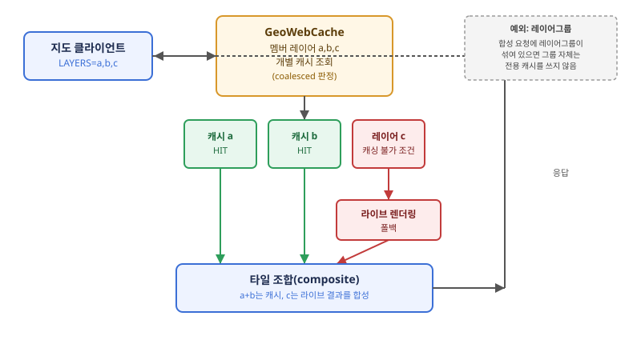

## 왜 지금 이 판단이 필요한가

"행정구역 경계랑 하천, 건물 레이어를 한 지도에 같이 띄워주세요." 흔한 요구다. 그런데 GeoServer를 WMS로 운영해 본 사람이라면 한 번쯤 의아했을 지점이 있다 — 레이어 하나씩 따로 요청하면 두 번째부터는 캐시에서 바로 나오는데, `LAYERS=boundary,river,building`처럼 한 요청에 여러 레이어를 합쳐서 보내면 매번 느리다. GeoWebCache(GWC)는 지금까지 **단일 레이어를 지정한 타일 요청만 캐싱 대상으로 인식**했고, 여러 레이어가 섞인 "coalesced" 요청은 캐시를 아예 건너뛰고 그때그때 GeoServer가 직접 렌더링해 돌려줬다.

프론트엔드 입장에서 레이어 합성 요청은 네트워크 왕복을 줄이는 자연스러운 최적화다. 하지만 그 요청이 GWC 캐시의 사각지대였다는 사실은 운영자 쪽에서는 잘 드러나지 않는다. 타일 요청 로그에 `TYPE=OWS`가 아니라 `TYPE=PNG`로 찍히는 라이브 렌더링이 섞여 있어도, 전체 응답 시간이 "그냥 느린 레이어가 있나 보다"로 넘어가기 쉽기 때문이다.

2026년 6월 17년 만의 메이저 업데이트로 나온 GeoServer 3.0 계열이 이 지점을 바꿨다. GWC 2.0 기반의 3.0.2 릴리스(GeoTools 35.2 동반)에 **멀티 레이어(coalesced) 타일 캐싱** 기능이 들어오면서, 합성 요청도 각 멤버 레이어의 개별 캐시를 조합해 내려줄 수 있게 됐다. 기능 하나가 추가된 게 아니라, "레이어를 합쳐 요청하면 느리다"는 그동안의 암묵적 전제 자체가 깨지는 변화다.

## 전체 시스템에서의 위치

레이어 합성 요청이 들어왔을 때 GWC가 어디서 캐시를 찾고 어디서 포기하는지를 먼저 그려 보면 이번 변화의 의미가 분명해진다.



프론트엔드 지도 클라이언트가 보내는 `LAYERS=a,b,c` 요청은 WMS 레이어에게 가기 전에 GWC 캐시 레이어를 거친다. 기존에는 이 단계에서 "레이어가 2개 이상이니 캐시 대상 아님" 판정이 내려져 바로 GeoServer 렌더링 엔진으로 넘어갔다. 멀티 레이어 캐싱이 켜지면 이 판정 로직이 바뀐다 — `a`, `b`, `c` 각각을 **자신의 개별 타일 캐시에서 조회**하고, 모두 존재하면 조합(composite)해서 응답한다. 핵심은 **레이어 `a`를 단독으로 요청했을 때 쓰는 캐시와 `a,b,c`로 합성 요청할 때 쓰는 캐시가 같은 저장소라는 점**이다. 별도의 "합성 결과물 캐시"가 새로 생기는 게 아니라, 기존 레이어별 캐시의 활용도가 넓어지는 구조다.

단, 두 가지 예외가 전체 그림에 끼어든다. 첫째, 멤버 레이어 중 하나가 일반 캐싱 조건(지원하는 타일 그리드셋·포맷 등)을 만족하지 못하면 그 레이어만 라이브 렌더링되고 나머지는 캐시에서 가져와 조합한다 — 전부 아니면 전무가 아니라 레이어 단위 폴백이다. 둘째, 레이어그룹이 합성 요청에 섞여 있으면 그 레이어그룹 자체는 전용 캐시를 쓰지 않는다. 레이어그룹을 많이 쓰는 조직이라면 "그룹으로 묶으면 캐시가 더 잘 될 것"이라는 기대가 이번에도 그대로 깨진다는 점을 염두에 둬야 한다.

## 선택의 트레이드오프

| 운영 방식 | 캐시 적중률 | 캐시 용량 증가 | 언제 쓰면 안 되는가 |
|---|---|---|---|
| 멀티 레이어 캐싱 끔(기존 기본값) | 합성 요청 0% | 변화 없음 | 레이어 조합 요청 비중이 낮은 서비스 |
| 멀티 레이어 캐싱 켬 | 멤버 레이어 각각 100% 도달 가능 | 레이어별 캐시가 더 빨리, 더 자주 채워짐 | 디스크·오브젝트 스토리지 여유가 빠듯한 환경 |
| 레이어그룹으로 미리 합성해 별도 캐싱 | 그룹 조합 고정 시 가장 빠름 | 그룹 수만큼 캐시 중복 | 클라이언트가 레이어 조합을 자유롭게 바꾸는 서비스 |

멀티 레이어 캐싱을 켠다고 캐시 용량이 공짜로 늘어나는 건 아니다. 공식 문서도 "합성 요청이 단일 레이어 캐시와 같은 저장소에 쓰기 때문에 해당 레이어들의 캐시가 더 빨리 채워진다"고 명시한다. 즉 지금까지 라이브 렌더링으로 새어 나가던 부하가 캐시 디스크 쓰기 부하로 자리를 옮기는 셈이다. 기존에 레이어별 캐시 만료 주기나 시드(seed) 작업을 디스크 용량에 맞춰 빠듯하게 잡아 둔 조직이라면, 이 기능을 켜기 전에 용량 여유부터 다시 계산해야 한다.

또 하나, 합성 결과를 조합할 때 GeoServer의 최대 WMS 요청 메모리 설정을 초과하면 그 요청은 캐시 여부와 무관하게 여전히 거부되거나 제한된다. 레이어를 많이 겹칠수록 조합 단계의 메모리 사용량도 함께 늘어난다는 뜻이므로, 켜는 것과 무제한으로 많은 레이어를 합성해도 된다는 것은 별개의 문제다.

## 실무 설정과 확인 순서

GWC 관리자 UI 또는 `gwc-gs.xml`에서 멀티 레이어 캐싱을 레이어 단위로 활성화한다. 설정 자체는 간단하지만, 켜기 전/후 비교가 운영 판단의 핵심이다.

```xml
<!-- gwc-layer 설정에 캐싱 가능한 레이어로 등록 -->
<GeoServerTileLayer>
  <name>boundary</name>
  <enabled>true</enabled>
  <!-- 멀티 레이어(coalesced) 요청의 멤버로 캐시되도록 허용 -->
</GeoServerTileLayer>
```

```bash
# 켜기 전: 합성 요청이 라이브 렌더링되는지 응답 헤더로 확인
curl -s -D - -o /dev/null \
  "http://geoserver/geoserver/gwc/service/wms?LAYERS=boundary,river,building&TILED=true&WIDTH=256&HEIGHT=256&BBOX=..." \
  | grep -i "geowebcache-cache-result"
```

`geowebcache-cache-result` 응답 헤더가 `MISS`에서 `HIT`으로 바뀌는지가 가장 빠른 검증 지표다. 진행 순서는 다음과 같다. 1) 로그나 모니터링에서 실제로 레이어 합성 요청이 얼마나 자주 들어오는지부터 집계한다 — 이 비중이 낮다면 굳이 설정을 바꿀 이유가 없다. 2) 합성에 자주 쓰이는 레이어 조합 중 트래픽이 가장 많은 것부터 멀티 레이어 캐싱을 켠다. 3) 켠 직후 며칠간 디스크 사용량 증가 추이를 관찰한다 — 예상보다 빠르게 차면 레이어별 만료 정책을 다시 조정한다. 4) 레이어그룹으로 자주 쓰는 조합이 있다면, 그 조합만큼은 멀티 레이어 캐싱이 아니라 기존 방식대로 레이어그룹 자체 캐시로 남겨 둘지 별도로 판단한다.

가장 흔히 걸리는 함정은 "레이어그룹을 쓰면 당연히 캐시가 더 잘 될 것"이라는 역방향 기대다. 레이어그룹은 여전히 전용 캐시가 없으므로, 클라이언트가 보내는 조합이 고정적이라면 차라리 그 조합 그대로 레이어그룹을 만들어 그룹 전용 캐시를 쓰는 기존 방식이 낫고, 조합이 매번 달라진다면 멀티 레이어 캐싱 쪽이 유리하다. 둘을 혼동하면 기대한 적중률이 나오지 않는다.

## 마무리 요약

- GWC는 그동안 `LAYERS=a,b,c` 같은 멀티 레이어 합성 요청을 캐시 대상에서 제외하고 매번 라이브 렌더링했다. GeoServer 3.0.2(GWC 2.0.2)부터 멤버 레이어별 캐시를 조합해 응답할 수 있다.
- 새로운 캐시 저장소가 생기는 게 아니라 **기존 레이어별 캐시를 합성 요청도 함께 쓰도록 넓히는 구조**라서, 디스크 용량과 만료 정책을 먼저 재점검해야 한다.
- 레이어그룹은 이 기능의 적용 대상이 아니다. 고정된 레이어 조합은 레이어그룹 캐시, 가변적인 조합은 멀티 레이어 캐싱으로 역할을 나눠야 한다.

## 참고 자료

- [GeoServer 3.0.2 Release Notes](https://geoserver.org/announcements/vulnerability/2026/08/14/geoserver-3-0-1-released.html)
- [GeoWebCache Multi-layer Tile Caching — GeoServer User Manual](https://docs.geoserver.org/main/en/user/geowebcache/webadmin/defaults/)
- [GeoServer Release Schedule](https://github.com/geoserver/geoserver/wiki/Release-Schedule)
