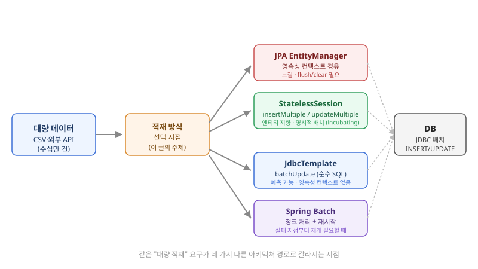

## 왜 지금 이 판단이 필요한가

"외부 파트너사에서 상품 마스터 CSV가 하루 한 번 넘어오는데, 그걸 수십만 건씩 DB에 반영해주세요." 이런 요구를 받으면 가장 먼저 손이 가는 건 이미 쓰고 있는 `JpaRepository.saveAll()`이다. 작은 테이블에서는 문제없이 동작하다가, 행 수가 10만을 넘어가는 순간 힙 메모리가 치솟거나 트랜잭션이 몇 분씩 걸리는 사고로 이어진다. 원인은 단순하다 — `EntityManager`를 쓰는 일반 세션은 저장하는 모든 엔티티를 1차 캐시(영속성 컨텍스트)에 계속 쌓아두기 때문에, 몇만 건만 넘어가도 메모리와 더티 체킹 비용이 선형으로 불어난다.

지금까지는 이 문제를 `hibernate.jdbc.batch_size` 설정과 주기적인 `flush()`/`clear()` 호출로 우회해왔다. 그런데 2025년 공개된 Hibernate ORM 7은 이 우회를 정식 API로 바꿨다. `StatelessSession`에 `insertMultiple()`·`updateMultiple()`·`deleteMultiple()`이라는 명시적 배치 메서드가 추가되면서, 공식 문서는 이제 "JDBC 배칭 설정에 기대지 말고 이 메서드를 직접 호출하라"고 안내한다. 동시에 `hibernate.jdbc.batch_size` 설정 자체는 `StatelessSession`에서 더 이상 효과가 없다는 변경도 같이 들어왔다. 즉 예전에 암묵적으로 의존하던 설정이 조용히 무력화되면서, 대량 적재 코드를 짤 때 "어떤 세션, 어떤 메서드로 밀어넣을 것인가"를 다시 판단해야 하는 시점이 됐다.

## 전체 시스템에서의 위치

대량 적재 파이프라인은 보통 외부 데이터 소스(CSV, 외부 API, 파트너 피드)와 애플리케이션 DB 사이에 끼는 한 단계다. 이 단계가 어떤 세션·API를 쓰느냐에 따라 같은 "데이터 넣기" 요구가 네 가지 전혀 다른 아키텍처 경로로 갈린다 — 엔티티 지향 영속성 컨텍스트를 그대로 쓸지, Hibernate 7의 명시적 배치 API로 우회할지, ORM을 아예 건너뛰고 순수 JDBC로 내려갈지, 재시작·실패 복구가 필요한 규모라면 별도 배치 프레임워크를 둘지의 선택이다.



여기서 중요한 건 이 네 경로가 "같은 걸 다르게 구현한 것"이 아니라는 점이다. `EntityManager` 경로는 영속성 컨텍스트가 변경 감지(dirty checking)·캐스케이드·2차 캐시 동기화를 모두 챙겨주는 대신 메모리 비용을 지불한다. `StatelessSession`은 이 챙김을 전부 포기하는 대신 가볍다 — 영속성 컨텍스트가 없고, 캐스케이드도 자동 적용되지 않으며, 연관관계는 직접 관리해야 한다. 적재 로직을 어디에 둘지 정하는 건 결국 "이 단계에서 엔티티 생명주기 관리가 필요한가"를 먼저 묻는 일이다.

## 선택의 트레이드오프

| 방식 | 영속성 컨텍스트 | 식별자 전략 제약 | 캐스케이드·연관관계 | 적합한 상황 |
|---|---|---|---|---|
| `EntityManager.persist()` 반복 | 있음 — 메모리 누적 | 없음 | 자동 지원 | 수천 건 이하, 연관관계 자동 저장이 필요할 때 |
| `StatelessSession.insertMultiple()` | 없음 — 가벼움 | IDENTITY 전략은 JDBC 배칭 최적화 미지원 | 수동 관리 필요 | 수만~수십만 건, 엔티티 매핑은 유지하고 싶을 때 |
| `JdbcTemplate.batchUpdate()` | 없음 | 없음(SQL 직접 작성) | 없음 — 전부 수동 | SQL을 직접 제어하고 싶거나 엔티티 매핑 자체가 과할 때 |
| Spring Batch (청크 처리) | 선택적 | 구현에 따라 다름 | 선택적 | 실패 지점부터 재시작해야 하거나 수백만 건 이상 |

가장 흔히 걸리는 함정은 `insertMultiple()`을 "그냥 더 빠른 `saveAll()`"로 오해하는 것이다. 이 메서드는 아직 인큐베이팅(실험적) 기능으로 분류돼 있고, 식별자 생성 전략이 `IDENTITY`(DB 자동 증가)인 엔티티는 JDBC 배칭 최적화가 적용되지 않아 기대한 만큼 빨라지지 않는 경우가 보고된다. 반대로 `SEQUENCE`나 애플리케이션이 직접 할당하는 식별자라면 배칭 효과를 제대로 받는다. 또 하나, `StatelessSession`은 Hibernate 7부터 2차 캐시를 기본으로 사용하기 시작했다는 점도 바뀐 부분이다 — 이전 버전의 습관대로 "스테이트리스니까 캐시와 무관하다"고 가정하면 안 되고, 필요하면 `setCacheMode()`로 명시적으로 꺼야 한다.

## 실제 프로젝트 진행 순서

가장 먼저 할 일은 라이브러리 버전을 올리는 게 아니라, 적재 대상 엔티티의 식별자 전략을 확인하는 것이다. `IDENTITY` 전략을 쓰는 엔티티라면 `insertMultiple()`로 바꿔도 체감 성능 개선이 제한적일 수 있으므로, 이 경우는 처음부터 `JdbcTemplate.batchUpdate()`나 시퀀스 기반 식별자로의 전환을 함께 검토해야 한다.

```java
@Repository
public class ProductBulkLoader {

    @PersistenceContext
    private EntityManager entityManager;

    @Transactional
    public void loadProducts(List<Product> products) {
        SessionFactory sessionFactory = entityManager.unwrap(Session.class).getSessionFactory();
        try (StatelessSession session = sessionFactory.openStatelessSession()) {
            session.setCacheMode(CacheMode.IGNORE); // 2차 캐시 동기화 비용을 건너뛴다
            // Hibernate 7: 명시적 배치 API — hibernate.jdbc.batch_size 설정은 여기서 효과 없음
            session.insertMultiple(products);
        }
    }
}
```

다음 단계는 작은 규모(수천 건)로 먼저 전환해서 실제 쿼리 로그로 JDBC 배칭이 제대로 묶여 나가는지 확인하는 것이다. `show_sql`과 함께 `hibernate.jdbc.batch_size`를 올려봐도 배칭이 안 먹힌다면 식별자 전략 문제일 가능성이 높다. 그 다음, 연관관계가 걸린 엔티티라면 캐스케이드가 빠진다는 점을 감안해 자식 테이블 적재 순서를 코드에서 직접 제어하도록 바꾼다. 마지막으로, 적재 작업 중간에 실패했을 때 어디서부터 재시작할지가 운영상 중요하다면 — 예를 들어 파트너 피드가 하루 한 번이 아니라 몇 시간 단위로 계속 들어오고 실패 시 수동 재처리가 부담스럽다면 — `StatelessSession` 단일 트랜잭션보다는 Spring Batch의 청크·재시작 모델로 한 단계 올리는 것이 맞다. `insertMultiple()`은 "한 번에 다 넣거나 다 실패하는" 모델에 가깝고, 부분 실패 복구는 스스로 설계해야 한다는 점을 처음부터 염두에 둬야 한다.

## 마무리 요약

- Hibernate 7은 `StatelessSession`에 `insertMultiple()`·`updateMultiple()`·`deleteMultiple()` 명시적 배치 API를 추가했고, `hibernate.jdbc.batch_size` 설정은 이 세션에서 더 이상 효과가 없다.
- `IDENTITY` 식별자 전략은 이 배치 최적화에서 제외되므로, 전환 전 식별자 전략부터 확인해야 한다.
- 엔티티 매핑을 유지하면서 가볍게 가려면 `insertMultiple()`, SQL을 직접 통제하려면 `JdbcTemplate.batchUpdate()`, 실패 지점 재시작이 필요하면 Spring Batch로 올라가야 한다.

## 참고 자료

- [Hibernate ORM 7.0 What's New](https://docs.hibernate.org/orm/7.0/whats-new/)
- [Hibernate StatelessSession Javadoc](https://docs.hibernate.org/orm/7.1/javadocs/org/hibernate/StatelessSession.html)
- [Spring Framework — JDBC Batch Operations](https://docs.spring.io/spring-framework/reference/data-access/jdbc/advanced.html)
