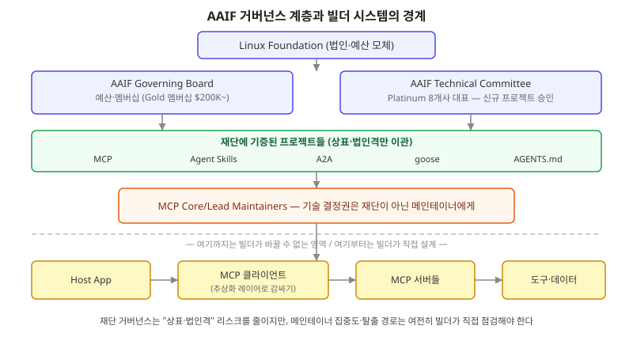

## 왜 지금 이 판단이 필요한가

"사내 에이전트 도구 연동, 전부 MCP 서버로 통일해주세요." 이 요구를 받은 팀 대부분은 기술 선택 문제로만 본다. 호환성 좋고, 여러 모델 벤더가 다 지원하니 표준으로 삼자는 식이다. 그런데 이 표준의 원 소유자가 Anthropic 한 회사라는 사실이 걸리면 "회사가 방향을 바꾸거나 라이선스를 조이면 어떡하냐"는 반론이 바로 따라붙는다. 이 저장소를 돌리는 이 자동화 세션 자체도 MCP 위에서 Figma·Notion·GitHub 연동 도구를 공급받고 있으니, 질문이 추상적이지 않다.

2025년 12월 9일 리눅스 재단이 AAIF(Agentic AI Foundation)를 출범시키며 Anthropic의 MCP, Block의 goose, OpenAI의 AGENTS.md를 창립 프로젝트로 받아들였다. 1년이 채 안 된 지금(2026년 11월) AAIF 산하 프로젝트는 Agent Skills·A2A·agentgateway·OpenSandbox·OpenEnv까지 늘어 사실상 에이전트 툴링 스택 전체가 한 재단 아래로 모였다. "이제 특정 벤더 소유가 아니니 안심하고 올인해도 된다"는 말이 돌지만, 재단 이관이 실제로 없애는 리스크와 그대로 남기는 리스크를 구분하지 않으면 아키텍처 판단을 잘못된 전제 위에 세우게 된다.

## 전체 시스템에서의 위치

MCP는 에이전트 호스트 애플리케이션과 외부 도구·데이터 소스 사이의 연결 계층이다. 재단 이관이 바꾸는 것은 이 프로토콜 자체의 동작이 아니라, 그 위에 있는 통제 구조다. 아래 그림처럼 리눅스 재단 산하에 AAIF 거버닝 보드(예산·멤버십)와 테크니컬 커미티(Platinum 8개사 대표, 신규 프로젝트 승인)가 있고, 그 아래 MCP·Agent Skills·A2A 같은 프로젝트들이 재단에 상표와 법인격만 넘긴 채 들어와 있다. 중요한 건 그 아래 한 단계다 — MCP의 실제 기술 결정권은 재단이 아니라 여전히 MCP 자체의 Lead Maintainer·Core Maintainer들에게 있다. 재단 donation 발표문도 "메인테이너 구조는 그대로 유지되고, 재단이 기술 방향을 지시하지 않는다"고 명시했다.



즉 빌더 입장에서 바뀌는 지점은 "회사 하나가 사양을 바꾸거나 라이선스를 조이는" 시나리오의 발생 확률이지, 메인테이너 구성이나 기술 로드맵 자체가 아니다. 그리고 그 메인테이너 구성은 여전히 특정 회사 출신에 쏠려 있을 수 있다 — 재단 소속이라는 사실이 이 쏠림을 자동으로 바꾸지 않는다.

## 선택의 트레이드오프

| 거버넌스 모델 | 기술 결정권 위치 | 라이선스·방향 전환 리스크 | 실제 선례 |
|---|---|---|---|
| 단일 기업 오픈소스 | 그 기업 내부 | 높음 — 기업 판단으로 즉시 변경 가능 | Redis의 라이선스 전환과 Valkey 포크 |
| 재단 donation (AAIF, CNCF 등) | 기존 메인테이너 유지, 재단은 법인격·상표만 | 중간 — 이사회 합의 필요하지만 메인테이너 쏠림은 남음 | MCP·goose·AGENTS.md, Agent Substrate(CNCF) |
| 표준 기구형 (W3C, OGC 등) | 다자 워킹그룹, 투표 기반 | 낮음 — 의사결정이 가장 느리지만 쏠림도 가장 적음 | HTTP, GeoJSON 등 |

AAIF의 Gold 멤버십이 20만 달러부터 시작하고 테크니컬 커미티 의석이 Platinum 등급 회사에 배정된다는 점도 봐야 한다. "자금을 댄 회사가 그 재단의 기본값으로부터 가장 먼저 이익을 보는 회사이기도 하다"는 지적은 출범 직후부터 업계 평론에서 반복됐다. 재단 소속이 되었다는 사실 하나로 "완전히 중립적인 공공 표준"과 동일시하면 과대평가다. 반대로 Redis 사례처럼 단일 기업이 하루아침에 라이선스를 바꾸는 최악의 시나리오는 확실히 막는다 — 재단에 기증된 상표와 IP는 그 기업이 마음대로 회수할 수 없기 때문이다.

## 실제 프로젝트 진행 순서

지금 MCP 위에 핵심 연동 아키텍처를 올리기로 했다면, 재단 이관 뉴스 하나로 안심하지 말고 아래 순서로 직접 점검한다.

1. **메인테이너 명단 확인** — MCP 거버넌스 페이지(modelcontextprotocol.io/community/governance)에서 Lead·Core Maintainer 명단과 소속 회사를 직접 읽는다. 재단 소속이어도 특정 회사 출신이 과반이면 그 회사의 방향 전환 리스크는 여전히 남아 있다고 본다.
2. **상표·라이선스 조항 분리해서 읽기** — "사양이 공개됐다"와 "상표·커뮤니티 자산이 재단에 있다"는 별개 사실이다. 스펙이 Apache-2.0이라도 레퍼런스 구현의 실제 운영 주체가 어디인지는 따로 확인한다.
3. **추상화 경계 설계** — 비즈니스 로직이 MCP SDK를 직접 참조하지 않게 내부 인터페이스로 한 겹 감싼다. 아래는 최소 형태 예시다.

```typescript
// 내부 도구 호출 인터페이스 — MCP 구현 세부사항을 여기서 끊는다
interface ToolGateway {
  callTool(name: string, args: Record<string, unknown>): Promise<ToolResult>;
}

class McpToolGateway implements ToolGateway {
  constructor(private client: McpClient) {}
  async callTool(name: string, args: Record<string, unknown>) {
    return this.client.request({ method: "tools/call", params: { name, arguments: args } });
  }
}
```

4. **탈출 경로를 미리 문서화** — 프로토콜 포크나 메인테이너 대거 이탈 같은 사태가 벌어졌을 때 무엇을 바꿔야 하는지 한 페이지로 적어 둔다. 이 작업 자체가 1번·2번 점검을 강제로 하게 만든다.

여기서 흔히 막히는 지점은 "어느 정도 추상화가 과한가"다. 모든 걸 범용 인터페이스로 감싸면 MCP가 제공하는 리소스·프롬프트 같은 고유 기능을 못 쓰게 된다. 실무에서는 "도구 호출"처럼 다른 프로토콜로도 대체 가능한 경계만 감싸고, MCP 고유 기능은 직접 쓰되 그 사용처를 한 모듈에 몰아 둬서 나중에 바꿔야 할 범위를 좁히는 선이 합리적이다.

## 마무리 요약

- AAIF 재단 이관은 "단일 기업이 라이선스를 조이는" 최악의 시나리오를 막지만, 메인테이너 쏠림과 기술 방향 리스크까지 없애지는 않는다.
- 재단 소속 여부보다 실제 메인테이너 명단과 상표·법인격 귀속을 직접 확인하는 쪽이 더 정확한 리스크 판단이다.
- 핵심 연동을 MCP에 올리기로 했다면, 도구 호출처럼 대체 가능한 경계는 내부 인터페이스로 감싸고 탈출 경로를 미리 문서화해 둔다.

## 참고 자료

- [MCP Joins Agentic AI Foundation (공식 발표)](https://blog.modelcontextprotocol.io/posts/2025-12-09-mcp-joins-agentic-ai-foundation/)
- [MCP Community Governance](https://modelcontextprotocol.io/community/governance)
- [Linux Foundation Announces the Formation of the Agentic AI Foundation](https://www.linuxfoundation.org/press/linux-foundation-announces-the-formation-of-the-agentic-ai-foundation)
- [AAIF 공식 사이트](https://aaif.io)
