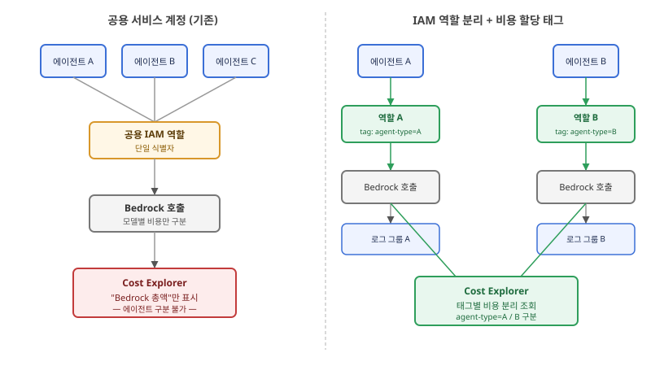

## 왜 지금 이 판단이 필요한가

"리서치용 에이전트, 코드리뷰용 에이전트, 데이터 정제용 에이전트까지 열 개쯤 돌리고 있는데, 이번 달 Bedrock 청구서를 보니 총액만 찍혀 있고 어떤 에이전트가 얼마를 썼는지는 안 나와요." 에이전트를 프로덕션에 여러 개 올린 팀이라면 한 번쯤 마주치는 요구다. 처음에는 모니터링 대시보드를 하나 더 붙이면 끝날 문제처럼 보인다. 하지만 실제로는 **과금 데이터 자체가 에이전트 단위로 쪼개지지 않는** 구조적 문제다. 대시보드는 있는 데이터를 보여줄 뿐, 없는 구분을 만들어내지는 못한다.

AWS Cost Explorer는 기본적으로 계정·서비스·리전 단위로 집계한다. Bedrock을 호출하는 주체가 에이전트 A든 B든, API 호출이 같은 IAM 역할과 같은 리전을 쓰면 청구 데이터에는 똑같이 "Bedrock"으로만 찍힌다. 2026년 8월 AWS가 Bedrock 비용을 모델·공급자·추론 타입·기능 단위로 쪼개 보여주는 기능을 추가 요금 없이 내놓았지만, 이 역시 "어떤 모델을 얼마나 썼는가"를 답할 뿐 "어떤 에이전트 인스턴스가 그 호출을 발생시켰는가"는 답하지 못한다. 커뮤니티 가이드들도 공통적으로 지적한다 — Cost Explorer는 지난달 Bedrock에 얼마를 썼는지는 말해주지만, 어떤 에이전트가 그 돈을 썼는지는 말해주지 않는다.

2026년 하반기 GA된 Amazon Bedrock AgentCore는 이 틈을 메우는 두 가지 장치를 가져왔다. 하나는 IAM 주체(principal) 기반 비용 할당 — 호출을 발생시킨 역할(runtime role)에 태그를 달아 청구 데이터와 연결하는 방식이다. 다른 하나는 에이전트별 로그 그룹 — 에이전트 하나의 트레이스·프롬프트·구조화 로그·표준 출력이 전부 그 에이전트 전용 CloudWatch 로그 그룹에 모이는 구조다. 둘 다 2026년 7월 이후 정식 기능으로 자리잡았다. 이 글에서 다루는 건 특정 벤더 기능 소개가 아니라, **"비용을 에이전트 단위로 쪼개 보고 싶다"는 요구를 어느 계층에 심어야 하는가**라는 설계 판단이다.

## 전체 시스템에서의 위치



공용 서비스 계정 하나로 에이전트 여러 개를 돌리는 구조에서는, 각 에이전트의 Bedrock 호출이 전부 같은 IAM 역할을 거쳐 나간다. 이 역할이 청구 데이터의 유일한 식별자이기 때문에, Cost Explorer에서는 계정 전체의 합계만 재구성할 수 있다. 어떤 에이전트가 비용을 유발했는지 되짚으려면 CloudTrail 로그를 전부 뒤져 요청 시각과 Bedrock 호출 시각을 수작업으로 맞춰봐야 하는데, 트래픽이 많아지면 이 방식은 현실적으로 무너진다.

AgentCore가 제안하는 구조는 식별자를 호출 경로 더 앞단으로 옮기는 것이다. 에이전트 유형마다 별도의 IAM 런타임 역할을 발급하고, 그 역할에 비용 할당 태그(`agent-type=research`, `agent-type=codereview` 등)를 붙인다. Bedrock 호출은 이 역할을 통해 나가므로, 청구 데이터에 역할 식별자가 함께 실린다. 동시에 그 역할로 실행되는 모든 트레이스·로그가 역할별(사실상 에이전트별) 로그 그룹에 쌓이므로, "비용이 많이 나온 시점에 이 에이전트가 정확히 뭘 하고 있었는가"까지 같은 식별자로 추적할 수 있다. 즉 **비용 귀속은 과금 계층의 문제가 아니라 IAM 설계 시점에 결정되는 문제**라는 것이 이 구조의 핵심이다.

## 선택의 트레이드오프

| 방식 | 구축 비용 | 귀속 정확도 | 언제 쓰면 안 되는가 |
|---|---|---|---|
| 공용 서비스 계정/단일 키 | 거의 0 | 없음(계정 합계만) | 에이전트가 2~3개를 넘는 순간부터 |
| IAM 역할 분리 + 비용 할당 태그 | 중간(역할 설계·태그 정책 필요) | 역할 단위로 정확, 공유 인프라 비용은 별도 안분 필요 | 역할 수가 수백 개로 폭증할 조직 구조 |
| 자체 게이트웨이에서 토큰·호출 단위 미터링 | 높음(직접 구축·유지) | 실시간, 벤더 중립 | 이미 AgentCore·Bedrock 생태계에 깊이 들어간 경우 |

AWS 생태계 바깥에서는 비슷한 문제를 다른 층에서 풀기도 한다. Claude Code의 게이트웨이 비용 리포트 API처럼, 추론 요청을 중계하는 게이트웨이 단계에서 호출마다 토큰 수를 집계해 비용을 실시간으로 안분하는 방식이다. AWS의 IAM 역할 기반 방식은 클라우드 청구 체계에 올라타는 대신 반영까지 시차가 있고(태그 활성화 후 데이터에 반영되기까지 통상 하루 가까이 걸린다), 게이트웨이 방식은 구축 비용을 치르는 대신 즉시성을 얻는다. 둘 중 무엇을 고를지는 "이미 AWS 청구 체계 안에서 비용을 통제하고 싶은가, 아니면 벤더와 무관하게 통제점을 직접 갖고 싶은가"로 갈린다.

어느 쪽을 고르든 공통으로 비켜갈 수 없는 함정이 있다. VPC 엔드포인트, 공유 데이터베이스, 공통 로깅 파이프라인처럼 **여러 에이전트가 나눠 쓰는 인프라 비용**은 어느 방식으로도 자동으로 쪼개지지 않는다. 이런 공유 비용까지 에이전트 단위로 안분하려면 결국 별도의 배분 규칙(예: 호출 횟수 비례, 균등 분배)을 사람이 정해야 한다. 비용 귀속 설계는 "자동으로 100% 정확해지는 지점"이 아니라 "어디까지는 자동으로, 어디부터는 정책으로 나눌지"를 정하는 작업이다.

## 실제 진행 순서

```bash
# 1) 에이전트 유형별 IAM 런타임 역할 생성 시 비용 할당 태그를 함께 붙인다
aws iam tag-role \
  --role-name agentcore-research-runtime-role \
  --tags Key=agent-type,Value=research Key=cost-center,Value=data-platform

# 2) Billing 콘솔에서 해당 태그를 비용 할당 태그로 활성화(최초 1회, 반영까지 시차 있음)
aws ce create-cost-category-definition \
  --name agent-cost-by-type \
  --rule-version CostCategoryExpression.v1
```

1. 에이전트 유형별로 런타임 IAM 역할을 먼저 분리한다 — 역할을 나중에 쪼개면 과거 데이터는 소급 적용되지 않는다.
2. 역할 생성 시점에 비용 할당 태그를 함께 붙이고 Billing 콘솔에서 활성화한다. 활성화 직후가 아니라 **다음 청구 주기부터 완전히 반영**된다는 점을 미리 공지해 둔다.
3. 에이전트별 로그 그룹을 켜서, 비용이 튄 시점의 트레이스를 같은 식별자로 바로 찾을 수 있게 한다.
4. 태그별 예산 알람을 먼저 보수적인 임계값으로 걸어, 신규 에이전트가 예상보다 많은 호출을 시작하는 신호를 조기에 잡는다.
5. 공유 인프라 비용은 자동 귀속 대상에서 제외하고, 배분 규칙을 별도 문서로 합의해 둔다 — 이 부분을 빠뜨리면 나중에 "그래서 합계가 왜 안 맞냐"는 질문에 답할 수 없다.

## 마무리 요약

- 에이전트별 비용 귀속은 모니터링 대시보드가 아니라 **IAM 역할 설계 시점**에 결정되는 문제다. 역할을 나중에 쪼개면 과거 데이터는 복구할 수 없다.
- AWS 생태계에서는 IAM 역할 분리 + 비용 할당 태그 + 에이전트별 로그 그룹 조합이 기본 경로이고, 벤더 중립을 원하면 게이트웨이 단의 자체 미터링이 대안이다.
- 어느 방식을 골라도 여러 에이전트가 공유하는 인프라 비용은 자동으로 쪼개지지 않으므로, 배분 규칙은 사람이 정책으로 합의해야 한다.

## 참고 자료

- [Amazon Bedrock AgentCore — Introducing](https://aws.amazon.com/blogs/aws/introducing-amazon-bedrock-agentcore-securely-deploy-and-operate-ai-agents-at-any-scale/)
- [ICYMI: What landed for AI builders in October 2026 — AWS ML Blog](https://aws.amazon.com/blogs/machine-learning/icymi-what-landed-for-ai-builders-in-october-2026/)
- [Which agent is costing me the most? — AWS Builder Center](https://builder.aws.com/content/3DGqrMSRlS7leXjfoYUp9O80dDY/which-agent-is-costing-me-the-most-per-agent-cost-attribution-for-amazon-bedrock-agentcore)
- [AWS Cost Allocation Tags — User Guide](https://docs.aws.amazon.com/awsaccountbilling/latest/aboutv2/cost-alloc-tags.html)
