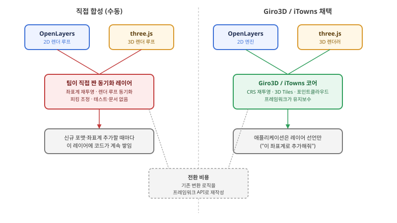

## 왜 지금 이 판단이 필요한가

"2D 지도 위에 3D 건물을 올려주세요"라는 요구를 OpenLayers와 three.js를 직접 붙여 풀어낸 팀은, 얼마 지나지 않아 비슷한 요구를 또 받는다. "이번엔 포인트클라우드도 같이 보여주세요", "건물 돌출(extrusion)도 되나요", "다른 좌표계로 들어온 데이터도 섞어주세요". 그때마다 답은 같다 — 좌표계 재투영 코드를 또 짜고, 두 렌더 루프를 맞추는 동기화 코드를 또 손본다. 이 반복 자체가 신호다. 문제는 "3D를 어떻게 띄울까"가 아니라 "이 글루 코드를 언제까지 직접 들고 갈 것인가"로 이미 옮겨가 있다.

지금까지 이 블로그에서 다룬 OpenLayers+three.js 합성 글들은 전부 "이미 둘을 직접 붙이기로 정한 다음"의 문제였다 — 오브젝트 수가 늘어날 때 프레임 예산이 무너지는 지점, 두 렌더러의 피킹 체계가 충돌하는 지점. 이 글이 다루는 건 그보다 한 단계 앞선 질문이다. 같은 문제를 반복해서 겪고 있다면, 애초에 **직접 합성 대신 전용 3D 지리공간 프레임워크를 채택하는 선택지**를 지금 검토해야 하는가다.

Oslandia가 2025년 12월 1.0을 낸 Giro3D는 OpenLayers를 2D 지도 엔진으로, three.js를 3D 렌더러로 쓰면서 그 사이의 좌표계 재투영, 래스터 변환, 3D 건물 돌출 표현을 프레임워크 레벨에서 끝내놓은 라이브러리다. 로드맵에는 Gaussian Splatting 같은 새 데이터 포맷 지원과 3D Tiles Next 연동이 올라와 있다. 프랑스 국토지리원(IGN)이 지원하는 iTowns도 같은 계열이다 — three.js 기반으로 2D·3D 지리공간 데이터를 함께 다루며, 3D Tiles와 포인트클라우드(COPC·EPT·Potree) 로딩을 표준 지원한다. 둘 다 "OpenLayers와 three.js를 직접 붙이는 글루 코드"를 프레임워크 책임으로 끌어올린 결과물이라는 공통점이 있다.

## 전체 시스템에서의 위치

직접 합성 구조에서는 OpenLayers와 three.js가 각자 독립된 렌더 루프와 좌표계를 갖고, 그 사이를 잇는 동기화 레이어를 팀이 직접 작성해 유지한다. 신규 데이터 포맷이나 좌표계가 들어올 때마다 이 동기화 레이어에 변환 로직이 하나씩 쌓인다. 처음엔 코드 몇 줄이지만, 데이터 소스가 늘어날수록 이 레이어 자체가 하나의 미니 프레임워크로 자라난다 — 다만 테스트도, 문서도, 유지보수 담당자도 없는 프레임워크다.

Giro3D·iTowns를 채택하면 이 동기화 책임이 프레임워크 내부로 들어간다. 애플리케이션 코드는 "이 레이어를 이 좌표계로 추가해달라"는 선언만 하면 되고, 재투영·타일링·3D 오브젝트 배치는 프레임워크가 맡는다. 대신 팀이 작성한 변환 로직 전체를 프레임워크가 제공하는 API로 다시 써야 하는 **마이그레이션 비용**이 한 번 발생한다. 전체 시스템에서 이 선택은 "글루 코드를 어디서 유지보수할 것인가"를 애플리케이션 팀에서 오픈소스 프레임워크 커뮤니티로 옮기는 결정이다.

## 선택의 트레이드오프

| 선택지 | 강점 | 약점 | 언제 쓰면 안 되는가 |
|---|---|---|---|
| OpenLayers+three.js 수동 합성 | 완전한 제어, 외부 의존성 최소 | 기능이 늘수록 글루 코드가 비공식 프레임워크로 자람 | 데이터 포맷·좌표계가 계속 늘어나는 로드맵이 이미 보이는 경우 |
| Giro3D | CRS 재투영·3D 건물 돌출 내장, OpenLayers 생태계 그대로 활용 | 1.0 출시가 최근(2025-12)이라 커뮤니티·레퍼런스가 아직 얇음 | 포인트클라우드가 지금 당장 핵심 요구사항인 경우 |
| iTowns | IGN 지원으로 실제 프로덕션 검증 사례 존재, 포인트클라우드(COPC·EPT·Potree) 성숙 | API 철학이 지구본형(globe) 중심이라 평면 2D 우선 앱엔 과함 | 2D 지도가 주력이고 3D는 보조 오버레이 수준인 경우 |
| Cesium로 전면 전환 | 진짜 3D 지구본, 지형·대용량 3D Tiles 네이티브 | OpenLayers 스타일·데이터 파이프라인 전면 재구축 필요 | 기존 2D 지도 UX·스타일 자산을 그대로 가져가야 하는 경우 |

세 번째 줄과 네 번째 줄을 혼동하기 쉽다. Giro3D·iTowns는 "OpenLayers 중심 2D 지도에 3D를 자연스럽게 얹는" 선택지이고, Cesium 전환은 "애초에 3D 지구본이 주인공이고 2D는 그 위의 투영일 뿐"이라는 완전히 다른 출발점이다. 지금 운영 중인 서비스가 2D 지도 UX·스타일·상호작용을 이미 OpenLayers 생태계로 다 갖춰 놓은 상태라면, Cesium 전면 전환은 되돌리기 어려운 재구축이므로 Giro3D·iTowns 쪽을 먼저 검토하는 것이 합리적이다.

## 실제 진행 순서

1. 지금 유지보수 중인 좌표계·렌더 루프 동기화 코드의 규모를 먼저 측정한다. 파일 하나, 함수 몇 개 수준이라면 아직 전환할 때가 아니다.
2. 현재 지도에서 쓰는 레이어 중 대표적인 몇 개(2D 벡터 레이어 하나, 3D 건물 레이어 하나)만 골라 Giro3D 또는 iTowns로 PoC를 만든다. 전체 마이그레이션 전에 좌표계 재투영 결과와 렌더링 품질이 기존과 동일한지부터 확인한다.
3. 당장 필요한 핵심 기능으로 둘 중 하나를 고른다 — 포인트클라우드가 이미 로드맵에 있다면 iTowns, 래스터 재투영과 건물 돌출이 급하다면 Giro3D.
4. 기존 OpenLayers 스타일 정의와 데이터 소스 연결 코드를 프레임워크 API로 옮기는 마이그레이션 계획을 레이어 단위로 쪼갠다 — 한 번에 전부 옮기면 회귀 테스트 범위가 감당 안 된다.
5. 피킹·인터랙션 모델이 기존 수동 합성과 어떻게 다른지 먼저 검증한다. 프레임워크가 제공하는 피킹 API가 기존 커스텀 레이캐스트 로직과 다른 좌표 기준을 쓸 수 있다.

## 마무리 요약

- 같은 좌표계·렌더 루프 동기화 코드를 반복해서 손보고 있다면, 그건 이미 애플리케이션 코드가 아니라 비공식 프레임워크를 직접 유지보수하고 있다는 신호다.
- Giro3D·iTowns는 OpenLayers 생태계를 그대로 쓰면서 3D 합성의 글루 코드를 프레임워크 책임으로 옮기는 선택지이고, Cesium 전면 전환과는 전제 자체가 다르다.
- 전환은 전체가 아니라 레이어 단위로 PoC → 검증 → 단계적 마이그레이션 순서로 진행해야 회귀 리스크를 감당할 수 있다.

## 참고 자료

- [Giro3D 1.0 Release — Oslandia](https://oslandia.com/en/2025/12/19/sortie-giro3d-v1-0-outil-web-visualisation-opensource/)
- [Giro3D Official Site](https://giro3d.org/)
- [iTowns — OSGeo Project Page](https://www.osgeo.org/projects/itowns/)
- [iTowns GitHub Repository](https://github.com/iTowns/itowns)
