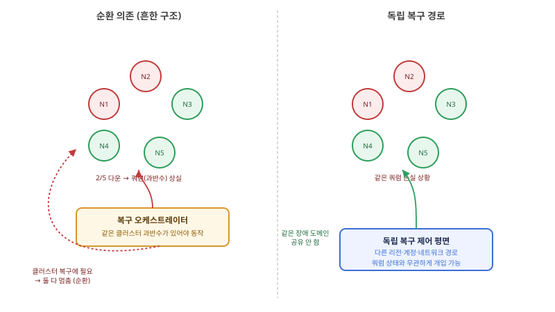

## 왜 지금 이 판단이 필요한가

"장애가 나도 사람이 안 붙어 있어도 자동으로 복구되게 해주세요." 이 요구를 받으면 대부분의 팀은 헬스체크·오토스케일링·페일오버 같은 자동 복구 장치를 설계하는 데 집중한다. 그런데 2026년 11월 12일부터 17일 사이 벌어진 일련의 장애들이 공통으로 드러낸 질문은 그게 아니었다 — "그 자동 복구 시스템 자체는 무엇에 의존하고 있는가"였다. Cloud Security Alliance가 이 시기를 묶어 낸 리서치 노트는 이 구간을 사람들이 대부분 고정 인프라로 여기는 서비스들이 연달아 무너진 사건으로 규정했다.

구체적인 사례를 보면 패턴이 또렷해진다. Coinbase의 2026년 5월 장애 사후분석은 거래 시스템이 5노드 합의 클러스터로 돌아가는데, AWS 장애로 그중 3노드가 한꺼번에 내려가며 **쿼럼(과반수)을 잃어 거래 처리 자체가 멈춘** 사례를 짚었다. Coinbase는 장애 지속 시간이 길어진 원인을 실제 장애 상황에서 한 번도 검증된 적 없던 아키텍처 가정 때문이라고 결론 내렸다. Cloudflare의 2025년 11월 장애 사후분석은 원인을 잘못된 설정 파일로 지목하면서, 자주 바뀌는 대형 설정 파일은 사실상 코드이며 코드와 같은 안전장치를 받아야 한다는 교훈을 남겼다. 그리고 가장 반복되는 패턴은 따로 있다 — 복구 시스템이 클러스터가 회복돼야 작동하는데, 클러스터는 복구 시스템 없이는 회복될 수 없는 **순환 의존**이다.

개별 컴포넌트 장애는 설계에서 이미 가정하고 대비한다. 문제는 각자 감당할 수 있다고 여겼던 장애 여러 개가 예상 못 한 방식으로 서로 얽힐 때 생긴다. 이번 11월 장애 클러스터가 특별한 신기술 때문이 아니라 오래된 설계 질문 — 쿼럼 크기, 설정 변경 안전장치, 복구 경로의 독립성 — 을 다시 들여다보게 만들었다는 점에서, 지금 이 판단을 점검할 이유가 있다.

## 전체 시스템에서의 위치

흔한 구조에서는 복구 오케스트레이터가 클러스터의 헬스체크 결과를 보고 재시작·페일오버를 트리거한다. 그런데 이 오케스트레이터 자신이 같은 클러스터의 과반수 노드, 같은 네트워크 경로, 때로는 같은 리전의 제어 평면을 통해서만 동작한다면, 클러스터가 쿼럼을 잃는 순간 오케스트레이터도 같이 눈이 먼다. 클러스터를 고치려면 오케스트레이터가 필요하고, 오케스트레이터가 움직이려면 클러스터의 일부가 먼저 살아 있어야 하는 닫힌 고리가 만들어진다.

독립 경로를 둔 구조에서는 복구 제어 평면이 의도적으로 다른 실패 도메인에 놓인다 — 다른 리전, 다른 계정, 혹은 완전히 다른 네트워크 경로로 클러스터 상태를 관찰하고 개입할 수 있는 경로를 별도로 유지한다. 이 경로는 평소엔 거의 쓰이지 않기 때문에 존재 자체를 잊기 쉽지만, 정작 전체 장애 상황에서 유일하게 살아 있는 경로가 되는 쪽은 이쪽이다. 전체 시스템 그림에서 이 설계의 위치는 "복구 자동화를 어디에 둘 것인가"가 아니라 "복구 자동화가 보호 대상과 같은 장애 도메인을 공유하지 않도록 어디에 떼어 둘 것인가"다.

## 선택의 트레이드오프

| 설계 요소 | 선택지 A | 선택지 B | 언제 B가 필요한가 |
|---|---|---|---|
| 쿼럼 크기 | 3/5(과반수 2개 손실까지 허용) | 5/7 또는 멀티 리전 쿼럼 | 결제·거래처럼 쿼럼 손실이 곧 서비스 정지로 이어지는 시스템 |
| 설정 변경 | 설정 파일을 데이터로 취급(직접 수정·즉시 반영) | 설정을 코드로 취급(리뷰·카나리·단계적 롤아웃) | 설정 하나로 전체 트래픽 경로가 바뀌는 엣지·네트워크 계층 |
| 복구 제어 평면 | 클러스터와 같은 인프라·리전에 둠 | 다른 실패 도메인에 독립적으로 둠 | 자동 복구가 꺼지면 사람 개입 전까지 전체 서비스가 멈추는 시스템 |

B열의 공통점은 전부 비용이 더 든다는 것이다. 멀티 리전 쿼럼은 지연시간과 인프라 비용을 늘리고, 설정을 코드 취급하면 변경 속도가 느려지고, 독립 복구 경로는 평소엔 쓰지도 않는 인프라를 유지보수해야 한다. 그래서 이 표의 함정은 "B가 항상 낫다"가 아니라 "A로 충분한 시스템에까지 B를 강요하면 그 자체가 낭비"라는 데 있다. 내부 대시보드나 배치 작업처럼 몇 시간 멈춰도 복구 가능한 시스템이라면 A열로 충분하다. 반대로 결제·합의·안전 필수 시스템이라면 비용을 감수하고서라도 B열로 가야 한다는 판단을, 장애가 나기 전에 미리 내려둬야 한다.

## 실제 진행 순서

1. 지금 운영 중인 자동 복구·헬스체크 시스템이 무엇에 의존하는지 지도를 그린다 — 같은 리전인가, 같은 쿼럼의 과반수가 살아있어야 하는가, 같은 네트워크 경로를 쓰는가.
2. 쿼럼 손실을 의도적으로 시험한다. 대부분의 시스템은 노드 하나가 죽는 시나리오는 테스트하지만, N개 중 과반수가 동시에 죽는 시나리오는 한 번도 검증하지 않은 채 프로덕션에 올라가 있다.
3. 자주 바뀌는 대형 설정 파일(라우팅 규칙, 피처 플래그, 보안 정책)을 찾아, 코드와 동일한 리뷰·카나리·롤백 절차를 적용할지 판단한다.
4. 복구 제어 평면이 보호 대상과 같은 실패 도메인에 있는지 점검하고, critical path에 한해 독립 경로를 설계한다.
5. 장애 사후분석 때마다 한 가지 질문을 고정 항목으로 넣는다 — "우리 복구 시스템이 방금 망가진 바로 그것에 의존하고 있었는가?"

## 마무리 요약

- 2026년 11월 장애 클러스터의 공통점은 새로운 기술 결함이 아니라, 개별적으로는 감당 가능하다고 여긴 실패들이 예상 못 한 방식으로 얽힌 것이었다.
- 가장 반복된 패턴은 자동 복구 시스템이 자신이 고쳐야 할 클러스터에 의존하는 순환 구조였다 — 쿼럼을 잃으면 복구 장치도 함께 눈이 먼다.
- 쿼럼 크기·설정 거버넌스·복구 경로 독립성은 전부 비용을 수반하므로, 모든 시스템에 똑같이 적용할 게 아니라 critical path를 먼저 가려내 거기에만 투자해야 한다.

## 참고 자료

- [The November Outage Cluster: Correlated Fragility and Attribution — CSA Research](https://labs.cloudsecurityalliance.org/research/csa-research-note-november-outage-cluster-correlated-fragili/)
- [Coinbase AWS Failure Postmortem — InfoQ](https://www.infoq.com/news/2026/06/coinbase-aws-failure-postmortem)
- [The Pulse: Cloudflare Postmortem — Pragmatic Engineer](https://blog.pragmaticengineer.com/the-pulse-cloudflare-takes-down-half-the-internet)
