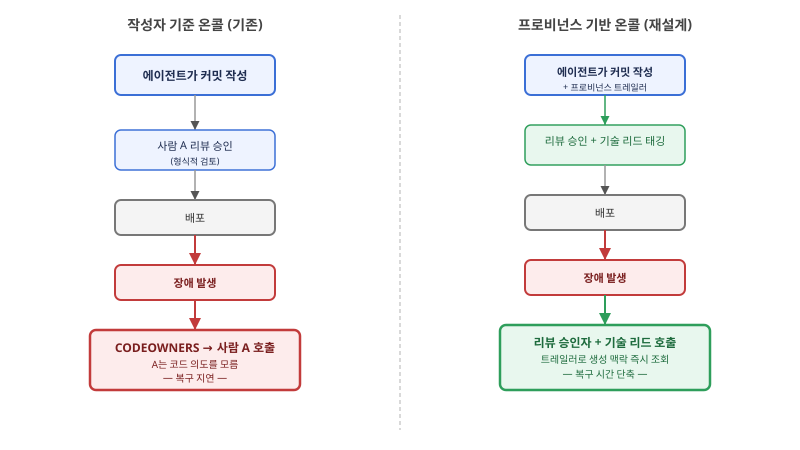

## 왜 지금 이 판단이 필요한가

"이번 장애 포스트모템을 하는데, 터진 코드가 누가 짠 건지부터 못 찾았어요. 에이전트가 쓰고 리뷰어는 승인 버튼만 눌렀거든요." 2026년 들어 온콜을 서는 엔지니어들 사이에서 자주 나오는 말이다. CloudBees의 "State of Code Abundance 2026" 조사는 이 느낌을 숫자로 보여준다. 응답 조직의 81%가 AI 생성 코드와 관련된 프로덕션 장애가 늘었다고 답했는데, 그 장애의 책임을 **코드를 생성하도록 요청한 개발자**에게 묻는다고 답한 비율은 7%에 그쳤다. 대신 46%는 책임이 CTO나 VP 엔지니어링급으로 올라간다고 답했고, AI 생성 코드를 전담 관리하는 팀을 둔 조직은 12%뿐이었다. 같은 조사에서 93%의 조직이 AI 생성 코드를 검토·배포하는 공식 프로세스를 갖고 있다고 답했지만, 그 프로세스를 일관되게 지킨다고 답한 비율은 56%에 그쳤다. Lightrun의 별도 설문에서는 AI가 생성한 변경의 43%가 프로덕션에서 추가 디버깅을 필요로 했다는 결과도 나왔다.

이 숫자들을 한 문장으로 요약하면 이렇다 — **"작성자가 곧 그 코드를 가장 잘 아는 사람"이라는, 온콜과 CODEOWNERS 설계가 암묵적으로 깔고 있던 전제가 깨졌다.** "에이전트 생산성 올려주세요"라는 요청 뒤에는 "장애가 나면 누구를 깨울 것인가"라는, 지금까지는 자동으로 풀리던 질문이 다시 설계 과제로 떠오른다.

## 전체 시스템에서의 위치



기존 온콜 라우팅은 CODEOWNERS 파일이 "이 경로를 마지막에 수정한 사람"을 기준으로 자동 생성되고, 장애가 나면 그 사람을 호출하는 구조다. 이 구조는 "커밋을 쓴 사람이 그 코드의 의도를 안다"는 전제 위에서만 작동한다. 에이전트가 코드를 쓰고 사람은 리뷰 승인만 한 경우, CODEOWNERS는 여전히 그 리뷰어(혹은 커밋 작성자로 기록된 봇 계정)를 가리키지만, 호출받은 사람은 왜 그렇게 짰는지 설명할 수 없다. 장애 대응의 첫 단계인 "원인 추정"이 사람을 깨운 이후에야, 그것도 코드를 처음부터 다시 읽으며 시작된다.

재설계의 핵심은 두 가지를 커밋 시점에 함께 남기는 것이다. 하나는 **프로비넌스 트레일러** — 그 변경이 어떤 에이전트·세션·프롬프트로 생성됐는지를 커밋 메타데이터에 남겨, 장애 시 생성 맥락을 바로 조회할 수 있게 한다. 다른 하나는 CODEOWNERS를 "최종 작성자" 기준에서 **"그 영역을 실제로 설명할 수 있는 사람"**(리뷰를 실질적으로 수행한 사람, 또는 그 기능 영역의 기술 리드) 기준으로 다시 매핑하는 것이다. 이 둘이 합쳐져야 온콜 라우팅이 "누구를 깨울까"뿐 아니라 "깨운 사람이 실제로 답할 수 있는가"까지 보장한다.

## 선택의 트레이드오프

| 방식 | 구축 비용 | 장애 시 적합성 | 언제 쓰면 안 되는가 |
|---|---|---|---|
| 기존 CODEOWNERS(최종 작성자 기준) | 0 | 낮음(짜지 않은 코드를 떠맡음) | 에이전트 커밋 비중이 일정 수준을 넘는 순간부터 |
| 리뷰 승인자 기준으로 온콜 전환 | 중간 | 중간(리뷰가 실질적이었는지에 좌우) | 리뷰가 형식적 승인(rubber-stamp)에 머무는 조직 |
| 프로비넌스 트레일러 + 기술 리드 포함 | 높음(툴링·정책 필요) | 높음(생성 맥락을 추적 가능) | 레포·팀 규모가 작아 투자 대비 효과가 낮을 때 |

세 번째 방식이 가장 견고하지만, 93%가 프로세스를 만들고도 56%만 지킨다는 통계가 경고하는 함정을 그대로 물려받는다. 트레일러 규칙을 만들어도 강제하는 장치 없이는 금방 빠지기 시작한다. 트레이드오프의 핵심은 "누구에게 책임을 지울 것인가"가 아니라 **"장애가 난 순간, 깨운 사람이 그 코드에 대해 뭔가 답할 수 있는 상태를 어떻게 만들어 둘 것인가"**다.

## 실제 진행 순서

```text
# 커밋 메시지 프로비넌스 트레일러 예시
feat: 쿠폰 중복 적용 방지 로직 추가

Generated-By: claude-code/agent-session
Session-Ref: https://internal.example/sessions/8f21c4
Reviewed-By: jane.kim (실질 검토, 수용 기준 1~3 확인)
```

1. 최근 포스트모템 몇 건을 다시 훑어 "에이전트가 짠 코드 비중"과 "온콜이 걸린 사람이 실제로 맥락을 아는 사람이었는가"를 측정한다 — 이 기준선 없이는 재설계 효과를 말할 수 없다.
2. 커밋 메시지에 AI 생성 여부와 세션·프롬프트 참조를 남기는 프로비넌스 트레일러 규칙부터 도입한다. 강제 장치(커밋 훅, PR 템플릿 필수 필드) 없이 권고만 하면 금방 사라진다.
3. CODEOWNERS를 "최종 작성자" 기준에서 "리뷰 승인자 + 기능 영역 기술 리드" 기준으로 다시 매핑한다.
4. 온콜 플레이북에 "이 변경, 에이전트가 생성했는가"를 확인하는 단계를 넣고, 작성자가 아니라 리뷰어·기술 리드를 호출하는 경로를 명시해 둔다.
5. 프로세스 준수율(93%→56%로 벌어지는 격차)을 줄이기 위해, 트레일러·리뷰 체크리스트 누락을 CI에서 자동으로 걸러내는 게이트를 추가한다 — 사람의 의지에만 맡기지 않는다.

## 마무리 요약

- 짜지 않은 코드에 대한 온콜은 이미 현실이다. CODEOWNERS와 온콜 라우팅이 전제한 "최종 작성자=내용을 아는 사람" 공식이 깨졌다.
- 해법은 책임질 사람을 새로 지정하는 게 아니라, 책임의 기준점을 작성자에서 리뷰 승인자·기술 리드로 옮기고 그 판단에 쓸 프로비넌스 정보를 커밋에 남기는 것이다.
- 프로세스를 만드는 것과 지켜지게 만드는 것은 별개다. 자동 감사·강제 게이트 없이는 "있는데 안 지키는" 격차가 그대로 남는다.

## 참고 자료

- [Who owns AI-generated code failures? — CloudBees Blog](https://www.cloudbees.com/blog/who-owns-ai-generated-code-failures)
- [We're on call for code nobody wrote — LeadDev](https://leaddev.com/software-quality/were-on-call-for-code-nobody-wrote)
- [AI wrote the code… so now who's accountable? — Palo Alto Networks](https://www.paloaltonetworks.com/perspectives/ai-wrote-the-codeso-now-whos-accountable/)
- [Who owns AI-generated code when it breaks? — DEV Community](https://dev.to/myfear/who-owns-ai-generated-code-when-it-breaks-176)
