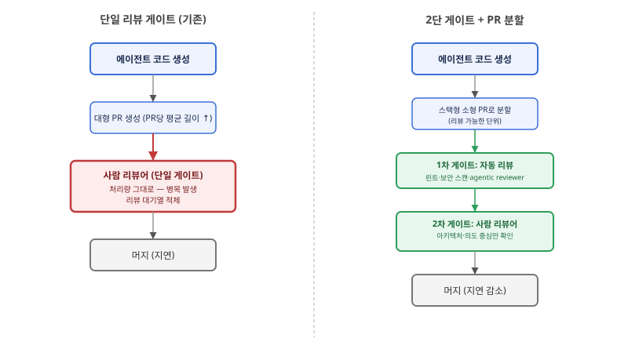

## 왜 지금 이 판단이 필요한가

"에이전트 다 붙였으니 이제 기능 출시 속도가 훨씬 빨라지겠죠?" — 경영진이나 PM이 흔히 하는 기대다. 실제로 코드 작성 속도는 분명히 빨라졌다. 문제는 그 다음 단계다. Faros AI가 1만 명 이상의 개발자를 분석한 결과, PR 볼륨은 98% 늘었는데 PR 리뷰에 걸리는 시간은 91% 더 늘었다. 코드를 짜는 속도가 빨라진 만큼 병목이 **작성 단계에서 리뷰 단계로 그대로 옮겨갔을 뿐**이라는 뜻이다.

병목이 옮겨간 자리의 품질도 간단치 않다. LeadDev 분석에 따르면 AI가 작성한 PR은 평균 10.83건의 이슈를 안고 들어오는 반면 사람이 작성한 PR은 6.45건에 그쳤고, Kodus의 리서치에서도 AI 작성 코드는 PR당 리뷰 지적 사항이 1.6배 많았다. 여기에 DX의 조사는 2025년 7월부터 2026년 6월 사이 PR 중앙값 크기가 44줄에서 72줄로 거의 두 배가 됐다고 보고한다. 리뷰어 입장에서는 "더 많은 PR이, 더 크게, 더 많은 문제를 안고" 몰려드는 상황인 셈이다. "에이전트를 도입하면 더 빨리 나간다"는 기대가 "리뷰 체계를 그대로 두면 오히려 전체 출시 속도가 느려질 수 있다"는 실제 설계 문제로 번역되는 지점이 바로 여기다.

## 전체 시스템에서의 위치



에이전트를 도입하기 전 파이프라인은 코드 생성 → PR 생성 → 사람 리뷰어 한 명(또는 소수)의 단일 게이트 → 머지로 이어진다. 이 구조에서 "리뷰어가 처리할 수 있는 PR 수"는 사람의 처리량에 묶여 있는 상수에 가깝다. 에이전트가 코드 생성 단계의 처리량만 올려버리면, 뒤에 있는 상수 처리량 게이트 앞에 PR이 쌓인다 — 흐름 전체의 속도는 가장 느린 단계가 정한다는 간단한 사실이 여기서도 그대로 작동한다.

재설계의 핵심은 게이트를 하나 더 늘리고 PR 단위를 쪼개는 것이다. 에이전트가 생성한 변경을 리뷰 가능한 크기로 스택형(stacked) PR로 나누고, 그 앞에 자동화된 1차 게이트(린트, 보안 스캐너, 정책 체크, 필요하면 또 다른 에이전트의 1차 리뷰)를 세운다. 사람 리뷰어는 이 1차 게이트를 통과한 PR만, 그것도 코드 한 줄 한 줄이 아니라 아키텍처와 의도가 맞는지 중심으로 본다. GitHub가 2026년 4월 내놓은 스택형 PR 도구는 정확히 이 지점 — 큰 변경을 리뷰 가능한 레이어로 쪼개는 것 — 을 겨냥한다.

## 선택의 트레이드오프

| 방식 | 리뷰어 부담 | 머지까지 지연 | 놓치는 버그 위험 | 언제 쓰면 안 되는가 |
|---|---|---|---|---|
| 기존 그대로(사람 전체 리뷰 유지) | 계속 증가 | 계속 증가 | 낮음(사람이 전부 봄, 단 피로로 인한 누락 증가) | PR 볼륨이 이미 리뷰어 용량을 넘어선 팀 |
| PR 크기 상한 + 스택형 분할만 도입 | 감소 | 감소 | 중간(분할 경계를 잘못 자르면 맥락 소실) | 변경이 본질적으로 쪼개기 어려운 핵심 로직일 때 |
| 1차 자동 게이트 + 2차 사람 승인 | 가장 적음(아키텍처 중심만) | 가장 적음 | 자동 게이트 품질에 좌우 — 오탐/미탐 존재 | 자동 게이트를 구축·튜닝할 여유가 전혀 없는 조직 |

세 번째 방식이 가장 매력적으로 보이지만 공짜는 아니다. 1차 게이트가 설익은 상태로 들어가면 "기계가 이미 걸러줬으니 괜찮겠지"라는 방심이 더해져 오히려 결함이 새어나갈 위험이 커진다. Anthropic의 2026년 보고서도 사람 리뷰만으로는 늘어난 코드 생산량을 더 이상 흡수할 수 없다고 진단하면서, 동시에 에이전틱 품질관리가 사람 리뷰를 완전히 대체하는 것이 아니라 **역할을 나누는 장치**여야 한다는 점을 강조한다.

## 실제 진행 순서

```yaml
# .github/workflows/pr-size-gate.yml (개념 예시)
name: pr-size-gate
on: pull_request
jobs:
  check-size:
    runs-on: ubuntu-latest
    steps:
      - uses: actions/checkout@v4
      - run: |
          CHANGED=$(git diff --shortstat origin/${{ github.base_ref }} | awk '{print $4+$6}')
          if [ "$CHANGED" -gt 400 ]; then
            echo "::warning::PR이 400줄을 넘습니다 — 스택형 분할을 검토하세요"
          fi
```

1. 먼저 현재 기준선을 잰다 — 평균 PR 크기, PR 생성부터 첫 리뷰까지 걸리는 시간, 리뷰당 지적 사항 수를 2~4주 측정해 둔다. 기준선 없이 "좋아졌다"를 말할 수 없다.
2. PR 크기 상한 정책과 스택형 PR 템플릿부터 도입한다 — 도구를 바꾸기 전에 작업 단위를 쪼개는 습관부터 자리잡아야 자동 게이트도 의미가 있다.
3. 1차 자동 게이트(린트·보안 스캐너·agentic reviewer)를 사람 리뷰 앞에 배치하되, 처음에는 차단이 아니라 경고 모드로 띄워 오탐률을 먼저 확인한다.
4. 사람 리뷰어의 역할을 공식적으로 재정의한다 — "모든 줄을 본다"가 아니라 "아키텍처·의도·엣지케이스 판단"으로 체크리스트를 바꾼다.
5. 측정 지표를 처리량(머지된 PR 수)에서 결과 지표(리뷰 시작까지 걸린 시간, 머지 후 결함률)로 바꾼다 — 처리량만 보면 "빨리 밀어내는" 쪽으로 다시 역주행한다.

## 마무리 요약

- 코드 생성 속도가 빨라져도 뒤에 있는 사람 리뷰 게이트가 그대로면 병목은 사라지지 않고 리뷰 단계로 옮겨갈 뿐이다.
- 재설계의 핵심은 PR을 스택형으로 쪼개고, 자동 게이트와 사람 게이트를 분리해 사람은 아키텍처·의도 판단에 집중하게 하는 것이다.
- 처리량이 아니라 리뷰 시작까지 걸린 시간과 머지 후 결함률 같은 결과 지표로 전환 성공 여부를 측정해야 한다.

## 참고 자료

- [AI-authored code has nearly doubled, but so has PR size — DX](https://newsletter.getdx.com/p/ai-authored-code-has-nearly-doubled)
- [As AI helps us write more code, who's catching the bugs? — LeadDev](https://leaddev.com/ai/as-ai-helps-us-write-more-code-whos-catching-the-bugs)
- [State of AI Code Review 2026 — Kodus Research](https://kodus.io/data/)
- [Agentic Code Review — Addy Osmani](https://addyosmani.com/blog/agentic-code-review/)
