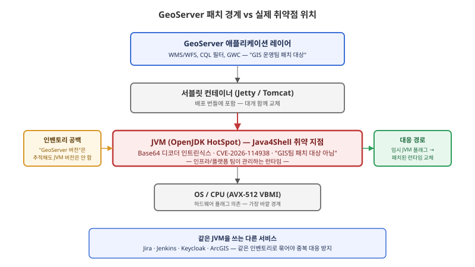

## 왜 지금 이 판단이 필요한가

"GeoServer는 최신 버전으로 다 올려놨는데요, 이번 CVE도 저희랑 상관없는 거 아닌가요?" — 2026년 11월 17일 공개된 Java4Shell(CVE-2026-114938) 앞에서 많은 GIS 운영팀이 이런 반응을 보였다. 이 취약점은 GeoServer의 WMS 핸들러나 CQL 파서 같은 애플리케이션 코드가 아니라, 그 밑에 깔린 OpenJDK HotSpot JVM의 Base64 디코더 하드웨어 가속 경로(인트린식스)에서 발견됐다. AVX-512 VBMI 명령어를 지원하는 CPU 위에서 영향받는 JVM 버전(17.0.6~17.0.21 및 일부 21·25·27 빌드)을 돌리면, 원격 코드 실행까지 이어질 수 있는 메모리 손상이 발생한다. 캐나다 사이버보안센터는 이 취약점을 GeoServer 환경에 대한 별도 보안 권고(AV26-595)로 공지했고, Esri도 ArcGIS 제품군에 대한 전용 권고를 냈다 — 같은 JVM 버그가 서로 다른 GIS 스택 전체에 걸쳐 있다는 뜻이다.

여기서 드러나는 진짜 문제는 CVE 자체가 아니라 **"GeoServer 패치"와 "JVM 패치"가 서로 다른 인벤토리라는 사실**이다. 대부분의 GIS 운영팀은 GeoServer 버전, 플러그인 버전, 설정 파일은 꼼꼼히 추적하지만 그 GeoServer가 어떤 JDK 벤더·버전 위에서 도는지는 배포 당시 한 번 정하고 다시 보지 않는다. Java4Shell 같은 런타임 레벨 CVE가 터지면, GeoServer 자체에는 패치할 코드가 없는데도 서비스는 그대로 취약한 상태로 남는다. 이 글은 특정 CVE의 기술적 세부사항보다, **패치 책임의 경계를 어디에 그어야 하는가**라는 운영 설계 문제를 다룬다.

## 전체 시스템에서의 위치



GeoServer를 하나의 레이어로만 보면 패치 경계가 보이지 않는다. 실제로는 네 개 층이 겹쳐 있다 — 맨 위는 GeoServer 애플리케이션(WMS/WFS, GWC, CQL 필터)이고, 그 아래 서블릿 컨테이너(Jetty 또는 Tomcat)가 배포 번들에 묶여 함께 교체되며, 그 아래 JVM이 있고, 맨 아래 OS·CPU 명령어 집합이 있다. Java4Shell은 위에서 세 번째, JVM 레이어에 있다. GeoServer 팀이 통상 "우리 책임"으로 여기는 범위는 맨 위 레이어뿐이고, JVM은 보통 인프라·플랫폼 팀이나 컨테이너 베이스 이미지 관리자가 소유한다.

문제는 이 두 조직 경계가 CVE 발표 속도를 못 따라간다는 점이다. GeoServer 보안 메일링 리스트를 구독해도 JVM 벤더의 Critical Patch Update 공지까지 자동으로 따라오지 않는다. 역으로 인프라 팀이 JVM을 패치해도, 그 변경이 GeoServer 같은 애플리케이션에 영향을 주는지 확인하는 절차가 없으면 조용히 넘어간다. 결국 JVM 레벨 CVE에 제대로 대응하려면, GeoServer 버전 인벤토리 옆에 **JVM 벤더·버전 인벤토리**를 나란히 두고, 둘 중 어느 쪽에서 CVE가 터지든 같은 테이블에서 조회할 수 있어야 한다.

## 선택의 트레이드오프

| 대응 방식 | 적용 속도 | 재기동 필요 | 소유 조직 | 언제 쓰면 안 되는가 |
|---|---|---|---|---|
| 벤더 패치된 런타임으로 교체 | 느림(이미지 빌드·배포 사이클 필요) | 필요 | 인프라/플랫폼 팀 | 당장 무중단 대응이 급할 때 |
| 임시 JVM 플래그(`-XX:-UseBASE64Intrinsics`) | 빠름 | 필요(플래그도 재시작 적용) | GIS 운영팀 단독 가능 | 영구 대응으로 착각하고 방치할 때 |
| CPU 레벨 완화(AVX-512 VBMI 비활성화) | 느림, 영향 범위 큼 | 필요(하드웨어/하이퍼바이저 설정) | 인프라/보안팀 | GeoServer 외 다른 워크로드 성능에 영향 줄 때 |

세 방식 모두 재기동이 필요하다는 공통점이 있다 — JVM 레벨 완화는 애플리케이션을 안 건드려도 끝나지 않는다. 임시 플래그는 가장 빠르게 GIS 운영팀 단독으로 적용할 수 있다는 점에서 매력적이지만, 영구 수정이 아니라 **패치된 런타임이 배포될 때까지의 다리**라는 점을 분명히 해 둬야 한다. 이 구분을 안 해 두면 "플래그 넣었으니 끝"으로 처리되고, 다음 JDK 업그레이드 때 플래그가 빠지면서 조용히 취약점이 재발하는 패턴이 반복된다.

## 실제 진행 순서

```bash
# 1) 현재 적용된 JVM 플래그 확인
ps aux | grep geoserver | grep -o '\-XX:[^ ]*'

# 2) 임시 완화 플래그 추가 (JAVA_OPTS 또는 systemd 유닛의 Environment)
export JAVA_OPTS="$JAVA_OPTS -XX:-UseBASE64Intrinsics"

# 3) 재기동 (무중단이 필요하면 로드밸런서에서 먼저 분리 후 순차 재기동)
systemctl restart geoserver
```

1. 모든 GeoServer(와 같은 JVM 위에 올라간 다른 서비스) 인스턴스의 **JDK 벤더·버전 인벤토리**부터 만든다 — 없으면 이번 기회에 만들어 둔다.
2. 영향받는 버전 범위와 대조해 우선순위를 매기고, 무중단이 중요한 서비스부터 임시 플래그를 적용한다.
3. 플래그 적용은 반드시 유지보수 윈도우를 잡고 순차 재기동으로 진행한다 — 플래그 자체도 재시작 없이는 반영되지 않는다.
4. 임시 플래그를 적용한 인스턴스 목록과 적용일을 따로 기록해, 벤더 패치된 런타임 교체 일정에서 빠뜨리지 않게 한다.
5. GeoServer뿐 아니라 같은 JVM을 공유하는 Jira·Jenkins·Keycloak 등도 같은 인벤토리에 넣어, 팀별로 따로 대응하다 중복·누락이 생기지 않게 한다.

## 마무리 요약

- CVE는 애플리케이션 코드뿐 아니라 그 밑 JVM·런타임 레이어에서도 터진다 — GeoServer를 최신 버전으로 올려도 JVM이 안 바뀌면 그대로 취약하다.
- 패치 책임의 조직 경계는 CVE가 어느 레이어에서 터지느냐와 일치하지 않는다 — JVM 버전 인벤토리를 GeoServer 버전 인벤토리 옆에 별도로 관리해야 한다.
- 임시 JVM 플래그는 재기동이 필요한 미봉책일 뿐이며, 패치된 런타임 교체 일정은 반드시 별도로 추적해야 한다.

## 참고 자료

- [GeoServer security advisory (AV26-595) — Canadian Centre for Cyber Security](https://cyber.gc.ca/en/alerts-advisories/geoserver-security-advisory-av26-595)
- [CVE-2026-114938 aka Java4Shell — Esri ArcGIS Blog](https://www.esri.com/arcgis-blog/products/trust-arcgis/administration/cve-2026-114938-aka-java4shell)
- [Critical OpenJDK RCE CVE-2026-114938: What to know — Sonatype Blog](https://www.sonatype.com/blog/critical-openjdk-rce-cve-2026-114938-what-to-know)
- [GeoServer Blog — Vulnerability announcements](https://geoserver.org/blog/index.html)
