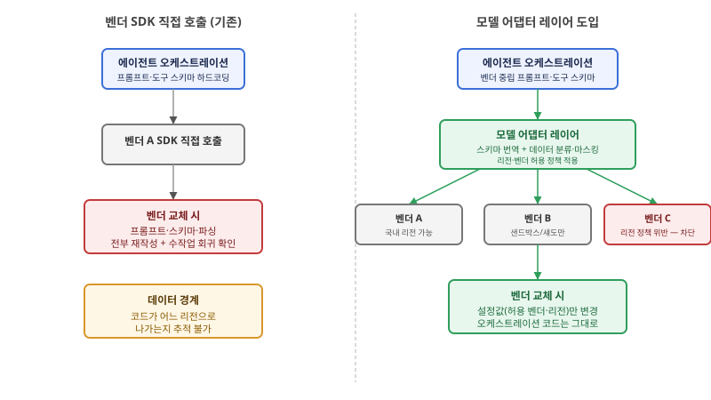

## 왜 지금 이 판단이 필요한가

"저희 보안팀이, 코드가 해외 리전에 저장될 수 있는 모델은 에이전트 백엔드로 못 쓰게 막아달라고 해요. 근데 다음 분기엔 또 다른 리전 요구가 올 수도 있다는데, 그때마다 에이전트를 새로 짜야 하나요?" — 이런 요청은 더 이상 가정이 아니다. 2026년 11월 1일 중국 DeepSeek이 미국 벤더가 장악한 개발자 도구 시장을 겨냥한 강화된 코딩 에이전트를 웹과 API로 공개했고, 곧이어 보안 업계에서는 이 모델이 사용자 데이터를 중국 내에 저장하며 현지 법에 따른 정부 접근 가능성이 있다는 점, 또 학습 데이터가 공개되지 않아 생성된 코드에 알려지지 않은 보안 취약 패턴이 섞여 들어갈 수 있다는 점을 경고했다. 동시에 GitHub Copilot과 Cursor 같은 상용 도구가 이미 DeepSeek을 모델 백엔드 선택지 중 하나로 문서화해 제공한다는 점도 함께 알려졌다.

이 둘을 겹쳐 보면 결론은 하나다 — "모델을 바꿀 수 있어야 한다"는 요구는 이제 특정 기업의 특수 사정이 아니라, 코딩 에이전트를 조직에 들이는 모든 빌더가 마주치는 기본 요구사항이 됐다. 문제는 이 요구를 "API 키만 바꾸면 되는 일"로 받아들이는 순간 생긴다. 실제로는 프롬프트 포맷, 도구 호출 스키마, 품질 평가 기준, 로그가 쌓이는 리전까지 여러 층이 얽힌 문제이고, 이 층들을 미리 분리해 두지 않으면 벤더를 바꾸는 날 에이전트 전체를 다시 설계해야 한다.

## 전체 시스템에서의 위치



"모델을 바꿀 수 있게 해달라"는 말은 대개 오케스트레이션 코드 안에 벤더 SDK를 직접 호출하는 구조에서 나온다. 이 구조에서는 프롬프트 문자열, 도구(tool) 정의 JSON, 응답 파싱 로직이 전부 특정 벤더의 API 형태에 맞춰져 있다. 벤더를 바꾸면 이 세 가지를 전부 다시 쓰고, 그 과정에서 생긴 회귀를 사람이 수작업으로 찾아야 한다. 어느 코드가 어느 리전으로 나갔는지도 사후에 로그를 뒤져야 알 수 있다.

해결 구조는 오케스트레이션과 벤더 API 사이에 **모델 어댑터 레이어**를 끼워 넣는 것이다. 어댑터는 세 가지 일을 한다. 첫째, 프롬프트와 도구 스키마를 벤더 중립 포맷으로 받아 각 벤더 형식으로 번역한다. 둘째, 응답을 다시 공통 포맷으로 되돌린다. 셋째, 어떤 데이터(코드 스니펫, 레포 경로, 사용자 식별자)가 그 벤더로 나가는지를 분류해 차단·마스킹 여부를 결정한다. 이 어댑터가 데이터 분류 정책과 맞물려야 "이 모델은 국내 리전만", "이 모델은 사용 금지" 같은 규칙을 코드 변경 없이 설정값으로 적용할 수 있다. 즉 모델 포터빌리티는 코딩 스타일의 문제가 아니라 **오케스트레이션과 벤더 사이에 경계 하나를 추가로 긋는** 아키텍처 결정이다.

## 선택의 트레이드오프

| 방식 | 전환 비용 | 데이터 통제 | 기능·성능 일치 | 언제 쓰면 안 되는가 |
|---|---|---|---|---|
| 벤더 SDK 직접 호출 | 초기엔 낮음 | 없음(사후 로그 추적만) | 높음(벤더 고유 기능 그대로) | 벤더가 둘 이상이 될 가능성이 조금이라도 있을 때 |
| LLM 게이트웨이·어댑터 레이어 | 중간(어댑터 구축·유지) | 설정 가능(정책 레벨) | 중간(공통분모로 수렴) | 벤더 특화 기능에 제품 핵심 경로가 깊이 의존할 때 |
| 완전 자체 호스팅(오픈소스 모델) | 높음(인프라·운영 인력) | 가장 높음(물리적 경계) | 낮음(품질 격차 가능) | 품질 격차를 감수할 수 없는 핵심 제품 경로 |

트레이드오프의 핵심은 "어느 모델이 더 똑똑한가"가 아니라 "코드와 로그가 어디로, 누구의 법 아래로 나가는지를 누가 언제 결정하느냐"다. 어댑터 레이어를 두면 이 결정을 배포 시점 설정으로 미룰 수 있지만 공짜는 아니다. 벤더마다 다른 도구 호출 방식(병렬 호출 지원 여부, 스트리밍 포맷, 긴 컨텍스트 캐싱 방식)을 하나의 공통 스키마로 수렴시키는 과정에서 일부 벤더 고유 최적화는 포기해야 한다. 그래서 어댑터를 넣을지 말지는 "지금 벤더 하나로 충분한가"가 아니라 "앞으로 2년 안에 벤더를 바꾸라는 요구가 올 가능성이 있는가"로 판단해야 한다.

## 실제 진행 순서

```typescript
interface ModelAdapter {
  translateRequest(req: CommonAgentRequest): ProviderRequest;
  translateResponse(res: ProviderResponse): CommonAgentResponse;
  dataPolicy: { allowedRegions: string[]; maskFields: string[] };
}
```

1. **데이터 분류부터 한다.** 에이전트가 모델에 보내는 데이터를 코드 스니펫 / 레포 경로·커밋 메타데이터 / 사용자 식별자·로그로 나누고, 각각에 "국내 리전만", "마스킹 후 전송", "전송 금지" 라벨을 붙인다. 이 분류표 없이 어댑터부터 만들면 나중에 정책을 코드에 다시 박아 넣어야 한다.
2. **공통 스키마를 먼저 고정한다** — 프롬프트, 도구 정의, 응답 포맷. 이미 쓰는 벤더의 스키마를 기준 삼되, 다른 벤더가 지원하지 않는 필드는 옵셔널로 둔다.
3. **두 번째 벤더는 섀도 모드로 먼저 붙인다** — 실제 응답은 버리고 로그만 비교해, 품질 회귀를 평가 게이트로 수치화한다.
4. **로깅·텔레메트리 목적지를 벤더·리전별로 분리한다.** 어댑터 레벨에서 이 분기를 끝내 두지 않으면 벤더를 추가할 때마다 로깅 파이프라인을 다시 손대야 한다.
5. **전환 완료 기준을 수치로 정해 둔다**(평가 게이트 통과율, 응답 지연 허용 범위). 기준 없이 "써보고 괜찮으면 바꾸자"로 가면 전환은 영원히 보류된다.

## 마무리 요약

- 모델 교체 요구는 API 키 수준이 아니라 오케스트레이션과 벤더 사이에 끼우는 **어댑터 레이어 수준**에서 설계해야 하는 문제다.
- 코드·로그·식별자의 데이터 분류가 먼저 끝나야 리전·벤더 허용 정책을 코드 변경 없이 설정값으로 바꿀 수 있다.
- 새 벤더는 섀도 모드와 평가 게이트로 검증한 뒤에만, 정해둔 수치 기준을 넘겨 전환을 완료한다.

## 참고 자료

- [What CISOs should know about DeepSeek cybersecurity risks — TechTarget](https://www.techtarget.com/cybersecurity/tip/What-CISOs-should-know-about-DeepSeek-cybersecurity-risks)
- [DeepSeek security concerns — Witness AI](https://witness.ai/blog/deepseek-security-concerns/)
- [Data residency for AI coding agents: a practical guide — Hoop.dev](https://hoop.dev/blog/data-residency-for-ai-coding-agents-a-practical-guide/)
- [Amazon Bedrock cross-region inference — AWS Docs](https://docs.aws.amazon.com/bedrock/latest/userguide/cross-region-inference.html)
